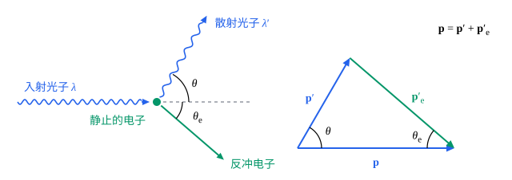

## 这一节要回答的问题

X 射线（X-ray）照到石墨上，散射（scattering）出去的 X 射线里有一部分波长变长了，偏离原方向越多，变长越多。按经典电磁学，电子被入射波推着以同一频率振动，发出的波长不该变。这是怎么回事？变长多少？

## 讲解

### 康普顿的实验

1923 年，康普顿（Arthur Compton）用钼靶发出的 X 射线（波长约$71\,\mathrm{pm}$）照射石墨，在和入射方向成$45^\circ$、$90^\circ$、$135^\circ$的方向上用晶体分光，测散射 X 射线的波长。每个方向上都有两个峰：一个在原来的波长$\lambda$，一个在更长的$\lambda'$；偏离入射方向越多，$\lambda'-\lambda$越大。1924 年他和吴有训（Wu Youxun）换用多种轻元素做散射物质，同一方向上的$\lambda'-\lambda$都一样。

经典的汤姆孙散射（Thomson scattering，见[拉莫尔公式](lesson:physics.electromagnetism.larmor-formula)第 5 题）只给出波长不变的峰。

::anchor{id="def-compton-scattering"}
X 射线、$\gamma$射线（gamma ray）被物质散射时，散射出来的射线里出现波长变长的成分，这叫作:term[康普顿散射]{id="physics.quantum-mechanics.compton-scattering"}（Compton scattering），也叫康普顿效应（Compton effect）；散射方向和入射方向的夹角$\theta$叫作散射角（scattering angle）。

为什么这样定义：经典理论给不出这种变长，要单独起名；下面会看到，它来自:term[光子]{id="physics.quantum-mechanics.photon"}（photon）和电子的碰撞。边界情况：同一方向上波长不变的那个峰不算康普顿散射。

### 光子的动量

::anchor{id="thm-photon-momentum"}
定理（:term[光子]{id="physics.quantum-mechanics.photon"}的动量，photon momentum）：真空中能量为$E$、波长为$\lambda$的光子，动量（momentum）沿传播方向，大小$p=\frac Ec=\frac h\lambda$；它的四维动量（four-momentum）$P_\gamma=\bigl(\frac Ec,\vb p\bigr)$满足$P_\gamma\cdot P_\gamma=0$。

证明思路：光子是无质量粒子（massless particle），由[四维速度与四维动量](lesson:physics.special-relativity.four-momentum#def-massless-particle)，$P_\gamma\cdot P_\gamma=0$，即$E=pc$，速度$\vb u=\frac{\vb pc^2}E$和动量同向；再由$E=h\nu$和$\lambda\nu=c$，$p=\frac{h\nu}c=\frac h\lambda$。下标$\gamma$表示光子，不是洛伦兹因子（Lorentz factor）。

这和[电磁场的动量](lesson:physics.electromagnetism.field-momentum)里吸收能量$U$就得到动量$\frac Uc$的结论一致；大量光子打在物体上，就产生:term[辐射压强]{id="physics.electromagnetism.radiation-pressure"}（radiation pressure）。

### 波长的改变量

[相对论碰撞与衰变](lesson:physics.special-relativity.relativistic-collisions)第 6 题说，自由电子不能吸收:term[光子]{id="physics.quantum-mechanics.photon"}；可它能把光子散射开，自己成为反冲电子（recoil electron）：$\gamma+\mathrm e\to\gamma+\mathrm e$。设电子原来静止，入射光子的能量、波长为$E$、$\lambda$，散射后为$E'$、$\lambda'$，反冲电子和入射方向成$\theta_{\mathrm e}$角。下图左边的长短不按比例，散射光子的波形画得疏一些，表示波长变长；右边是动量三角形，按入射光子的能量等于电子的静能（rest energy）$m_{\mathrm e}c^2$（狭义相对论里写作$m_ec^2$，约$0.511\,\mathrm{MeV}$）、$\theta=60^\circ$画，长短按比例。

::anchor{id="thm-compton-shift"}
定理（康普顿公式，Compton formula）：波长为$\lambda$的光子被静止的自由电子散射，散射角为$\theta$时，散射光子的波长$\lambda'$满足$\lambda'-\lambda=\frac h{m_{\mathrm e}c}(1-\cos\theta)$，$m_{\mathrm e}$是电子的质量。

证明：四维动量守恒，$P_\gamma+P_{\mathrm e}=P_\gamma'+P_{\mathrm e}'$。先把不关心的$P_{\mathrm e}'$单独放在一边，再照[相对论碰撞与衰变](lesson:physics.special-relativity.relativistic-collisions)第 5 题的办法，两边平方：

$$
P_{\mathrm e}'\cdot P_{\mathrm e}'=(P_\gamma+P_{\mathrm e}-P_\gamma')\cdot(P_\gamma+P_{\mathrm e}-P_\gamma').
$$

光子的$P\cdot P$是$0$，电子的是$m_{\mathrm e}^2c^2$，消去以后只剩交叉项，再约去公因子$2$：

$$
P_\gamma\cdot P_{\mathrm e}-P_\gamma'\cdot P_{\mathrm e}=P_\gamma\cdot P_\gamma'.
$$

电子原来静止，$P_{\mathrm e}=(m_{\mathrm e}c,\vb 0)$，左边是$m_{\mathrm e}(E-E')$；右边是$\frac{EE'}{c^2}-\vb p\cdot\vb p'=\frac{EE'}{c^2}(1-\cos\theta)$。两边除以$m_{\mathrm e}EE'$，得

$$
\frac1{E'}-\frac1E=\frac{1-\cos\theta}{m_{\mathrm e}c^2},
$$

再乘以$hc$，由$\frac{hc}E=\lambda$就得到定理。

::anchor{id="def-compton-wavelength"}
$\lambda_{\mathrm C}=\frac h{m_{\mathrm e}c}=2.426\,310\,235\,38\times10^{-12}\,\mathrm m$叫作电子的康普顿波长（Compton wavelength），于是$\lambda'-\lambda=\lambda_{\mathrm C}(1-\cos\theta)$。

为什么这样定义：它只由$h$、$c$和电子的质量组成，定下了波长改变量的尺度：$\theta$从$0$增大到$180^\circ$，改变量从$0$增大到$2\lambda_{\mathrm C}\approx4.85\,\mathrm{pm}$。边界情况：质子的康普顿波长只有电子的$\frac1{1836}$，X 射线被质子散射，波长几乎不变。

### 不移动的峰与可见光

公式要求电子静止、自由。石墨里外层电子受的束缚只有十几$\mathrm{eV}$，约为 X 射线:term[光子]{id="physics.quantum-mechanics.photon"}能量的千分之一，可以近似看成静止的自由电子。被原子核（nucleus）束缚得很紧的电子不容易被打出来，光子相当于和整个原子碰撞，公式里的$m_{\mathrm e}$要换成原子的质量，改变量小到测不出，峰就留在原来的波长上。

可见光看不出:term[康普顿散射]{id="physics.quantum-mechanics.compton-scattering"}：改变量至多$2\lambda_{\mathrm C}$，不到可见光波长（约$500\,\mathrm{nm}$）的十万分之一；况且可见光的光子只有几$\mathrm{eV}$，和电子受的束缚差不多，电子不能看成自由的。

光子的能量远小于$m_{\mathrm e}c^2$时，自由电子的散射回到汤姆孙散射。[拉莫尔公式](lesson:physics.electromagnetism.larmor-formula)第 5 题算过它的[散射截面](lesson:physics.quantum-mechanics.cross-sections)（scattering cross section）$\frac{8\pi}3r_{\mathrm e}^2$，$r_{\mathrm e}=\frac{e^2}{4\pi\varepsilon_0m_{\mathrm e}c^2}\approx2.818\times10^{-15}\,\mathrm m$时约为$6.65\times10^{-29}\,\mathrm{m^2}$（那道题取$2.82\times10^{-15}\,\mathrm m$，得$6.66\times10^{-29}\,\mathrm{m^2}$）。

## 几何图像

:::anim{component="function-plot"}
range: { x: [0, 180], y: [0, 1.05] }
functions:
  - expr: "1/(1 + Eg/510.999*(1 - cos(x*pi/180)))"
    label: |
      $\frac{E'}{E}$
sliders:
  - name: Eg
    min: 1
    max: 1000
    step: 1
    default: 100
    label: |
      入射光子的能量$E$（keV）
:::

横轴是散射角$\theta$（以度为单位，图上写作 x），纵轴是:term[光子]{id="physics.quantum-mechanics.photon"}散射后和散射前的能量之比（图上写作 y），由康普顿公式

$$
\frac{E'}E=\frac\lambda{\lambda'}=\frac1{1+(1-\cos\theta)E/(m_{\mathrm e}c^2)}.
$$

入射光子只有十几 keV 时，曲线几乎是水平的，光子只丢掉百分之几的能量；能量越高，向后散射时丢得越多，$1000\,\mathrm{keV}$时$180^\circ$处只剩约五分之一。

## 例题

### 例 1　钼的 X 射线在$90^\circ$方向上

波长为$71.1\,\mathrm{pm}$的 X 射线被石墨散射。求$90^\circ$方向上散射 X 射线的波长，以及反冲电子的动能。

**为什么想到这么做**：$\theta=90^\circ$时$1-\cos\theta=1$，波长正好增加一个康普顿波长；电子得到的动能就是:term[光子]{id="physics.quantum-mechanics.photon"}少掉的能量。

**推导**：$\lambda'=71.1\,\mathrm{pm}+2.43\,\mathrm{pm}\approx73.5\,\mathrm{pm}$，变长约$3.4\%$。入射光子的能量$E=\frac{hc}\lambda\approx\frac{1240\,\mathrm{eV\cdot nm}}{0.0711\,\mathrm{nm}}\approx17.4\,\mathrm{keV}$。由能量守恒$E+m_{\mathrm e}c^2=E'+E_{\mathrm e}'$，反冲电子的动能

$$
K_{\mathrm e}=E_{\mathrm e}'-m_{\mathrm e}c^2=E-E'=hc\Bigl(\frac1\lambda-\frac1{\lambda'}\Bigr)\approx0.58\,\mathrm{keV},
$$

只有电子静能的千分之一左右。

## 常见误区

- 「:term[光子]{id="physics.quantum-mechanics.photon"}被散射后跑慢了，所以波长变长。」散射前后的光子在真空中都以$c$运动；光子交出一部分能量，频率变低，所以波长$\lambda=\frac c\nu$变长。
- 「变长的峰是散射物质发出的荧光（fluorescence）。」荧光的波长由物质决定、和方向无关；变长的峰随散射角变，和散射物质无关。
