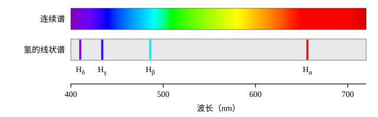

## 这一节要回答的问题

让氢气通电发光，用棱镜分开，看到的不是彩带，而是几条分立的彩色亮线。它们的波长有什么规律？原子为什么只发这几种光？

## 讲解

### 线状谱

阳光经过棱镜，展开成从紫到红连成一片的彩带。氢气在放电管（discharge tube）里发的光，光谱（spectrum）里却主要只有四条彩色谱线（spectral line）：红、蓝绿各一条，紫色两条（下图）。红、蓝绿两条就是[棱镜与色散](lesson:physics.optics.prisms-dispersion)里描述玻璃色散（dispersion）用的 C 线（$656.3\,\mathrm{nm}$）和 F 线（$486.1\,\mathrm{nm}$），记作$\mathrm H_\alpha$、$\mathrm H_\beta$。

::anchor{id="def-line-spectrum"}
只含一些分立的波长、由一条条亮线组成的光谱叫作:term[线状谱]{id="physics.quantum-mechanics.line-spectrum"}（line spectrum），各种波长都有、连成一片的叫作连续谱（continuous spectrum）。物体发光得到的叫作发射光谱（emission spectrum）；白光穿过气体后某些波长被吸收、留下暗线，叫作吸收光谱（absorption spectrum）。

为什么这样定义：每种元素的原子有自己的一组谱线，像指纹一样，看谱线就能认出元素。边界情况：气体的吸收暗线也是分立的，都落在它发光时某些亮线的位置上，太阳光谱里的 C、F 暗线就在氢的$\mathrm H_\alpha$、$\mathrm H_\beta$处。

### 里德伯公式

::anchor{id="def-rydberg-formula"}
1885 年，巴耳末（Johann Balmer）发现氢的这四条谱线的波长依次正比于$\frac{n^2}{n^2-4}$，$n=3,4,5,6$，这叫作巴耳末公式（Balmer formula）。1888 年，里德伯（Johannes Rydberg）把它推广成$\frac1\lambda=R_{\mathrm H}\bigl(\frac1{n_1^2}-\frac1{n_2^2}\bigr)$，$n_1<n_2$都是正整数，$\lambda$是真空中的波长，这叫作:term[里德伯公式]{id="physics.quantum-mechanics.rydberg-formula"}（Rydberg formula），常量$R_{\mathrm H}\approx1.096\,78\times10^7\,\mathrm{m^{-1}}$叫作氢的:term[里德伯常量]{id="physics.quantum-mechanics.rydberg-constant"}（Rydberg constant）。

为什么这样定义：取$n_1=2$就是巴耳末公式；换别的$n_1$，它预言了新的谱线，后来真在紫外、红外找到了。边界情况：有两个以上电子的原子，谱线没有这么整齐。课本把$R_{\mathrm H}$也写成$R_\infty$；本领域的$R_\infty$指原子核（nucleus）不动时的理论值，见[原子光谱与玻尔模型](lesson:physics.quantum-mechanics.bohr-model)。

::anchor{id="def-spectral-series"}
$n_1$相同、$n_2$依次取$n_1+1$、$n_1+2$……的一组谱线叫作一个:term[谱线系]{id="physics.quantum-mechanics.spectral-series"}（spectral series），也叫线系：$n_1=1$的是莱曼系（Lyman series），在紫外；$n_1=2$的是巴耳末系（Balmer series），可见光的四条都在其中；$n_1=3$的是帕邢系（Paschen series），在红外。$n_2\to\infty$时波长趋于$\frac{n_1^2}{R_{\mathrm H}}$，这叫作这个谱线系的线系限（series limit）。

为什么这样定义：同一系的谱线最有规律，$n_2$越大，波长越短、越挤，挤向线系限（几何图像）。边界情况：线系限本身不是一条谱线。

### 能量的量子化

:term[里德伯公式]{id="physics.quantum-mechanics.rydberg-formula"}说，每条谱线的$\frac1\lambda$都是两项之差；乘上$hc$，:term[光子]{id="physics.quantum-mechanics.photon"}（photon）的能量$\frac{hc}\lambda$（见[光子与光电效应](lesson:physics.quantum-mechanics.photons)）也是两项之差：

$$
\frac{hc}\lambda=\frac{hcR_{\mathrm H}}{n_1^2}-\frac{hcR_{\mathrm H}}{n_2^2},\qquad hcR_{\mathrm H}\approx13.6\,\mathrm{eV}.
$$

原子放出一个光子，能量就少了$\frac{hc}\lambda$。要是氢原子的能量只能取$-\frac{hcR_{\mathrm H}}{n^2}$（$n=1,2,3,\dots$）这些值，放出的光子就正好是这些谱线（只有差值要紧，同时加上一个常数也行）。

::anchor{id="def-quantization"}
一个物理量只能取一些分立的值、不能连续变化，就说这个量是量子化的（quantized），这种现象叫作:term[量子化]{id="physics.quantum-mechanics.quantization"}（quantization）。

为什么这样定义：有了这个词，:term[线状谱]{id="physics.quantum-mechanics.line-spectrum"}说明的事一句话就能说清：原子的能量是量子化的。反例：经典图像里，绕核电子的轨道半径能连续变，能量也连续变。这些分立的能量值以后叫作:term[能级]{id="physics.quantum-mechanics.energy-level"}（energy level）。

### 核式结构与经典模型的困难

1904 年，汤姆孙（J. J. Thomson）设想正电荷均匀分布在一个球里，电子嵌在其中；对氢原子，电子在球里做简谐运动（simple harmonic motion），只发一个频率的光（见[用高斯定律求对称电场](lesson:physics.electromagnetism.gauss-applications)第 6 题），给不出那组谱线。

::anchor{id="def-nuclear-model"}
1911 年，卢瑟福（Ernest Rutherford）根据$\alpha$粒子（alpha particle）的散射（scattering）实验提出：原子的正电荷和几乎全部质量集中在半径约$10^{-15}$到$10^{-14}\,\mathrm m$的原子核里，电子在核外运动。这叫作:term[原子的核式结构模型]{id="physics.quantum-mechanics.nuclear-model"}（nuclear model of the atom），也叫卢瑟福模型（Rutherford model）。

为什么这样定义：少数$\alpha$粒子被大角度弹回，只有很集中的正电荷给得出这么大的力；[电势](lesson:physics.electromagnetism.electric-potential)第 3 题里，几 MeV 的$\alpha$粒子正对金核能靠近到$10^{-14}\,\mathrm m$的量级。边界情况：核的半径不到原子的万分之一，原子里几乎是空的。

可按经典电磁学，绕核电子有向心加速度（centripetal acceleration），会不断辐射电磁波（electromagnetic wave），约$1.6\times10^{-11}\,\mathrm s$就落到核上，辐射的频率连续升高，该得到连续谱（见[拉莫尔公式](lesson:physics.electromagnetism.larmor-formula)例 2）。实际上原子是稳定的，发出的是:term[线状谱]{id="physics.quantum-mechanics.line-spectrum"}；怎样解决，见[原子光谱与玻尔模型](lesson:physics.quantum-mechanics.bohr-model)。

## 几何图像

:::anim{component="function-plot"}
range: { x: [0, 21], y: [0, 1.05] }
functions:
  - expr: "1"
    label: |
      莱曼系的线系限
  - expr: "1/4"
    label: |
      巴耳末系的线系限
  - expr: "1/9"
    label: |
      帕邢系的线系限
sequences:
  - expr: "1 - 1/n^2"
    n: [2, 20]
    label: |
      莱曼系（$n_1=1$）
  - expr: "1/4 - 1/n^2"
    n: [3, 20]
    label: |
      巴耳末系（$n_1=2$）
  - expr: "1/9 - 1/n^2"
    n: [4, 20]
    label: |
      帕邢系（$n_1=3$）
:::

横轴是$n_2$（图上写作 x，悬停时的 n 也是它），纵轴是$\frac1{\lambda R_{\mathrm H}}=\frac1{n_1^2}-\frac1{n_2^2}$（图上写作 y），越高波长越短。三组圆点从上到下是:term[莱曼系]{id="physics.quantum-mechanics.spectral-series"}、巴耳末系、帕邢系，各自挤向上方的水平线，即线系限。

## 例题

### 例 1　认出一条谱线

氢的光谱里有一条紫色谱线，真空中的波长是$434.17\,\mathrm{nm}$。它属于哪个:term[谱线系]{id="physics.quantum-mechanics.spectral-series"}，$n_2$是几？:term[光子]{id="physics.quantum-mechanics.photon"}的能量多大？

**为什么想到这么做**：:term[里德伯公式]{id="physics.quantum-mechanics.rydberg-formula"}里只有$n_1$、$n_2$不知道，它们都是正整数：先算出$\frac1{\lambda R_{\mathrm H}}=\frac1{n_1^2}-\frac1{n_2^2}$，再看哪个$n_1$让$n_2$是整数。

**推导**：$\frac1{\lambda R_{\mathrm H}}=\frac1{434.17\times10^{-9}\times1.096\,78\times10^7}\approx0.2100$。$\frac1{n_1^2}$得比它大，$n_1$只能是 1 或 2；莱曼系那一组都不低于$\frac34$（几何图像），所以$n_1=2$，$\frac1{n_2^2}=0.25-0.21=0.04$，$n_2=5$。它是巴耳末系的第三条，记作$\mathrm H_\gamma$；光子的能量$\frac{hc}\lambda\approx\frac{1240\,\mathrm{eV\cdot nm}}{434.17\,\mathrm{nm}}\approx2.86\,\mathrm{eV}$。

## 常见误区

- 「:term[谱线系]{id="physics.quantum-mechanics.spectral-series"}有无穷多条谱线，波长要多长有多长。」$n_2$越大波长越短，最长的是$n_2=n_1+1$那条。
- 「空气中量出的$656.3\,\mathrm{nm}$和:term[里德伯公式]{id="physics.quantum-mechanics.rydberg-formula"}算出的$656.47\,\mathrm{nm}$对不上，说明公式粗糙。」公式给的是真空中的波长；空气的折射率（refractive index）约 1.0003，空气中短约万分之三，正是$656.3\,\mathrm{nm}$。
