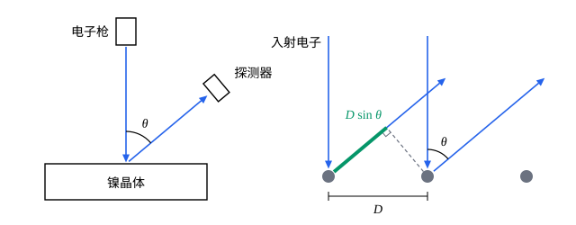
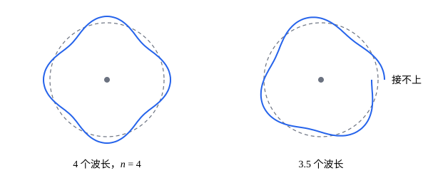

## 这一节要回答的问题

光既是波，又由一个个:term[光子]{id="physics.quantum-mechanics.photon"}（photon）组成。反过来，电子这样的粒子会不会也是波？要是波，它的波长有多长，为什么平时看不出来，又怎样才看得出来？

## 讲解

### 德布罗意的假设

[光子与光电效应](lesson:physics.quantum-mechanics.photons)说，频率为$\nu$的光由能量$E=h\nu$的:term[光子]{id="physics.quantum-mechanics.photon"}组成；光子还带有动量（momentum），大小$p=\frac h\lambda$（见[康普顿散射](lesson:physics.quantum-mechanics.compton-scattering#thm-photon-momentum)）。描述波的$\nu$、$\lambda$和描述粒子的$E$、$p$，由:term[普朗克常量]{id="physics.quantum-mechanics.planck-constant"}（Planck constant）$h$连在一起。

::anchor{id="def-de-broglie"}
1924 年，德布罗意（Louis de Broglie）在博士论文里反过来设想：能量为$E$、动量为$p$的实物粒子（material particle）也伴随着一列频率$\nu=\frac Eh$、波长$\lambda=\frac hp$的波。这两个关系叫作德布罗意关系（de Broglie relations），这种波叫作:term[物质波]{id="physics.quantum-mechanics.matter-wave"}（matter wave），也叫德布罗意波（de Broglie wave），$\lambda$叫作:term[德布罗意波长]{id="physics.quantum-mechanics.de-broglie-wavelength"}（de Broglie wavelength）。

为什么这样定义：光子正好满足这两个关系，德布罗意让实物粒子和光一视同仁。边界情况：宏观物体的波长短得测不出，质量$0.145\,\mathrm{kg}$的棒球以$40\,\mathrm{m/s}$飞行，$\lambda\approx1.1\times10^{-34}\,\mathrm m$，比原子核（nucleus，约$10^{-15}\,\mathrm m$）还小十九个数量级。

电子从静止开始，经过电势差（potential difference）$\Delta\varphi$加速（课本写作$U$），动能$e\Delta\varphi=\frac{p^2}{2m_{\mathrm e}}$，$m_{\mathrm e}$是电子的质量。不计相对论效应时，它的德布罗意波长是

$$
\lambda=\frac h{\sqrt{2m_{\mathrm e}e\Delta\varphi}}\approx\frac{1.23\,\mathrm{nm}}{\sqrt{\Delta\varphi/\mathrm V}}.
$$

几十伏到几百伏加速的电子，波长在$0.1\,\mathrm{nm}$上下，和晶体里原子的间距差不多；[电势](lesson:physics.electromagnetism.electric-potential)例 2 里经过$1.0\,\mathrm{kV}$加速的电子，波长约$3.9\times10^{-11}\,\mathrm m$。电势差很高时，$p$要由:term[能量-动量关系]{id="physics.special-relativity.energy-momentum-relation"}（energy–momentum relation）求；$10\,\mathrm{kV}$以内，不计相对论效应的误差不到$0.5\%$（第 5 题）。

### 电子衍射

1927 年，戴维孙（Clinton Davisson）和革末（Lester Germer）让一束电子沿表面法线射到镍晶体上（下图左），测弹回的电子往各个方向去的有多少。加速电势差为$54\,\mathrm V$时，和表面法线成约$50^\circ$的方向上电子特别多（例 1）。同年，G. P. 汤姆孙（George Paget Thomson）让电子穿过金属薄膜，在底片上得到一圈圈的环。

::anchor{id="def-electron-diffraction"}
电子被晶体散射（scattering）或穿过薄膜以后，在一些方向上特别多、另一些方向上特别少，和光的衍射（diffraction）一样，这叫作电子衍射（electron diffraction）。

为什么这样定义：这是电子有波动性最直接的证据，由图样量出的波长和$\frac hp$相符（例 1 差约$1\%$）。边界情况：障碍物比波长大得多时，衍射不明显，电子像小球一样沿直线飞；所以要用原子间距和电子波长相近的晶体。

::anchor{id="thm-row-diffraction"}
定理：电子沿法线射到晶体表面上，只看表面一层间距为$D$的$N$排原子，它们各自把电子散射出去，散射的波一样强。在远处和表面法线成$\theta$角的方向上，$D\sin\theta=m\lambda$（$m$是整数）时各排散射的波同相，合振幅最大，是一排的$N$倍，电子特别多，形成亮纹；$N$越大，亮纹越窄。

证明思路：电子沿法线射来，各排同相地被照到；相邻两排到远处的路程差是$D\sin\theta$（上图右），相位差（phase difference）$\delta=\frac{2\pi D\sin\theta}\lambda$。这正是[复数表示与旋转矢量](lesson:physics.oscillations-waves.phasors)例 2：$N$个等长、依次多转$\delta$的旋转矢量（phasor）相加，合振幅是一排的$\bigl|\frac{\sin(N\delta/2)}{\sin(\delta/2)}\bigr|$倍。$\delta$是$2\pi$的整数倍时各个矢量同向，合振幅是$N$倍；$\delta$离开这些值$\frac{2\pi}N$就降为零，所以$N$越大，亮纹越窄。

这和:term[光栅方程]{id="physics.optics.grating-equation"}（grating equation）同形；晶体里更深的原子层也散射电子，这里不管。和光一样，强度按合振幅的平方算，为什么能这样算，见[波函数与概率诠释](lesson:physics.quantum-mechanics.wavefunction)。

1961 年，约恩松（Claus Jönsson）让电子束穿过双缝，屏上也出现了等间距的条纹，正是杨氏双缝干涉（Young's double-slit interference）：[双光束干涉](lesson:physics.optics.two-beam-interference#thm-young)里的条纹间距$\frac{L\lambda}d$照样成立，只是$\lambda$换成$\frac hp$。他用约$50\,\mathrm{kV}$加速的电子，不计相对论效应算出波长$5.485\,\mathrm{pm}$，计入后是$5.355\,\mathrm{pm}$，相差$2.4\%$。

电子有确定的质量和电荷，又能像波一样衍射、干涉（interference）：实物粒子也有:term[波粒二象性]{id="physics.quantum-mechanics.wave-particle-duality"}（wave–particle duality）。电子显微镜（electron microscope）就是用波长很短的电子束代替光来成像（见[圆孔衍射与分辨本领](lesson:physics.optics.resolving-power)）。

### 驻波与玻尔的量子化条件

德布罗意用:term[物质波]{id="physics.quantum-mechanics.matter-wave"}给:term[玻尔量子化条件]{id="physics.quantum-mechanics.bohr-quantization-condition"}（Bohr quantization condition）找到了一个理由（见[原子光谱与玻尔模型](lesson:physics.quantum-mechanics.bohr-model#def-quantization-condition)）。电子以速率$v_n$在半径为$r_n$的圆轨道上运动，它的物质波绕一圈回来要和自己接上，才能像弦上的驻波（standing wave）那样稳定下来（下图左），所以轨道的周长是波长的整数倍：$2\pi r_n=n\lambda$。代入$\lambda=\frac h{m_{\mathrm e}v_n}$，得

$$
m_{\mathrm e}v_nr_n=n\frac h{2\pi}=n\hbar,
$$

正是玻尔量子化条件，绕一圈的波长数就是:term[量子数]{id="physics.quantum-mechanics.quantum-number"}（quantum number）$n$。

这只是一幅图像，电子并不沿轨道走（见[氢原子的波函数](lesson:physics.quantum-mechanics.hydrogen-wavefunctions)）。

## 几何图像

:::anim{component="function-plot"}
range: { x: [0, 90], y: [0, 1.05] }
functions:
  - expr: "(N + 2*sum(k, 1, N - 1, (N - k)*cos(k*2*pi*0.215*sin(x*pi/180)*sqrt(V)/1.22643)))/N^2"
    label: |
      相对强度
sliders:
  - name: N
    min: 1
    max: 20
    step: 1
    default: 6
    label: |
      原子的排数$N$
  - name: V
    min: 40
    max: 80
    step: 1
    default: 54
    label: |
      加速电势差$\Delta\varphi$（V）
:::

横轴是和表面法线的夹角$\theta$（以度为单位，图上写作 x），纵轴是$N$排原子散射的强度和一排单独散射时之比再除以$N^2$（图上写作 y），亮纹顶都是 1；晶体取镍的$D=0.215\,\mathrm{nm}$。$\theta=0$处是沿法线弹回的零级亮纹，默认的$54\,\mathrm V$时一级亮纹在约$51^\circ$。把排数调大，亮纹变窄；排数为 1 时比值处处是 1，没有亮纹。

## 例题

### 例 1　戴维孙和革末的数据

经过$54\,\mathrm V$加速的电子沿法线射到镍晶体上，表面原子排的间距$D=0.215\,\mathrm{nm}$。一级亮纹应在哪个方向上？戴维孙和革末实测约在和法线成$50^\circ$的方向上。

**为什么想到这么做**：先由加速电势差求电子的:term[德布罗意波长]{id="physics.quantum-mechanics.de-broglie-wavelength"}，再由$D\sin\theta=\lambda$求方向。

**推导**：$\lambda\approx\frac{1.226\,\mathrm{nm}}{\sqrt{54}}\approx0.167\,\mathrm{nm}$，$\sin\theta=\frac\lambda D\approx\frac{0.167}{0.215}\approx0.776$，$\theta\approx50.9^\circ$，和实测相符。二级亮纹要$\sin\theta\approx1.55>1$，不存在。反过来由$50^\circ$算出的波长是$0.215\,\mathrm{nm}\times\sin50^\circ\approx0.165\,\mathrm{nm}$，和$\frac hp$只差约$1\%$。

## 常见误区

- 「:term[物质波]{id="physics.quantum-mechanics.matter-wave"}是粒子在空间里走出的波浪形路线。」电子并不左右摆着前进；物质波描述的是什么，见[波函数与概率诠释](lesson:physics.quantum-mechanics.wavefunction)。
- 「只有电子这样带电的粒子才有物质波。」不带电的中子、原子乃至分子也能衍射（第 1 题）。
