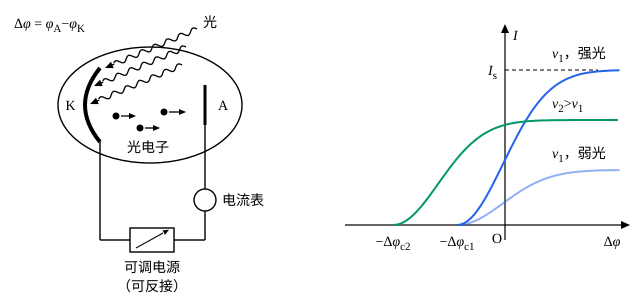

## 这一节要回答的问题

紫外线能从锌板上打出电子，红光再强也打不出一个。光越强能量越多，为什么能否打出电子却看频率？

## 讲解

### 光电效应

把金属阴极（cathode）K 和阳极（anode）A 封在真空玻璃管里（下图左），光照到 K 上，打出的电子飞向 A。两极的电势差（potential difference）$\Delta\varphi=\varphi_{\mathrm A}-\varphi_{\mathrm K}$可调、可反接（课本写作$U$），电流表读出电流$I$。

::anchor{id="def-photoelectric-effect"}
光照射金属表面时，电子从表面射出的现象叫作:term[光电效应]{id="physics.quantum-mechanics.photoelectric-effect"}（photoelectric effect），研究它用的真空管叫作光电管（phototube）。射出的电子叫作:term[光电子]{id="physics.quantum-mechanics.photoelectron"}（photoelectron），它们形成的电流叫作光电流（photocurrent）。

为什么这样定义：有了名字，才好讨论打出多少、跑多快。边界情况：金属烧得很热时电子也会跑出来，那不算光电效应。

::anchor{id="def-stopping-voltage"}
$\Delta\varphi$足够大时，光电流不再增加，这个电流叫作饱和电流（saturation current），记作$I_{\mathrm s}$；反接时光电流减小，恰好减为零时反向电势差的大小$\Delta\varphi_{\mathrm c}$叫作:term[遏止电压]{id="physics.quantum-mechanics.stopping-voltage"}（stopping voltage），也叫截止电压（课本写作$U_{\mathrm c}$）。

为什么这样定义：饱和时打出的光电子全到了阳极，$I_{\mathrm s}$量的是每秒打出多少个。反向电势差让光电子减速，由$\Delta K=-q\Delta\varphi$，最快的也恰好到不了阳极时，$e\Delta\varphi_{\mathrm c}=K_{\max}$，$K_{\max}$是最大动能（课本写作$E_{\mathrm k}$），[电势](lesson:physics.electromagnetism.electric-potential)例 2 截停电子用的「截止电压」就是$\Delta\varphi_{\mathrm c}$。边界情况：$\Delta\varphi=0$时光电流不为零。

实验发现（上图右）：频率不变时，饱和电流和光强（light intensity）成正比，遏止电压和光强无关；频率越高，遏止电压越大；光一照上，不超过$10^{-9}\,\mathrm s$就有光电子射出。本领域频率写作$\nu$，即[简谐波](lesson:physics.oscillations-waves.harmonic-waves)里的$f$。

::anchor{id="def-cutoff-frequency"}
对一种金属，频率低于某个值的光，用通常的光源怎样加强都打不出电子，这个频率叫作截止频率（cutoff frequency），也叫极限频率，记作$\nu_{\mathrm c}$。

为什么这样定义：它是光电效应的门槛，锌的在紫外区，铯的在可见光区。边界情况：频率正好是$\nu_{\mathrm c}$的光，打出的电子动能为零。

### 波动说的困难

按经典电磁学，光是电磁波（electromagnetic wave，见[真空中的电磁波](lesson:physics.electromagnetism.em-waves)），电子从波里吸收能量，光越强吸收得越快。那么:term[光电子]{id="physics.quantum-mechanics.photoelectron"}的最大动能应当随光强增大；任何频率的光，够强或够久都能打出电子；弱光要先攒够能量（估算见第 5 题）。三条都不符合实验。

### 光子

::anchor{id="def-photon"}
1905 年，爱因斯坦（Albert Einstein）提出：频率为$\nu$的光由一个个能量为$E=h\nu$的:term[光子]{id="physics.quantum-mechanics.photon"}（photon）组成，一个电子一次吸收一整个光子。光子也叫光量子（light quantum），比例常数$h=6.626\,070\,15\times10^{-34}\,\mathrm{J\cdot s}$叫作:term[普朗克常量]{id="physics.quantum-mechanics.planck-constant"}（Planck constant），2019 年起是定义的精确值。

为什么这样定义：每份多大由频率决定，光强只决定份数，正好对上实验。$h$是普朗克（Max Planck）1900 年研究热辐射（thermal radiation）时引入的（见[黑体辐射与普朗克定律](lesson:physics.thermal-physics.blackbody-radiation)）。边界情况：光再强，每个光子的能量也不变；极强的激光才能让电子同时吸收两个光子，那时频率低于截止频率的光也能打出电子。本节说的都是通常强度的光、一个电子只吸收一个光子的情形。

光子能量用电子伏特（electron volt，eV）表示：由$\lambda\nu=c$，$E=\frac{hc}\lambda$，而

$$
hc\approx\frac{6.626\times10^{-34}\,\mathrm{J\cdot s}\times2.998\times10^8\,\mathrm{m/s}}{1.602\times10^{-19}\,\mathrm{J/eV}}\approx1.240\times10^{-6}\,\mathrm{eV\cdot m}=1240\,\mathrm{eV\cdot nm}.
$$

所以$E\approx\frac{1240\,\mathrm{eV\cdot nm}}\lambda$，可见光（400 到 700 nm）的光子约 1.8 到 3.1 eV，正是[电势](lesson:physics.electromagnetism.electric-potential)说的「几个电子伏特」。[四维速度与四维动量](lesson:physics.special-relativity.four-momentum)说光的频率越高，光子的能量越大，具体关系就是$E=h\nu$。

### 光电效应方程

::anchor{id="def-work-function"}
把一个电子从金属里移到外面，至少要给它的能量叫作这种金属的逸出功（work function），记作$W_0$。

为什么这样定义：电子被金属里的正离子吸引着，出来要克服吸引；铯的约 2.1 eV，锌的约 4.3 eV。边界情况：电子出来后再被电场加速或减速，不算在逸出功里。

::anchor{id="thm-photoelectric-equation"}
定理（光电效应方程，photoelectric equation）：一个电子吸收一个频率为$\nu$的:term[光子]{id="physics.quantum-mechanics.photon"}、且$h\nu\ge W_0$时，:term[光电子]{id="physics.quantum-mechanics.photoelectron"}的最大动能是$K_{\max}=h\nu-W_0$，所以$e\Delta\varphi_{\mathrm c}=h\nu-W_0$，截止频率$\nu_{\mathrm c}=\frac{W_0}h$。

证明思路：能量守恒，电子得到$h\nu$，出来至少花掉$W_0$，剩下的动能至多$h\nu-W_0$。$K_{\max}\ge0$要求$\nu\ge\frac{W_0}h$。

这解释了实验规律：频率一定时，光子数正比于光强，饱和电流也正比于光强；$K_{\max}$和光强无关；$h\nu<W_0$的光子打不出电子；一次给足，不用攒。打出的是受束缚的电子，自由电子不能吸收光子（见[相对论碰撞与衰变](lesson:physics.special-relativity.relativistic-collisions)第 6 题）。

### 光的波粒二象性

::anchor{id="def-wave-particle-duality"}
光的干涉（interference）、衍射（diffraction）说明光是波，:term[光电效应]{id="physics.quantum-mechanics.photoelectric-effect"}又说明光和物质交换能量时是一个个:term[光子]{id="physics.quantum-mechanics.photon"}。光既有波动性，又有粒子性，这叫作光的:term[波粒二象性]{id="physics.quantum-mechanics.wave-particle-duality"}（wave–particle duality）。

为什么这样定义：两类实验各要一种图像才说得通。边界情况：光子不是牛顿（Isaac Newton）设想的微粒，大量光子照样干涉，光在水里照样比在空气里慢（见[惠更斯原理](lesson:physics.optics.huygens-principle)）。

## 几何图像

:::anim{component="function-plot"}
range: { x: [0, 15], y: [-0.5, 5] }
functions:
  - expr: "0.41357*x - W + 0*sqrt(0.41357*x - W)"
    label: |
      最大动能$K_{\max}$（eV）
points:
  - { x: "4.283", y: "0" }
  - { x: "7.495", y: "0" }
sliders:
  - name: W
    min: 1.5
    max: 5
    step: 0.1
    default: 4.3
    label: |
      逸出功$W_0$（eV）
:::

横轴是频率$\nu$（以$10^{14}\,\mathrm{Hz}$为单位，图上写作 x），纵轴是:term[光电子]{id="physics.quantum-mechanics.photoelectron"}的最大动能$K_{\max}$（以 eV 为单位，图上写作 y），也就是以伏特计的:term[遏止电压]{id="physics.quantum-mechanics.stopping-voltage"}；两个圆点是可见光的两端。拖动逸出功，直线平移，斜率总是$h$；直线和横轴交于截止频率。默认的 4.3 eV 是锌。

## 例题

### 例 1　紫外线和锌板

锌的逸出功约 4.3 eV，用汞灯 254 nm 的紫外线照射锌板，:term[光电子]{id="physics.quantum-mechanics.photoelectron"}的最大动能和:term[遏止电压]{id="physics.quantum-mechanics.stopping-voltage"}各是多少？可见光能不能打出电子？

**为什么想到这么做**：先用$hc\approx1240\,\mathrm{eV\cdot nm}$把波长换成:term[光子]{id="physics.quantum-mechanics.photon"}的能量，再用光电效应方程。

**推导**：$h\nu=\frac{1240}{254}\,\mathrm{eV}\approx4.88\,\mathrm{eV}$，$K_{\max}=h\nu-W_0\approx0.58\,\mathrm{eV}$，遏止电压约$0.58\,\mathrm V$。截止频率$\nu_{\mathrm c}=\frac{W_0}h\approx1.04\times10^{15}\,\mathrm{Hz}$（波长约 288 nm），在紫外区；可见光的光子至多约 3.1 eV，再强也打不出电子，所以用锌板演示:term[光电效应]{id="physics.quantum-mechanics.photoelectric-effect"}要用紫外线。

## 常见误区

- 「频率不变，光越强，:term[光电子]{id="physics.quantum-mechanics.photoelectron"}的最大动能越大。」光强只决定:term[光子]{id="physics.quantum-mechanics.photon"}的个数；一个电子吸收一个光子，最大动能$h\nu-W_0$和光强无关。
- 「:term[遏止电压]{id="physics.quantum-mechanics.stopping-voltage"}乘以$e$就是光子的能量。」$e\Delta\varphi_{\mathrm c}$是最大动能，比光子的能量少了逸出功。
