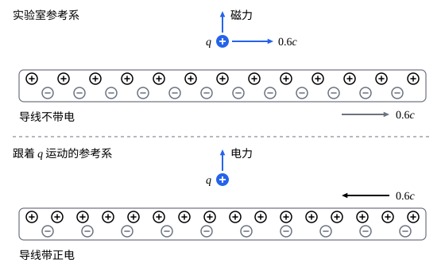

## 这一节要回答的问题

相对论是从电磁学出发的：麦克斯韦方程组（Maxwell's equations）里只出现光速$c$，爱因斯坦（Albert Einstein）保留了它，改的是时空坐标的变换（见[相对性原理与光速不变](lesson:physics.special-relativity.postulates#thm-galilean-light)）。那么，麦克斯韦方程组在:term[洛伦兹变换]{id="physics.special-relativity.lorentz-transformation"}（Lorentz transformation）下，真的在每个:term[惯性系]{id="physics.special-relativity.inertial-frame"}（inertial frame）里形式都相同吗？能不能把它写成一眼就看得出这一点的形式？

## 讲解

### 四维电流

::anchor{id="def-four-current"}
电荷密度（charge density）$\rho$和电流密度（current density）$\vb J$合成的$J^\mu=(c\rho,\vb J)$，叫作:term[四维电流]{id="physics.special-relativity.four-current"}（four-current）。

为什么这样定义：$c\rho$和$\vb J$单位相同，正像:term[四维动量]{id="physics.special-relativity.four-momentum"}（four-momentum）里的$\frac Ec$和$\vb p$。电荷守恒的连续性方程（continuity equation）$\pdv\rho t+\divg\vb J=0$（见[电流与欧姆定律](lesson:physics.electromagnetism.current-density)）就写成$\partial_\mu J^\mu=0$，和[粒子数守恒](lesson:physics.special-relativity.stress-energy-tensor#thm-number-conservation)$\partial_\mu N^\mu=0$一模一样。边界情况：电荷密度不是:term[洛伦兹标量]{id="physics.special-relativity.lorentz-scalar"}（Lorentz scalar），它是四维电流的时间分量除以$c$，换:term[惯性系]{id="physics.special-relativity.inertial-frame"}时会变，不变的是电荷本身。

::anchor{id="thm-four-current"}
定理（四维电流的变换）：电荷在各惯性系里相同时，$J^\mu$是:term[四维矢量]{id="physics.special-relativity.four-vector"}（four-vector）；所以电荷守恒$\partial_\mu J^\mu=0$在一个惯性系里成立，就在所有惯性系里成立。

证明：先看一种以速度$\vb u$运动的电荷，在和它一起运动的惯性系里电荷密度是$\rho_0$。道理和[四维粒子流](lesson:physics.special-relativity.stress-energy-tensor#thm-number-flux)一样：电荷不变，体积沿运动方向按:term[长度收缩]{id="physics.special-relativity.length-contraction"}（length contraction）缩成原来的$\frac1{\gamma_u}$，所以$\rho=\gamma_u\rho_0$，电流密度是$\rho\vb u$，于是$J^\mu=\rho_0U^\mu$，而$\rho_0$是洛伦兹标量，$U^\mu$是:term[四维速度]{id="physics.special-relativity.four-velocity"}（four-velocity）。一般的电流由几种这样的电荷组成，例如导线里的正离子和电子，四维电流是各部分之和，四维矢量相加仍是四维矢量。$\partial_\mu J^\mu$是:term[四维梯度]{id="physics.special-relativity.four-gradient"}（four-gradient）和四维矢量配成的洛伦兹标量，在一个惯性系里为零，在所有惯性系里都为零。

### 有源的方程

::anchor{id="thm-inhomogeneous"}
定理（有源的两个方程）：$\partial_\mu F^{\mu\nu}=\mu_0J^\nu$的$\nu=0$分量是高斯定律（Gauss's law）$\divg\vb E=\frac\rho{\varepsilon_0}$，$\nu=1,2,3$分量是安培-麦克斯韦定律（Ampère–Maxwell law）$\curl\vb B=\mu_0\vb J+\mu_0\varepsilon_0\pdv{\vb E}t$。

证明：:term[电磁场张量]{id="physics.special-relativity.field-tensor"}（electromagnetic field tensor）的分量是$F^{i0}=-F^{0i}=\frac{E_i}c$（$E_1=E_x$等），$F^{21}=B_z$，$F^{13}=B_y$，$F^{32}=B_x$。$\nu=0$：$\partial_\mu F^{\mu0}=\partial_iF^{i0}=\frac1c\divg\vb E$，右边是$\mu_0c\rho$，用$\mu_0\varepsilon_0=\frac1{c^2}$，得$\divg\vb E=\frac\rho{\varepsilon_0}$。$\nu=1$：$\partial_0F^{01}+\partial_2F^{21}+\partial_3F^{31}=-\frac1{c^2}\pdv{E_x}t+\pdv{B_z}y-\pdv{B_y}z$，令它等于$\mu_0J_x$，就是$(\curl\vb B)_x=\mu_0J_x+\frac1{c^2}\pdv{E_x}t$；$\nu=2,3$同理。

### 无源的方程

::anchor{id="thm-homogeneous"}
定理（无源的两个方程）：$\partial_\lambda F_{\mu\nu}+\partial_\mu F_{\nu\lambda}+\partial_\nu F_{\lambda\mu}=0$只有四个独立的方程：$(\lambda,\mu,\nu)=(1,2,3)$是$\divg\vb B=0$，$(0,1,2)$、$(0,2,3)$、$(0,3,1)$是法拉第定律（Faraday's law）$\curl\vb E=-\pdv{\vb B}t$的三个分量；有:term[四维势]{id="physics.special-relativity.four-potential"}（four-potential）时它自动成立。

证明：交换$\lambda,\mu,\nu$中的两个，由$F_{\mu\nu}=-F_{\nu\mu}$，左边整个变号，所以有两个指标相同时它为零，三个指标互不相同的只有$\binom43=4$组。降指标后$F_{0i}=\frac{E_i}c$，$F_{12}=-B_z$，$F_{23}=-B_x$，$F_{31}=-B_y$。$(1,2,3)$：$\partial_1F_{23}+\partial_2F_{31}+\partial_3F_{12}=-\divg\vb B$；$(0,1,2)$：$\partial_0F_{12}+\partial_1F_{20}+\partial_2F_{01}=-\frac1c\bigl(\pdv{B_z}t+\pdv{E_y}x-\pdv{E_x}y\bigr)$，令它为零就是$(\curl\vb E)_z=-\pdv{B_z}t$，另两组同理。

有四维势时，$F^{\mu\nu}=\partial^\mu A^\nu-\partial^\nu A^\mu$降指标得$F_{\mu\nu}=\partial_\mu A_\nu-\partial_\nu A_\mu$，代入左边是六项，混合偏导数可以交换次序，两两抵消。反过来，由这两个方程可以求出势（见[电磁势与规范变换](lesson:physics.electromagnetism.gauge-potentials)）：无源的方程说的正是「场由四维势给出」。

### 协变形式

::anchor{id="def-lorentz-covariance"}
两边换:term[惯性系]{id="physics.special-relativity.inertial-frame"}时按同样的方式变换的方程，例如两边都是:term[四维矢量]{id="physics.special-relativity.four-vector"}、或都是同一种:term[四维张量]{id="physics.special-relativity.four-tensor"}（four-tensor）的方程，叫作:term[洛伦兹协变]{id="physics.special-relativity.lorentz-covariance"}（Lorentz covariant）的；这样的方程在一个惯性系里成立，就在所有惯性系里以同样的形式成立。

为什么这样定义：:term[相对性原理]{id="physics.special-relativity.principle-of-relativity"}（principle of relativity）要求物理定律在所有惯性系里形式相同，把定律写成洛伦兹协变的方程，这一点就自动满足，用不着逐个惯性系去验证。$\partial_\mu J^\mu=0$、$\partial_\mu T^{\mu\nu}=0$都是这样的方程。边界情况：协变不等于不变，方程两边的分量换惯性系时都会变，只是变得一样；「下标分量也叫协变分量」里的「协变」说的是另一件事，指下标分量的变换方式。

::anchor{id="thm-maxwell-covariant"}
定理（麦克斯韦方程组是洛伦兹协变的）：设$F^{\mu\nu}$按四维张量、$J^\mu$按四维矢量变换，如果$\partial_\mu F^{\mu\nu}=\mu_0J^\nu$和无源的两个方程在一个惯性系里成立，那么它们在所有惯性系里都成立。

证明：由:term[四维梯度]{id="physics.special-relativity.four-gradient"}的变换，$\partial'_\mu F'^{\mu\nu}=(\Lambda^{-1})^\lambda{}_\mu\Lambda^\mu{}_\kappa\Lambda^\nu{}_\sigma\,\partial_\lambda F^{\kappa\sigma}=\Lambda^\nu{}_\sigma\,\partial_\kappa F^{\kappa\sigma}=\mu_0\Lambda^\nu{}_\sigma J^\sigma=\mu_0J'^\nu$。无源的方程：在原来的惯性系里它们保证有:term[四维势]{id="physics.special-relativity.four-potential"}，$F^{\mu\nu}=\partial^\mu A^\nu-\partial^\nu A^\mu$；令$A'=\Lambda A$，升了指标的$\partial^\mu$和上标分量一样按$\Lambda$变换，所以$\partial'^\mu A'^\nu-\partial'^\nu A'^\mu=\Lambda F\Lambda\T=F'$，新惯性系里$F'$也由四维势给出，无源的方程自动成立。

协变的写法还直接给出电荷守恒：$\partial_\nu\partial_\mu F^{\mu\nu}$里$\partial_\nu\partial_\mu$对两个指标对称，$F^{\mu\nu}$反对称，求和为零，所以$\partial_\nu J^\nu=0$。去掉安培-麦克斯韦定律里的位移电流（displacement current）项，就得不到这个结论，这正是麦克斯韦要加上它的原因（见[位移电流与麦克斯韦方程组](lesson:physics.electromagnetism.maxwell-equations)）。

1905 年，爱因斯坦在《论动体的电动力学》第 9 节把运流电流（convection current）也考虑进去，得到电荷密度的变换$\rho'=\gamma\bigl(1-\frac{u_xv}{c^2}\bigr)\rho$（$u_x$是电荷速度的$x$分量），这正是$J'^0=\gamma\bigl(J^0-\frac vcJ^1\bigr)$。他还指出，带电体的电荷在随它运动的坐标系里不随时间变时，在「静止」的惯性系里看也不随时间变。1908 年，闵可夫斯基（Hermann Minkowski）把整个方程组写成了四维的形式，他把第四个坐标取成虚数$it$（光速取作$1$），现在多用实坐标加度规。

### 四维势的方程

::anchor{id="def-dalembertian"}
算符$\Box=\partial_\mu\partial^\mu=\frac1{c^2}\frac{\partial^2}{\partial t^2}-\nabla^2$叫作达朗贝尔算符（d'Alembert operator）；它由:term[四维梯度]{id="physics.special-relativity.four-gradient"}一上一下配对得到，换:term[惯性系]{id="physics.special-relativity.inertial-frame"}时不变。

为什么这样定义：$\Box f=0$就是以速度$c$传播的波动方程（wave equation），它在每个惯性系里形式相同，正好和光速在每个惯性系里都是$c$相符。边界情况：不随时间变的量，$\Box$就是$-\nabla^2$，例如静电势满足$-\nabla^2\phi=\frac\rho{\varepsilon_0}$。

::anchor{id="thm-potential-equation"}
定理（:term[四维势]{id="physics.special-relativity.four-potential"}的方程）：用四维势表示，有源的方程是$\Box A^\nu-\partial^\nu(\partial_\mu A^\mu)=\mu_0J^\nu$；在洛伦茨规范（Lorenz gauge）$\partial_\mu A^\mu=0$下，就是$\Box A^\nu=\mu_0J^\nu$。

证明：$\partial_\mu F^{\mu\nu}=\partial_\mu\partial^\mu A^\nu-\partial^\nu\partial_\mu A^\mu$，第二项交换了求导次序。洛伦茨规范下第二项为零。$\nu=0$分量是$\Box\phi=\frac\rho{\varepsilon_0}$，空间分量是$\Box\vb A=\mu_0\vb J$，正是电磁势那一节在洛伦茨规范下的两个方程（一个标量方程、一个矢量方程），现在合成了一个。

四维势按:term[四维矢量]{id="physics.special-relativity.four-vector"}变换时，$\partial_\mu A^\mu$是:term[洛伦兹标量]{id="physics.special-relativity.lorentz-scalar"}，洛伦茨规范在一个惯性系里成立，在所有惯性系里都成立。在电荷静止的惯性系里求出四维势，再按四维矢量变换过去，它在新惯性系里满足同样的方程和规范条件，给出的场张量就是变换过去的$F'$（例 2）。

### 力的密度

::anchor{id="thm-force-density"}
定理（洛伦兹力密度）：$f^\nu=F^{\nu\lambda}J_\lambda$的空间分量是单位体积受的力$\rho\vb E+\vb J\times\vb B$，时间分量是$\frac1c\vb J\cdot\vb E$，即单位体积里电场做功的功率除以$c$。对带电的:term[尘埃]{id="physics.special-relativity.dust"}（dust），$\partial_\mu T^{\mu\nu}=f^\nu$，$T^{\mu\nu}$是尘埃的:term[能量-动量张量]{id="physics.special-relativity.stress-energy-tensor"}（stress–energy tensor）。

证明：$F^{i\lambda}J_\lambda=F^{i0}J_0+F^{ij}J_j=\frac{E_i}c\cdot c\rho-F^{ij}J^j$，而$-F^{ij}J^j$正是$(\vb J\times\vb B)_i$，例如$i=1$时是$-F^{12}J^2-F^{13}J^3=B_zJ_y-B_yJ_z$；$F^{0j}J_j=\bigl(-\frac{E_j}c\bigr)(-J^j)=\frac1c\vb J\cdot\vb E$。带电尘埃的每个粒子满足$m\dv{U^\nu}\tau=qF^{\nu\lambda}U_\lambda$，粒子数守恒时$\partial_\mu T^{\mu\nu}=mn_0U^\mu\partial_\mu U^\nu=n_0m\dv{U^\nu}\tau$（见[尘埃的运动](lesson:physics.special-relativity.stress-energy-tensor#thm-dust-motion)）。所以$\partial_\mu T^{\mu\nu}=qn_0F^{\nu\lambda}U_\lambda=F^{\nu\lambda}J_\lambda$，这里$J^\mu=qn_0U^\mu$。

尘埃的能量和动量不再守恒：电磁场在推它，也在对它做功。总的能量、动量守恒，要把场自己的能量和动量也算进去（见 p8）。

## 几何图像

上面是实验室：正离子不动，电子以$0.6c$向右运动，两者一样密，导线不带电，它对同样以$0.6c$向右运动的正电荷$q$的作用是磁力。下面是跟着$q$运动的:term[惯性系]{id="physics.special-relativity.inertial-frame"}：电子不动，正离子以$0.6c$向左运动。按:term[长度收缩]{id="physics.special-relativity.length-contraction"}，正离子的间距缩成实验室里的$0.8$倍，电子的间距是它们自己静止时的间距，是实验室里的$1.25$倍，于是导线带正电，对静止的$q$的作用是电力。为了看得清，速度取得很大；实际导线里电子的漂移速度只有每秒零点几毫米。

## 例题

### 例 1　载流导线在另一个惯性系里带电

一根很长的直导线在实验室里不带电，通有沿$+x$方向的电流$I=10\,\mathrm A$。在以$0.6c$沿$+x$方向运动的:term[惯性系]{id="physics.special-relativity.inertial-frame"}$S'$里，导线单位长度带多少电？离导线$1.0\,\mathrm{cm}$处的电场多大？

**为什么想到这么做**：把:term[四维电流]{id="physics.special-relativity.four-current"}对导线的截面积分，得到$(c\lambda,I,0,0)$，$\lambda$是单位长度的电荷；沿$x$轴推进时截面不变，它像$(ct,x)$那样变换。电场可以由高斯定律求，也可以由磁场的变换求，两者应当一致。

**推导**：$\gamma=1.25$，$c\lambda'=\gamma\bigl(c\lambda-\frac vcI\bigr)$，$\lambda=0$，所以$\lambda'=-\gamma\frac{vI}{c^2}=-\frac{1.25\times0.6\times10}{2.998\times10^8}\,\mathrm{C/m}\approx-2.50\times10^{-8}\,\mathrm{C/m}$，导线带负电。由高斯定律，$1.0\,\mathrm{cm}$处$E'=\frac{|\lambda'|}{2\pi\varepsilon_0r}\approx\frac{2.50\times10^{-8}}{2\pi\times8.854\times10^{-12}\times0.010}\,\mathrm{V/m}\approx4.50\times10^4\,\mathrm{V/m}$。核对：实验室里那里的磁场是$B=\frac{\mu_0I}{2\pi r}=2.0\times10^{-4}\,\mathrm T$，由场的变换$E'_\perp=\gamma vB\approx1.25\times0.6\times2.998\times10^8\times2.0\times10^{-4}\,\mathrm{V/m}\approx4.50\times10^4\,\mathrm{V/m}$，一致。

### 例 2　匀速运动的点电荷的四维势

电荷$q$以速度$v$沿$x$轴匀速运动，$t=0$时在原点。在洛伦茨规范下求它的标势和矢势。

**为什么想到这么做**：在电荷静止的:term[惯性系]{id="physics.special-relativity.inertial-frame"}$S'$里，$\phi'=\frac{q}{4\pi\varepsilon_0r'}$，$\vb A'=0$，满足$\Box A'^\mu=\mu_0J'^\mu$和洛伦茨规范。按:term[四维矢量]{id="physics.special-relativity.four-vector"}把它变换到$S$，它在$S$里满足同样的方程和规范条件，给出的场就是变换过去的场。

**推导**：从$S'$变到$S$用$\Lambda(-\beta)$：$A^0=\gamma A'^0$，$A^1=\gamma\beta A'^0$，即$\phi=\gamma\phi'$，$A_x=\frac{\gamma v}{c^2}\phi'=\frac v{c^2}\phi$。$r'$用$S$的坐标写是$\sqrt{\gamma^2(x-vt)^2+y^2+z^2}$，所以$\phi=\frac{q}{4\pi\varepsilon_0}\frac{\gamma}{\sqrt{\gamma^2(x-vt)^2+y^2+z^2}}$，$\vb A=\frac{\vb v}{c^2}\phi$。由$\vb E=-\nabla\phi-\pdv{\vb A}t$、$\vb B=\curl\vb A$算出的场，就是[电磁场张量](lesson:physics.special-relativity.field-tensor)例 1 的结果；速度低时$\gamma\approx1$，$\phi$回到库仑势（Coulomb potential）。

## 常见误区

- 「麦克斯韦方程组要改写才能符合相对论。」它本来就是:term[洛伦兹协变]{id="physics.special-relativity.lorentz-covariance"}的，改的只是写法；当年要修改的是伽利略变换和牛顿力学。
- 「电荷密度是:term[洛伦兹标量]{id="physics.special-relativity.lorentz-scalar"}。」它是:term[四维电流]{id="physics.special-relativity.four-current"}的时间分量除以$c$；不变的是总电荷。
- 「不带电的导线在任何:term[惯性系]{id="physics.special-relativity.inertial-frame"}里都不带电。」通电的中性导线在相对它运动的惯性系里带电（例 1）。
- 「写成$\partial_\mu F^{\mu\nu}=\mu_0J^\nu$等两个式子，方程的内容少了。」两个式子合起来仍是 8 个分量方程，和原来的四个方程（两个标量方程、两个矢量方程）一样多。
- 「洛伦茨规范只在一个惯性系里成立。」:term[四维势]{id="physics.special-relativity.four-potential"}按:term[四维矢量]{id="physics.special-relativity.four-vector"}变换时，$\partial_\mu A^\mu$是洛伦兹标量，规范条件在所有惯性系里都成立。
