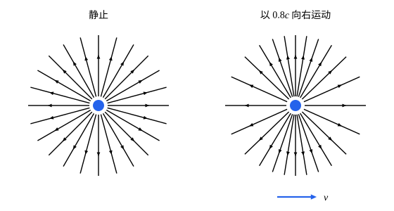

## 这一节要回答的问题

静止的点电荷（point charge）周围只有电场（electric field）。从旁边以速度$v$经过的观察者看来，它是一个运动的电荷，也就是一段电流，周围还有磁场（magnetic field）。同一个电磁场，在不同的:term[惯性系]{id="physics.special-relativity.inertial-frame"}（inertial frame）里，电场和磁场各是多少？它们按什么规律一起变换？

## 讲解

### 洛伦兹力的四维写法

电荷为$q$的粒子在电场$\vb E$、磁场$\vb B$里受到洛伦兹力（Lorentz force）$\vb F=q(\vb E+\vb u\times\vb B)$，它改变的是相对论动量（relativistic momentum）$\gamma_um\vb u$（见[四维力与相对论动力学](lesson:physics.special-relativity.four-force#def-relativistic-force)）。磁力和速度垂直、不做功，功率是$\vb F\cdot\vb u=q\vb E\cdot\vb u$，所以:term[四维力]{id="physics.special-relativity.four-force"}（four-force）是$K^\mu=\gamma_u\bigl(\frac qc\vb E\cdot\vb u,\ q(\vb E+\vb u\times\vb B)\bigr)$。它的每个分量都是:term[四维速度]{id="physics.special-relativity.four-velocity"}（four-velocity）$U^\mu=\gamma_u(c,\vb u)$各分量的线性组合，系数由$\vb E$、$\vb B$决定：

$$
\begin{pmatrix}K^0\\K^1\\K^2\\K^3\end{pmatrix}=q\begin{pmatrix}0&E_x/c&E_y/c&E_z/c\\E_x/c&0&B_z&-B_y\\E_y/c&-B_z&0&B_x\\E_z/c&B_y&-B_x&0\end{pmatrix}\begin{pmatrix}U^0\\U^1\\U^2\\U^3\end{pmatrix} .
$$

把$U^\nu$换成下标分量（covariant components，也叫协变分量）$U_\nu$，空间分量变号，右边矩阵的后三列也跟着变号，得到一个反对称矩阵：

$$
F^{\mu\nu}=\begin{pmatrix}0&-E_x/c&-E_y/c&-E_z/c\\E_x/c&0&-B_z&B_y\\E_y/c&B_z&0&-B_x\\E_z/c&-B_y&B_x&0\end{pmatrix} ,\qquad K^\mu=qF^{\mu\nu}U_\nu .
$$

::anchor{id="def-field-tensor"}
由电场和磁场按$F^{10}=\frac{E_x}c$、$F^{20}=\frac{E_y}c$、$F^{30}=\frac{E_z}c$、$F^{32}=B_x$、$F^{13}=B_y$、$F^{21}=B_z$和$F^{\nu\mu}=-F^{\mu\nu}$排出的$F^{\mu\nu}$，叫作:term[电磁场张量]{id="physics.special-relativity.field-tensor"}（electromagnetic field tensor）；电荷为$q$的粒子受的:term[四维力]{id="physics.special-relativity.four-force"}是$K^\mu=qF^{\mu\nu}U_\nu$。

为什么这样定义：洛伦兹力对速度是线性的，四维力就可以写成一个矩阵乘四维速度；用下标分量$U_\nu$写，这个矩阵恰好反对称。反对称不是巧合：质量不变时$K\cdot U=0$，$K_\mu U^\mu=qF_{\mu\nu}U^\mu U^\nu$对每个四维速度都为零，这要求$F_{\mu\nu}$的对称部分是零。反对称的$4\times4$矩阵恰好有 6 个独立元素，三个给电场、三个给磁场：电场和磁场是同一个量的两部分。边界情况：单独的$\vb E$或$\vb B$不是任何:term[四维矢量]{id="physics.special-relativity.four-vector"}（four-vector）的空间部分，下面会看到，换:term[惯性系]{id="physics.special-relativity.inertial-frame"}时它们互相混合。

### 场张量是四维张量

记号：下一节里$\rho$要表示电荷密度（charge density），所以这一节和下一节求和的指标改用$\lambda$、$\kappa$。

::anchor{id="thm-field-tensor"}
定理（场张量的变换）：如果洛伦兹力的公式在每个:term[惯性系]{id="physics.special-relativity.inertial-frame"}里都成立，电荷$q$在每个惯性系里都相同，那么$F^{\mu\nu}$是:term[四维张量]{id="physics.special-relativity.four-tensor"}（four-tensor）：$F'^{\mu\nu}=\Lambda^\mu{}_\lambda\Lambda^\nu{}_\kappa F^{\lambda\kappa}$，即$F'=\Lambda F\Lambda\T$。

证明：把:term[四维矢量]{id="physics.special-relativity.four-vector"}写成列向量，下标分量$U_\nu$排成的列向量是$\eta U$，所以$K=qF\eta U$，在另一个惯性系里$K'=qF'\eta U'$。$K'=\Lambda K$，$U'=\Lambda U$，于是$qF'\eta\Lambda U=q\Lambda F\eta U$。这对每个:term[四维速度]{id="physics.special-relativity.four-velocity"}$U$都成立，而静止的$(c,0,0,0)$和分别沿三个坐标轴运动的三个四维速度线性无关，所以$F'\eta\Lambda=\Lambda F\eta$，两边右乘$\Lambda^{-1}\eta$，得$F'=\Lambda F\eta\Lambda^{-1}\eta$。

由$\Lambda\T\eta\Lambda=\eta$（见[洛伦兹变换保持度规](lesson:physics.special-relativity.four-vectors#thm-metric-preserved)）左乘$\eta$，得$(\eta\Lambda\T\eta)\Lambda=I$，即$\Lambda^{-1}=\eta\Lambda\T\eta$，所以$\eta\Lambda^{-1}\eta=\Lambda\T$，$F'=\Lambda F\Lambda\T$。

定理的两个前提都是实验事实。加速器（accelerator）的设计用的就是「洛伦兹力改变相对论动量」。电荷不随速度变：氢分子和氦原子里，电子运动的快慢很不一样，两者却都是电中性的，1960 年金（John G. King）的实验测得，它们带的净电荷都不到电子电荷的$10^{-19}$。

### 电场和磁场的变换

::anchor{id="thm-field-boost"}
定理（沿$x$轴的推进下场的变换）：$S'$相对$S$按:term[标准位形]{id="physics.special-relativity.standard-configuration"}（standard configuration）以$v$沿$x$轴运动时，$E'_x=E_x$，$E'_y=\gamma(E_y-vB_z)$，$E'_z=\gamma(E_z+vB_y)$；$B'_x=B_x$，$B'_y=\gamma\bigl(B_y+\frac v{c^2}E_z\bigr)$，$B'_z=\gamma\bigl(B_z-\frac v{c^2}E_y\bigr)$。

证明：$\Lambda(\beta)$只混合第$0$、$1$两个指标，$\Lambda^0{}_0=\Lambda^1{}_1=\gamma$，$\Lambda^0{}_1=\Lambda^1{}_0=-\gamma\beta$，$\Lambda^2{}_2=\Lambda^3{}_3=1$。$F'^{01}=\Lambda^0{}_0\Lambda^1{}_1F^{01}+\Lambda^0{}_1\Lambda^1{}_0F^{10}=\gamma^2(1-\beta^2)F^{01}=F^{01}$，所以$E'_x=E_x$；$F'^{02}=\gamma F^{02}-\gamma\beta F^{12}=-\frac\gamma c(E_y-vB_z)$，所以$E'_y=\gamma(E_y-vB_z)$。同样，$F'^{03}=\gamma F^{03}-\gamma\beta F^{13}$给出$E'_z$，$F'^{12}=-\gamma\beta F^{02}+\gamma F^{12}=-\gamma\bigl(B_z-\frac v{c^2}E_y\bigr)$给出$B'_z$，$F'^{13}=-\gamma\beta F^{03}+\gamma F^{13}$给出$B'_y$，$F'^{23}=F^{23}$给出$B'_x=B_x$。

把平行和垂直于$\vb v$的分量分别记作$\parallel$、$\perp$，这组式子就是$\vb E'_\parallel=\vb E_\parallel$，$\vb E'_\perp=\gamma(\vb E+\vb v\times\vb B)_\perp$，$\vb B'_\parallel=\vb B_\parallel$，$\vb B'_\perp=\gamma\bigl(\vb B-\frac1{c^2}\vb v\times\vb E\bigr)_\perp$；它们只用矢量写成，对任意方向的$\vb v$都成立。速度低时$\gamma\approx1$，$\vb E'\approx\vb E+\vb v\times\vb B$，$\vb B'\approx\vb B-\frac1{c^2}\vb v\times\vb E$。

$\vb E'_\perp$的式子可以这样理解：一个在$S'$里静止的电荷，在$S'$里只受电场力$q\vb E'$，在$S$里以$\vb v$运动、受洛伦兹力$q(\vb E+\vb v\times\vb B)$。沿$x$轴推进时:term[四维力]{id="physics.special-relativity.four-force"}的$y$、$z$分量不变，在$S$里它们是$\gamma$乘力，在电荷静止的$S'$里就是力本身，所以垂直方向的力在$S'$里是$S$里的$\gamma$倍。一个:term[惯性系]{id="physics.special-relativity.inertial-frame"}里的磁力，在另一个惯性系里就是电力。

1905 年，爱因斯坦（Albert Einstein）在《论动体的电动力学》第 6 节要求麦克斯韦方程组（Maxwell's equations）在两个惯性系里形式相同，推出了这组变换，只是用的单位和这里不同。他由此指出，电荷在磁场里运动时受的「电动力」（electromotive force）只是一个辅助概念：换到电荷静止的惯性系，它就是那里的电场力。1908 年，闵可夫斯基（Hermann Minkowski）把电场和磁场合成一个有六个分量的量，他的原文写作「第二种时空矢量」（Raum-Zeit-Vektor II. Art），也就是现在的:term[电磁场张量]{id="physics.special-relativity.field-tensor"}。

::anchor{id="thm-field-invariant"}
定理（场的不变量）：$E^2-c^2B^2$在所有惯性系里相同，它等于$-\frac{c^2}2F_{\mu\nu}F^{\mu\nu}$。

证明：降指标时每个空间指标变一次号，$F_{0i}=-F^{0i}$，$F_{ij}=F^{ij}$，所以$F_{\mu\nu}F^{\mu\nu}=2\sum_iF_{0i}F^{0i}+\sum_{i,j}F_{ij}F^{ij}=-\frac{2E^2}{c^2}+2B^2$。写成矩阵，$F_{\mu\nu}$排成$\eta F\eta$，而$F\T=-F$，所以$F_{\mu\nu}F^{\mu\nu}=\mathrm{tr}\bigl((\eta F\eta)\T F\bigr)=-\mathrm{tr}(\eta F\eta F)$。换惯性系后它变成$-\mathrm{tr}(\eta\Lambda F\Lambda\T\eta\Lambda F\Lambda\T)$，把最后的$\Lambda\T$轮换到最前面，用$\Lambda\T\eta\Lambda=\eta$，又回到$-\mathrm{tr}(\eta F\eta F)$。

所以$E>cB$的场在任何惯性系里都是$E>cB$，不可能在某个惯性系里只剩磁场；只剩电场的场，在别的惯性系里也是电场占上风。另一个不变量是$\vb E\cdot\vb B$（见 p5）。

### 四维势

记号：分析力学和电磁学里，标势（scalar potential）写作$\varphi$；本领域的$\varphi$已经表示:term[快度]{id="physics.special-relativity.rapidity"}（rapidity），所以这里写作$\phi$。

::anchor{id="def-four-potential"}
标势（scalar potential）$\phi$和矢势（vector potential）$\vb A$合成的$A^\mu=\bigl(\frac\phi c,\vb A\bigr)$，叫作:term[四维势]{id="physics.special-relativity.four-potential"}（four-potential）。

为什么这样定义：随时间变化的场由势给出，$\vb E=-\nabla\phi-\pdv{\vb A}t$，$\vb B=\curl\vb A$（见[电磁势与规范变换](lesson:physics.electromagnetism.gauge-potentials)）。把$\phi$除以$c$，单位就和$\vb A$相同，正像$x^0=ct$和$\vb r$单位相同；下面的定理说明，场张量正是由四维势求导得到的。边界情况：势不是唯一的，规范变换（gauge transformation）$\phi\to\phi-\pdv\chi t$、$\vb A\to\vb A+\nabla\chi$不改变场，写成四维的形式是$A^\mu\to A^\mu-\partial^\mu\chi$。

::anchor{id="thm-field-from-potential"}
定理（场张量与四维势）：$F^{\mu\nu}=\partial^\mu A^\nu-\partial^\nu A^\mu$；规范变换$A^\mu\to A^\mu-\partial^\mu\chi$不改变$F^{\mu\nu}$。

证明：:term[四维梯度]{id="physics.special-relativity.four-gradient"}（four-gradient）升指标后是$\partial^\mu=\bigl(\frac1c\pdv{}{t},-\nabla\bigr)$，下面$A_x$、$A_y$、$A_z$是$\vb A$的直角分量，不是下标分量（$A_1=-A_x$）。$\partial^1A^0-\partial^0A^1=-\pdv{}{x}\frac\phi c-\frac1c\pdv{A_x}t=\frac1c\bigl(-\pdv\phi x-\pdv{A_x}t\bigr)=\frac{E_x}c=F^{10}$；$\partial^2A^1-\partial^1A^2=-\pdv{A_x}y+\pdv{A_y}x=(\curl\vb A)_z=B_z=F^{21}$，其余分量同理。规范变换时右边多出$-\partial^\mu\partial^\nu\chi+\partial^\nu\partial^\mu\chi=0$，因为混合偏导数可以交换次序。

带电粒子的:term[作用量]{id="physics.analytical-mechanics.action"}（action）里，电磁势出现在$-q\int A_\mu\,\dd x^\mu$这一项（见[自由粒子的作用量](lesson:physics.special-relativity.relativistic-action)的 p7），要它是:term[洛伦兹标量]{id="physics.special-relativity.lorentz-scalar"}（Lorentz scalar），$A^\mu$就得是:term[四维矢量]{id="physics.special-relativity.four-vector"}。能不能这样取，要看电荷和电流怎样变换：下一节会看到，在洛伦茨规范（Lorenz gauge）$\partial_\mu A^\mu=\frac1{c^2}\pdv\phi t+\divg\vb A=0$下，把四维势按四维矢量变换到另一个:term[惯性系]{id="physics.special-relativity.inertial-frame"}，它在那里满足同样的方程和规范条件，求出的正是那里的场张量，所以四维势可以取成四维矢量（见[麦克斯韦方程组的协变形式](lesson:physics.special-relativity.covariant-maxwell)）。这一节的推理不依赖这一点：场张量的变换已经由洛伦兹力定下了。

## 几何图像

左边是静止的点电荷，电场线均匀地向四周散开。右边是以$0.8c$向右运动的同一个电荷在某一时刻的电场线（例 1）：它们仍是从电荷此刻的位置出发的直线，却向垂直于运动的方向聚拢，表示前后方向的电场弱、两侧的电场强。把左图沿运动方向压缩成$\frac1\gamma=0.6$倍，电场线的方向就是右图。

:::anim{component="function-plot"}
range: { x: [0, 180], y: [0, 3] }
functions:
  - expr: "(1 - b^2) / (1 - b^2 * sin(x*pi/180)^2)^1.5"
    label: |
      运动的电荷
  - expr: "1"
    label: |
      静止的电荷
points:
  - { x: "90", y: "1/sqrt(1 - b^2)" }
sliders:
  - name: b
    min: 0
    max: 0.9
    step: 0.01
    default: 0.8
    label: |
      电荷的速度$v/c$
:::

横轴是场点所在方向和运动方向的夹角$\theta$，以度为单位，图上写作$x$；纵轴是同样距离上电场的大小，以静止电荷的库仑场（Coulomb field）为单位。速度越大，前后（$\theta=0^\circ$、$180^\circ$）的场越弱，降到$1-\beta^2$倍；两侧（$\theta=90^\circ$）的场越强，升到$\gamma$倍，标出的点就是它。

## 例题

### 例 1　匀速运动的点电荷

电荷$q$以速度$v$沿$x$轴匀速运动，$t=0$时在原点。求这一时刻各处的电场和磁场。

**为什么想到这么做**：在电荷静止的:term[惯性系]{id="physics.special-relativity.inertial-frame"}$S'$里只有库仑场，用场的变换换回$S$即可；$S$相对$S'$以$-v$运动，所以变换式里的$v$换成$-v$。$S'$里的场不随时间变，只需换算坐标：由:term[洛伦兹变换]{id="physics.special-relativity.lorentz-transformation"}（Lorentz transformation），$t=0$时$x'=\gamma x$，$y'=y$，$z'=z$。

**推导**：$S'$里$\vb E'=\frac{q}{4\pi\varepsilon_0}\frac{(x',y',z')}{r'^3}$，$\vb B'=0$，$\varepsilon_0$是真空介电常量（vacuum permittivity）。换回$S$：$E_x=E'_x$，$E_y=\gamma E'_y$，$E_z=\gamma E'_z$，代入$x'=\gamma x$，得$\vb E=\frac{q}{4\pi\varepsilon_0}\frac{\gamma(x,y,z)}{(\gamma^2x^2+y^2+z^2)^{3/2}}$；磁场$B_y=-\frac{\gamma v}{c^2}E'_z$，$B_z=\frac{\gamma v}{c^2}E'_y$，就是$\vb B=\frac1{c^2}\vb v\times\vb E$。

电场沿$(x,y,z)$方向，指向背离电荷此刻位置的方向。设场点到原点的距离为$r$、和$x$轴的夹角为$\theta$，$\gamma^2x^2+y^2+z^2=\gamma^2r^2(1-\beta^2\sin^2\theta)$，所以$E=\frac{q}{4\pi\varepsilon_0r^2}\cdot\frac{1-\beta^2}{(1-\beta^2\sin^2\theta)^{3/2}}$，这就是上面函数图里的曲线。速度低时$\vb B\approx\frac{\mu_0}{4\pi}\frac{q\vb v\times\hat{\vb r}}{r^2}$，$\mu_0=\frac1{\varepsilon_0c^2}$是真空磁导率（vacuum permeability），和毕奥-萨伐尔定律（Biot–Savart law）给出的一样。

### 例 2　平行板电容器之间的场

在$S$里，平行板电容器（capacitor）的两板平行于$xz$平面，板间是沿$y$轴的匀强电场$\vb E=E_0\hat{\vb y}$，没有磁场。$S'$以$0.8c$沿$x$轴运动，求$S'$里板间的电场和磁场，并核对$E^2-c^2B^2$。

**为什么想到这么做**：直接用:term[标准位形]{id="physics.special-relativity.standard-configuration"}下的变换；$\vb v$和$\vb E$垂直，所以电场要乘$\gamma$，还会出现磁场。

**推导**：$\gamma=\frac53$。$E'_y=\gamma E_0=\frac53E_0$，$B'_z=\gamma\bigl(0-\frac v{c^2}E_0\bigr)=-\frac43\frac{E_0}c$，其余分量为零。$E'^2-c^2B'^2=\bigl(\frac{25}9-\frac{16}9\bigr)E_0^2=E_0^2$，和$S$里一样。这和直接看电荷也对得上：在$S'$里两板以$0.8c$沿$-x$方向运动，沿运动方向缩短，面电荷密度是$S$里的$\gamma$倍，所以电场也是$\gamma$倍；运动的带电板又是两层方向相反的面电流，在板间产生磁场。

## 常见误区

- 「电场和磁场是两种互不相干的场。」它们是同一个:term[电磁场张量]{id="physics.special-relativity.field-tensor"}的不同分量，换:term[惯性系]{id="physics.special-relativity.inertial-frame"}时互相混合。
- 「换惯性系时，电场和磁场的每个分量都乘$\gamma$。」只有垂直于运动方向的分量乘$\gamma$并互相混合，平行于运动方向的分量不变。
- 「匀速运动的点电荷的电场线是弯的，或者指向它以前的位置。」匀速运动时电场线是从电荷此刻的位置出发的直线（例 1），只是疏密不均匀。
- 「$F^{\mu\nu}$有 16 个独立的分量。」它是反对称的，对角线为零，只有 6 个独立分量。
- 「:term[四维势]{id="physics.special-relativity.four-potential"}和电磁场张量一样是唯一确定的。」势可以做规范变换，场张量不变。
