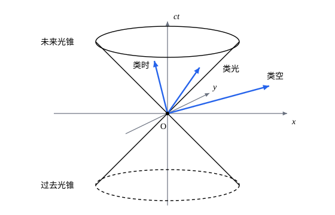

## 这一节要回答的问题

平面上转动坐标轴，矢量的分量变了，矢量的长度和两个矢量的点积（dot product）却不变；物理定律写成矢量之间的等式，就不依赖坐标轴怎么取。:term[洛伦兹变换]{id="physics.special-relativity.lorentz-transformation"}（Lorentz transformation）下也有一个不变的量，就是:term[时空间隔]{id="physics.special-relativity.spacetime-interval"}（spacetime interval）。能不能照着三维矢量的样子，定义「时空里的矢量」和它们的内积，让物理定律在每个:term[惯性系]{id="physics.special-relativity.inertial-frame"}（inertial frame）里写出来都一样？

## 讲解

### 指标记号

把:term[事件]{id="physics.special-relativity.event"}（event）的坐标写成$x^\mu$（$\mu=0,1,2,3$）：$x^0=ct$，$x^1=x$，$x^2=y$，$x^3=z$。上标是编号，不是乘方：$x^2$指$y$坐标，要写平方时加括号，如$(x^1)^2$。希腊字母$\mu,\nu,\rho,\sigma$作指标时取$0$到$3$，拉丁字母$i,j$只取空间的$1$到$3$。

:term[标准位形]{id="physics.special-relativity.standard-configuration"}（standard configuration）下的:term[洛伦兹变换]{id="physics.special-relativity.lorentz-transformation"}写成$4\times4$的矩阵，$y$、$z$不变：

$$
\Lambda(\beta)=\begin{pmatrix}\gamma&-\gamma\beta&0&0\\-\gamma\beta&\gamma&0&0\\0&0&1&0\\0&0&0&1\end{pmatrix} .
$$

它第$\mu$行、第$\nu$列的元素记作$\Lambda^\mu{}_\nu$（行、列都从$0$数起），变换就是$x'^\mu=\sum_{\nu=0}^{3}\Lambda^\mu{}_\nu x^\nu$。

::anchor{id="def-summation-convention"}
同一项里一个指标作为上标、下标各出现一次时，就表示对它从$0$到$3$求和，求和号省去不写，这个约定叫作:term[爱因斯坦求和约定]{id="physics.special-relativity.summation-convention"}（Einstein summation convention）；例如$x'^\mu=\Lambda^\mu{}_\nu x^\nu$就是上面那个求和。

为什么这样约定：相对论的式子里这样的求和到处都是，省掉求和号，式子短得多；求和总是一上一下配对，写错了也容易看出来。被求和的指标换个字母不改变意思，如$\Lambda^\mu{}_\nu x^\nu=\Lambda^\mu{}_\rho x^\rho$；没被求和的指标在等式两边要一致，上式两边都只剩$\mu$。边界情况：$A^\mu B^\mu$两个都是上标，按约定不求和，在本领域的式子里这样写通常说明写错了。

### 洛伦兹变换的一般形式

:term[标准位形]{id="physics.special-relativity.standard-configuration"}只是一种摆法：两个:term[惯性系]{id="physics.special-relativity.inertial-frame"}的坐标轴可以不平行，相对速度也可以不沿$x$轴。原点重合时，任意两个惯性系之间的换算都可以分成三步：一次空间转动、一次沿$x$轴的$\Lambda(\beta)$、再一次空间转动。这三种变换都保持:term[时空间隔]{id="physics.special-relativity.spacetime-interval"}不变。

::anchor{id="def-lorentz-general"}
保持任意两个:term[事件]{id="physics.special-relativity.event"}之间的时空间隔不变的线性坐标变换$x'^\mu=\Lambda^\mu{}_\nu x^\nu$，统称:term[洛伦兹变换]{id="physics.special-relativity.lorentz-transformation"}；$\Lambda(\beta)$叫作沿$x$轴的推进（boost），空间转动也是洛伦兹变换，它不改变$t$和$|\vb r|$。

为什么这样定义：两个惯性系的坐标之间的换算必须保持间隔不变，又要把匀速直线运动变成匀速直线运动，后一条要求它是线性的（见[洛伦兹变换](lesson:physics.special-relativity.lorentz-transformation)的 p7）；同时满足这两条的变换，就是可能出现的全部换算。边界情况：平移$x'^\mu=x^\mu+a^\mu$也保持坐标差的间隔，但它不是线性的，不算在内；把$x$换成$-x$的反射也保持间隔，物理上一般用不着，这里不讨论。

### 四维矢量

::anchor{id="def-four-vector"}
四个量$A^\mu=(A^0,A^1,A^2,A^3)$，如果换:term[惯性系]{id="physics.special-relativity.inertial-frame"}时总按$A'^\mu=\Lambda^\mu{}_\nu A^\nu$变换，即和两个:term[事件]{id="physics.special-relativity.event"}的坐标差$\Delta x^\mu$变得一样，就叫作一个:term[四维矢量]{id="physics.special-relativity.four-vector"}（four-vector）；$A^0$叫它的时间分量，$(A^1,A^2,A^3)$叫它的空间分量。

为什么这样定义：如果两个四维矢量在一个惯性系里相等，$A^\mu=B^\mu$，换到任何惯性系时两边乘的是同一个$\Lambda$，仍然相等。所以把物理定律写成四维矢量之间的等式，它自动在所有惯性系里形式相同，满足:term[相对性原理]{id="physics.special-relativity.principle-of-relativity"}（principle of relativity）。坐标差$\Delta x^\mu$是最基本的四维矢量；空间转动时，四维矢量的空间分量像三维矢量那样转，时间分量不变。边界情况：并不是随便四个量排在一起都是四维矢量，用质点速度凑成的$(c,u_x,u_y,u_z)$就不是（例 2）。

### 闵可夫斯基度规与内积

:term[时空间隔]{id="physics.special-relativity.spacetime-interval"}可以写成$\Delta s^2=(\Delta x^0)^2-(\Delta x^1)^2-(\Delta x^2)^2-(\Delta x^3)^2$。把各项的系数排成一个对角矩阵，间隔就是坐标差的一个二次型（quadratic form）。

::anchor{id="def-minkowski-metric"}
对角矩阵$\eta=\mathrm{diag}(1,-1,-1,-1)$，即$\eta_{00}=1$、$\eta_{11}=\eta_{22}=\eta_{33}=-1$、其余$\eta_{\mu\nu}=0$，叫作:term[闵可夫斯基度规]{id="physics.special-relativity.minkowski-metric"}（Minkowski metric）；两个:term[四维矢量]{id="physics.special-relativity.four-vector"}的内积规定为$A\cdot B=\eta_{\mu\nu}A^\mu B^\nu=A^0B^0-A^1B^1-A^2B^2-A^3B^3$。

为什么这样定义：$\Delta s^2=\eta_{\mu\nu}\Delta x^\mu\Delta x^\nu=\Delta x\cdot\Delta x$，间隔就是坐标差和自己的内积，正像平面上距离的平方是位移和自己的点积。这个二次型有一个正项、三个负项，号差（signature）是$(+,-,-,-)$；按惯性定理（Sylvester's law of inertia），无论怎样线性换元，正项、负项的个数都不变，所以时间和空间的差别不是坐标取法造成的。边界情况：$A\cdot A$可以是负数或零，「长度的平方」不一定是正的；$\eta$不是正定的，平面上的一些不等式在时空里要反过来（见 p6）。

::anchor{id="thm-metric-preserved"}
定理（:term[洛伦兹变换]{id="physics.special-relativity.lorentz-transformation"}保持度规）：线性变换$\Lambda$保持时空间隔，当且仅当$\Lambda\T\eta\Lambda=\eta$，用指标写是$\Lambda^\rho{}_\mu\,\eta_{\rho\sigma}\Lambda^\sigma{}_\nu=\eta_{\mu\nu}$。

证明：把四维矢量写成列向量，$\Delta s^2=\Delta x\T\eta\,\Delta x$。$\Lambda$保持间隔，就是对所有$x$有$(\Lambda x)\T\eta(\Lambda x)=x\T\eta x$，即对称矩阵$M=\Lambda\T\eta\Lambda-\eta$满足$x\T Mx=0$。对称矩阵由它的二次型决定：$x\T My=\frac14\bigl[(x+y)\T M(x+y)-(x-y)\T M(x-y)\bigr]=0$对所有$x$、$y$成立，取$x$、$y$为单位坐标向量就得$M$的每个元素都是$0$。反过来，$\Lambda\T\eta\Lambda=\eta$时$(\Lambda x)\T\eta(\Lambda x)=x\T\eta x$，间隔不变。

验证$\Lambda(\beta)$：它是对称矩阵，$y$、$z$那两行不变，只需看左上角的$2\times2$一块，

$$
\begin{pmatrix}\gamma&-\gamma\beta\\-\gamma\beta&\gamma\end{pmatrix}\begin{pmatrix}1&0\\0&-1\end{pmatrix}\begin{pmatrix}\gamma&-\gamma\beta\\-\gamma\beta&\gamma\end{pmatrix}=\begin{pmatrix}\gamma^2(1-\beta^2)&0\\0&-\gamma^2(1-\beta^2)\end{pmatrix}=\begin{pmatrix}1&0\\0&-1\end{pmatrix} .
$$

::anchor{id="thm-inner-product-invariant"}
定理（内积不变）：对任意两个四维矢量$A$、$B$，内积$A\cdot B$在所有:term[惯性系]{id="physics.special-relativity.inertial-frame"}里相同。

证明：换到另一个惯性系，$A'=\Lambda A$，$B'=\Lambda B$，所以$A'\cdot B'=(\Lambda A)\T\eta(\Lambda B)=A\T(\Lambda\T\eta\Lambda)B=A\T\eta B=A\cdot B$。时空间隔是$A=B=\Delta x$的特例。

::anchor{id="def-lorentz-scalar"}
在所有惯性系里取同一个值的量，叫作:term[洛伦兹标量]{id="physics.special-relativity.lorentz-scalar"}（Lorentz scalar），例如两个四维矢量的内积、两个:term[事件]{id="physics.special-relativity.event"}之间的时空间隔和:term[固有时]{id="physics.special-relativity.proper-time"}（proper time）。

为什么起这个名字：三维里的标量（scalar），如长度、点积，在转动坐标轴时不变；这里把「转动」换成了洛伦兹变换。边界情况：四维矢量的单个分量，例如时间分量$A^0$，一般不是洛伦兹标量，换了惯性系就变。

::anchor{id="def-four-vector-types"}
四维矢量$A$按$A\cdot A$的符号分成三类：$A\cdot A>0$的叫作:term[类时]{id="physics.special-relativity.timelike"}（timelike）的，$A\cdot A<0$的叫作:term[类空]{id="physics.special-relativity.spacelike"}（spacelike）的，$A\cdot A=0$的叫作:term[类光]{id="physics.special-relativity.lightlike"}（lightlike）的。

为什么这样分类：分类用的$A\cdot A$是洛伦兹标量，所以哪个惯性系里看都是同一类；坐标差$\Delta x$的分类就是[时空间隔与固有时](lesson:physics.special-relativity.spacetime-interval)里间隔的分类。边界情况：类光的四维矢量不一定是零，$(1,1,0,0)$就是类光的；零矢量也满足$A\cdot A=0$，一般不单独讨论。

### 上标和下标

::anchor{id="def-lower-index"}
对:term[四维矢量]{id="physics.special-relativity.four-vector"}$A^\mu$，规定$A_\mu=\eta_{\mu\nu}A^\nu$，即$A_0=A^0$，$A_i=-A^i$（$i=1,2,3$），这一步叫作降指标（lowering an index）；$A_\mu$叫$A$的下标分量（covariant components，也叫协变分量），$A^\mu$叫上标分量（contravariant components，也叫逆变分量）。

为什么这样规定：有了下标分量，内积就写成一上一下的求和$A\cdot B=A_\mu B^\mu=A^\mu B_\mu$，度规里的负号都藏进了$A_\mu$。$\eta$的逆矩阵记作$\eta^{\mu\nu}$，它的元素和$\eta_{\mu\nu}$一样，用它把指标升回去：$A^\mu=\eta^{\mu\nu}A_\nu$。边界情况：$A_\mu$和$A^\mu$描述的是同一个四维矢量，只是分量的写法不同；换:term[惯性系]{id="physics.special-relativity.inertial-frame"}时，下标分量不按$\Lambda$变，而按$\Lambda$的逆变（见 p5）。

## 几何图像

只画两个空间方向时，过原点 O 的:term[光锥]{id="physics.special-relativity.light-cone"}（light cone）是圆锥面$(x^0)^2=(x^1)^2+(x^2)^2$。从 O 出发的:term[四维矢量]{id="physics.special-relativity.four-vector"}，箭头落在锥内的是:term[类时]{id="physics.special-relativity.timelike"}的，落在锥面上的是:term[类光]{id="physics.special-relativity.lightlike"}的，落在锥外的是:term[类空]{id="physics.special-relativity.spacelike"}的。:term[洛伦兹变换]{id="physics.special-relativity.lorentz-transformation"}会让箭头在锥内或锥外挪动，却不会让它越过锥面：$A\cdot A$的符号是:term[洛伦兹标量]{id="physics.special-relativity.lorentz-scalar"}。

## 例题

### 例 1　在两个惯性系里算内积

在$S$里有两个:term[四维矢量]{id="physics.special-relativity.four-vector"}$A=(5,4,0,0)$、$B=(3,1,2,0)$（各分量的单位相同）。$S'$以$\beta=0.8$处于:term[标准位形]{id="physics.special-relativity.standard-configuration"}。分别在$S$和$S'$里算$A\cdot B$、$A\cdot A$、$B\cdot B$。

**为什么想到这么做**：内积直接按$\eta$算；换到$S'$只要用$\Lambda(0.8)$变换两个矢量。$A$的空间分量和时间分量之比恰好是$0.8$，在$S'$里它只剩时间分量，算起来最省事。

**推导**：在$S$里，$A\cdot B=5\times3-4\times1=11$，$A\cdot A=25-16=9$，$B\cdot B=9-1-4=4$。$\gamma=\frac53$，$A'^0=\frac53(5-0.8\times4)=3$，$A'^1=\frac53(4-0.8\times5)=0$，所以$A'=(3,0,0,0)$；$B'^0=\frac53(3-0.8\times1)=\frac{11}3$，$B'^1=\frac53(1-0.8\times3)=-\frac73$，所以$B'=\bigl(\frac{11}3,-\frac73,2,0\bigr)$。在$S'$里，$A'\cdot B'=3\times\frac{11}3=11$，$A'\cdot A'=9$，$B'\cdot B'=\frac{121}9-\frac{49}9-4=4$：三个内积都和$S$里一样，各个分量却都变了。

### 例 2　用速度凑成的四个量

质点在:term[惯性系]{id="physics.special-relativity.inertial-frame"}里的速度是$\vb u$。四个量$(c,u_x,u_y,u_z)$是不是:term[四维矢量]{id="physics.special-relativity.four-vector"}？

**为什么想到这么做**：要说明它不是，只要找到一个例子，它在另一个惯性系里的值和按$\Lambda$算出的不一样。

**推导**：取一个在$S$里静止的质点，四个量是$(c,0,0,0)$。在$S'$里这个质点以$-v$沿$x$轴运动，四个量是$(c,-v,0,0)$。可是按$\Lambda(\beta)$变换，$(c,0,0,0)$应该变成$(\gamma c,-\gamma v,0,0)$，两者只在$v=0$时相同，所以$(c,\vb u)$不是四维矢量。两者正好差一个因子$\gamma$：把每个分量乘上质点自己的:term[洛伦兹因子]{id="physics.special-relativity.lorentz-factor"}（Lorentz factor），就得到真正的四维矢量，这是[四维速度与四维动量](lesson:physics.special-relativity.four-momentum)的出发点。

## 常见误区

- 「$x^2$是$x$的平方。」在指标记号里上标是编号，$x^2$是$y$坐标；平方要写成$(x^1)^2$。
- 「$A\cdot A$是长度的平方，不会是负数。」:term[闵可夫斯基度规]{id="physics.special-relativity.minkowski-metric"}不是正定的：:term[类空]{id="physics.special-relativity.spacelike"}的:term[四维矢量]{id="physics.special-relativity.four-vector"}$A\cdot A<0$，非零的:term[类光]{id="physics.special-relativity.lightlike"}矢量$A\cdot A=0$。
- 「换了:term[惯性系]{id="physics.special-relativity.inertial-frame"}，:term[四维矢量]{id="physics.special-relativity.four-vector"}的分量不变。」变的是分量，不变的是内积这类:term[洛伦兹标量]{id="physics.special-relativity.lorentz-scalar"}。
- 「随便四个物理量排在一起就是四维矢量。」要看它是否按$\Lambda$变换，用速度凑成的$(c,\vb u)$就不是（例 2）。
- 「$A_\mu$和$A^\mu$是两个不同的矢量。」它们是同一个四维矢量的两种分量写法，空间分量差一个负号。
