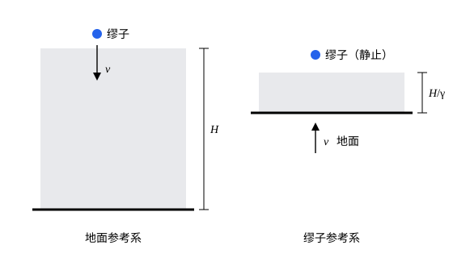

## 这一节要回答的问题

在地面参考系（frame of reference）里，缪子（muon）能飞到地面，是因为它的钟走慢了。可在缪子自己的参考系里，它的钟一点也不慢，平均只活$2.2\,\mu\mathrm s$。缪子会怎样解释自己在这么短的时间里穿过了十几千米厚的大气层？

## 讲解

### 运动物体的长度

静止的物体量长度很简单：拿尺子比，两端的读数什么时候记都一样。物体在运动时，两端的位置时刻在变，要是先记前端、过一会儿再记后端，记下的距离里就混进了这段时间的位移。

::anchor{id="def-moving-length"}
在一个:term[惯性系]{id="physics.special-relativity.inertial-frame"}（inertial frame）里，在同一时刻（按这个惯性系里:term[同步]{id="physics.special-relativity.synchronization"}（synchronized）的钟）记下物体沿某个方向的两端的位置，两点之间的距离叫作物体在这个惯性系里沿这个方向的长度。

为什么这样定义：只有两端同时记，量到的才是物体本身的长短，不掺进位移。物体静止时，什么时候记都一样，这个定义就是平常的量法。边界情况：「同时」是相对的（见[同时的相对性](lesson:physics.special-relativity.relativity-of-simultaneity)），不同的惯性系对「两端同时」的理解不同，所以没有理由认为它们量出的长度一样。

::anchor{id="def-proper-length"}
物体在它静止的惯性系里的长度，叫作它的:term[固有长度]{id="physics.special-relativity.proper-length"}（proper length）。

为什么这样定义：在物体静止的惯性系里，长度和记录时刻无关，这个数只属于物体自己，适合用来和别的惯性系量到的结果比较。边界情况：一个物体如果各部分相对运动（比如在拉伸），就没有一个让它整个静止的惯性系，这时谈不上固有长度。

### 长度收缩公式

::anchor{id="thm-length-contraction"}
定理（:term[长度收缩]{id="physics.special-relativity.length-contraction"}，length contraction）：一根杆沿$x$轴放置，:term[固有长度]{id="physics.special-relativity.proper-length"}为$L$，在:term[惯性系]{id="physics.special-relativity.inertial-frame"}$S$里沿$x$轴以速度$v$运动，那么它在$S$里的长度是$\ell=\frac{L}{\gamma}$，$\gamma$是:term[洛伦兹因子]{id="physics.special-relativity.lorentz-factor"}（Lorentz factor）；垂直于运动方向的长度不变。

证明：在$S$里$x=0$处放一只静止的钟，考虑两个:term[事件]{id="physics.special-relativity.event"}（event）：杆的前端经过这只钟（事件 1），杆的后端经过这只钟（事件 2）。在$S$里杆的两端以同一速度$v>0$运动，取$S$里杆还没到达那只钟的某一时刻，两端位于$x_{\text{后}}<x_{\text{前}}<0$，两者之差就是$\ell$；此后前端再走$-x_{\text{前}}$到达$x=0$，后端再走$-x_{\text{后}}$，所以两个事件相隔$\Delta t=\frac{x_{\text{前}}-x_{\text{后}}}{v}=\frac{\ell}{v}$。这两个事件在$S$里都发生在$x=0$，$\Delta t$是它们之间的:term[固有时]{id="physics.special-relativity.proper-time"}（proper time）。

在杆静止的惯性系$S'$里，那只钟以速度$v$从杆的前端走到后端，走过的距离是固有长度$L$，所以两个事件在$S'$里相隔$\Delta t'=\frac{L}{v}$。按:term[时间延缓]{id="physics.special-relativity.time-dilation"}（time dilation），$\Delta t'=\gamma\Delta t$，即$\frac Lv=\gamma\frac{\ell}{v}$，得$\ell=\frac{L}{\gamma}$。横向长度不变，在[时间延缓](lesson:physics.special-relativity.time-dilation)里已经证过。

这个效应也是相互的：$S$里静止的尺子，在$S'$里量同样缩短为$\frac1\gamma$。它不是物体受到挤压，杆里没有任何应力（stress）；变的是「两端同时」这个判断，量法相同、结果不同。19 世纪末，菲茨杰拉德（George FitzGerald，1889 年）和洛伦兹（Hendrik Lorentz，1892 年）为了解释迈克耳孙-莫雷实验（Michelson–Morley experiment）的零结果（null result），提出过运动物体沿运动方向缩短的假说，他们把它看作以太（ether）对物体的真实作用；在相对论里，它是两条基本假设的推论，例 2 用它重新算一遍那个实验。

## 几何图像

左边是地面参考系：大气层厚$H$，缪子以$v$向下飞，它的钟走慢了，所以能飞完全程。右边是缪子参考系：缪子不动，大气层和地面以$v$向上冲来，沿运动方向收缩成$\frac{H}{\gamma}$，缪子在平常的寿命里就等到了地面。两种说法描述的是同一组:term[事件]{id="physics.special-relativity.event"}，结论一致（图中的比例只是示意）。

## 例题

### 例 1　缪子参考系里的大气层

接[时间延缓](lesson:physics.special-relativity.time-dilation)的例 1：缪子在离地面$15\,\mathrm{km}$处产生，以$0.998c$竖直向下飞行，静止时平均寿命（mean lifetime）$2.2\,\mu\mathrm s$。在缪子参考系里，从产生处到地面有多远？地面飞到缪子跟前要多长时间？

**为什么想到这么做**：在缪子参考系里，地面和大气以$0.998c$运动，$15\,\mathrm{km}$是在地面静止时量的:term[固有长度]{id="physics.special-relativity.proper-length"}，沿运动方向收缩为$\frac1\gamma$。

**推导**：$\gamma=\frac{1}{\sqrt{1-0.998^2}}\approx15.8$，距离$\frac{15\,\mathrm{km}}{15.8}\approx0.95\,\mathrm{km}$，地面以$0.998c$飞来，用时$\frac{950\,\mathrm m}{0.998\times3.0\times10^8\,\mathrm{m/s}}\approx3.2\,\mu\mathrm s$，只比平均寿命长一些，相当一部分缪子能等到地面。地面参考系里飞行时间是$\frac{15\,\mathrm{km}}{0.998c}\approx50\,\mu\mathrm s$，除以$\gamma$也是约$3.2\,\mu\mathrm s$：两个参考系用不同的说法，算出同一个:term[固有时]{id="physics.special-relativity.proper-time"}。

### 例 2　以太参考系里重算迈克耳孙-莫雷实验

迈克耳孙干涉仪（interferometer）的两臂在仪器静止时都长$L$，仪器相对某个:term[惯性系]{id="physics.special-relativity.inertial-frame"}（以前设想的以太系）以$v$运动，臂 1 沿运动方向，臂 2 垂直于运动方向。在这个惯性系里计入:term[长度收缩]{id="physics.special-relativity.length-contraction"}，两束光往返的时间还有差别吗？

**为什么想到这么做**：[相对性原理与光速不变](lesson:physics.special-relativity.postulates)的例 1 在以太系里算过往返时间，那时没有考虑臂 1 会缩短。在任何惯性系里光速都是$c$，只要把臂 1 的长度换成$\frac{L}{\gamma}$。

**推导**：臂 1 在这个惯性系里长$\frac{L}{\gamma}$，往返时间$\frac{2L/\gamma}{c}\cdot\frac{1}{1-v^2/c^2}=\frac{2L}{c}\gamma$；臂 2 横向长度不变，往返时间仍是$\frac{2L}{c}\gamma$。两者严格相等，转动仪器也不会有条纹移动，和实验的零结果一致；臂取任何方向都是这样（见 p6）。在仪器静止的参考系里看就更简单：光沿两臂的速率都是$c$，臂长相等，时间当然相等。

## 常见误区

- 「:term[长度收缩]{id="physics.special-relativity.length-contraction"}是物体被压扁了。」物体里没有应力，原子之间也没有被挤近；它在自己静止的参考系里长度照旧，缩短是另一个:term[惯性系]{id="physics.special-relativity.inertial-frame"}按自己的「同时」量出来的结果。
- 「运动的物体拍下照片，会显出被压扁的样子。」照片记录的是同时到达相机的光，物体各部分发出这些光的时刻不同；把光的传播时间算进去，远处的高速物体在照片上看起来像是转了一个角度，而不是变扁（1959 年特雷尔（James Terrell）和彭罗斯（Roger Penrose）分别指出）。
- 「垂直于运动方向的长度也会收缩。」横向长度不变；只有沿运动方向的长度缩短为$\frac1\gamma$。
- 「$\ell=\frac{L}{\gamma}$里哪个是:term[固有长度]{id="physics.special-relativity.proper-length"}可以随便定。」固有长度是物体静止时的长度，它总是较大的那个；先找出物体在哪个惯性系里静止。
