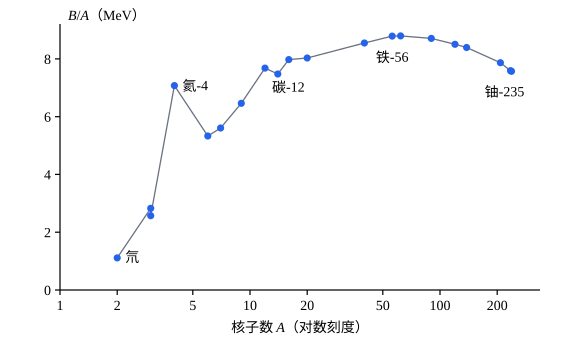

## 这一节要回答的问题

质点的能量$E=\gamma_umc^2$在速度为零时并不是零，而是$mc^2$。这只是一个可以随便挑的零点，还是实实在在、能放出来的能量？上一节两个小球迎面相撞、粘在一起，合成的物体质量比两球之和还大，多出来的质量从哪里来？

## 讲解

### 静能、动能和总能量

::anchor{id="def-rest-energy"}
质点静止时的能量$E_0=mc^2$叫作它的:term[静能]{id="physics.special-relativity.rest-energy"}（rest energy）；质点的能量$E=\gamma_umc^2$也叫总能量（total energy），它和静能之差$K=E-mc^2=(\gamma_u-1)mc^2$叫作动能（kinetic energy）。

为什么这样定义：速度低时$\gamma_u-1\approx\frac{u^2}{2c^2}$，$K\approx\frac12mu^2$，正是牛顿力学的动能；而$E$里不随速度变的那一部分$mc^2$，是质点静止时也有的能量。由:term[能量-动量关系]{id="physics.special-relativity.energy-momentum-relation"}（energy–momentum relation），$E^2=(K+mc^2)^2=p^2c^2+m^2c^4$，所以$pc=\sqrt{K^2+2Kmc^2}$，知道动能就能求动量。边界情况：动能不是$\frac12\gamma_umu^2$；$u\to c$时$K\to\infty$，所以有质量的质点要加速到光速，需要无穷多的能量。

### 质能关系

上一节例 2 里，两个质量为$m$的小球以$\pm0.6c$相撞、粘在一起，合成的物体质量是$2.5m$：碰撞前两球的动能共$0.5mc^2$，碰撞后物体静止，动能没了，质量多了$0.5m$。下面的定理说明这不是巧合。

::anchor{id="thm-mass-energy"}
定理（:term[质能关系]{id="physics.special-relativity.mass-energy-equivalence"}，mass–energy equivalence）：一个静止的物体放出能量$\Delta E$以后若仍然静止，它的质量减少$\frac{\Delta E}{c^2}$；吸收能量$\Delta E$以后若仍然静止，质量增加$\frac{\Delta E}{c^2}$。

证明：设物体（质量$M$）沿$+x$、$-x$方向各放出一个能量为$\frac{\Delta E}2$的光子，光子是:term[无质量粒子]{id="physics.special-relativity.massless-particle"}（massless particle），:term[四维动量]{id="physics.special-relativity.four-momentum"}（four-momentum）分别是$\bigl(\frac{\Delta E}{2c},\pm\frac{\Delta E}{2c},0,0\bigr)$。两个光子的动量相抵，由四维动量守恒，物体仍然静止，设质量变为$M'$。比较时间分量：$Mc=M'c+\frac{\Delta E}{c}$，即$M-M'=\frac{\Delta E}{c^2}$。吸收的情形把过程倒过来看即可；放出的能量不论是什么形式，只要总动量为零、总能量为$\Delta E$，四维动量就是$\bigl(\frac{\Delta E}c,0,0,0\bigr)$，结论相同。

反过来说，一个物体整体静止时，它的质量$M$乘以$c^2$等于它内部的全部能量：各部分的:term[静能]{id="physics.special-relativity.rest-energy"}、各部分相对运动的动能、它们之间相互作用的能量，都算在内。所以质量不是各部分质量的简单相加，加热一块铁、给弹簧上紧，它们的质量都会增加，只是增加得太少，平常察觉不到（见 p8）。

1905 年，爱因斯坦（Albert Einstein）在一篇只有三页的短文《物体的惯性同它所含的能量有关吗？》（Ist die Trägheit eines Körpers von seinem Energieinhalt abhängig?）里用两束反向的光证明了这一点：物体以光的形式放出能量$L$，质量就减少$\frac{L}{c^2}$。他由此认为，物体的质量是它所含能量的量度。

### 结合能与质量亏损

::anchor{id="def-nucleon"}
原子核（atomic nucleus）由质子和中子组成，它们统称核子（nucleon）。

为什么要有这个名字：质子和中子的质量相差只有约$0.14\%$，在核里都受核力（nuclear force）束缚，而核力几乎不分质子和中子，所以常把它们一并看待；要把核拆开，就得克服核力给它能量。边界情况：氢-1 的核只有一个质子，没有可以拆开的核子。

::anchor{id="def-binding-energy"}
把一个原子核拆成彼此远离、静止的质子和中子，至少要给它的能量，叫作这个核的:term[结合能]{id="physics.special-relativity.binding-energy"}（binding energy），记作$B$；由:term[质能关系]{id="physics.special-relativity.mass-energy-equivalence"}，核的质量比组成它的核子的质量之和少$\Delta m=\frac{B}{c^2}$，这个差叫作:term[质量亏损]{id="physics.special-relativity.mass-defect"}（mass defect）。

为什么这样定义：结合能衡量核结合得多紧，而它不用直接去拆核来量，比较质量就能算出来：拆开后各核子静止，总能量是$\sum m_ic^2$，拆开前核静止，能量是$Mc^2$，两者之差就是要补的能量。平均到每个核子上的结合能（binding energy per nucleon）$\frac BA$（$A$是核子数）在铁、镍附近最大（见几何图像）。边界情况：原子、分子也有结合能，例如氢原子是$13.6\,\mathrm{eV}$，只占它质量对应能量的$10^{-8}$量级，所以化学反应里的质量变化测不出来。

### 反应能

::anchor{id="def-q-value"}
反应$a+b\to c+d$前后，$Q=(m_a+m_b-m_c-m_d)c^2$叫作这个反应的:term[反应能]{id="physics.special-relativity.q-value"}（Q value）；参加反应的粒子不止两个时，同样用反应前后的质量之和相减。

为什么这样定义：每个粒子的能量是:term[静能]{id="physics.special-relativity.rest-energy"}加动能，$E=mc^2+K$；能量守恒要求$\sum(m_ic^2+K_i)$在反应前后相等，所以反应后总动能增加了$\sum K_{\text{后}}-\sum K_{\text{前}}=Q$。$Q>0$的反应放出能量，产物飞得比反应物快；$Q<0$的反应要外界给它动能才能发生。边界情况：放出的能量也可能被光子带走，光子的质量是零，它的能量全算在「动能」那一边。

这种「质量少了多少，就放出多少能量」的算法有过很多次检验。1932 年，考克饶夫（John Cockcroft）和沃尔顿（Ernest Walton）用加速器（accelerator）加速的质子打锂，锂-7 核变成两个氦核，放出约$17\,\mathrm{MeV}$的能量，这是早期的一次检验。2005 年的一个实验把中子被硅、硫的原子核俘获时放出的γ射线（gamma ray）的能量，和用离子阱（ion trap）测出的反应前后的质量差相比，两者在$4\times10^{-7}$的精度内相等。

## 几何图像

:::anim{component="function-plot"}
range: { x: [0, 1], y: [0, 3] }
functions:
  - expr: "1/sqrt(1 - x^2) - 1"
    label: |
      相对论：$K=(\gamma_u-1)mc^2$
  - expr: "x^2/2"
    label: |
      牛顿力学：$K=\frac12mu^2$
points:
  - { x: "u", y: "1/sqrt(1 - u^2) - 1" }
sliders:
  - name: u
    min: 0
    max: 0.95
    step: 0.01
    default: 0.5
    label: |
      速度$u/c$
:::

横轴是$\frac uc$，纵轴是动能，以$mc^2$为单位。速度小时两条曲线重合；速度越接近光速，相对论的动能越往上翘，$u\to c$时趋于无穷，牛顿力学的动能却停在$\frac12mc^2$。

横轴是核子数$A$（对数刻度），纵轴是平均每个核子的:term[结合能]{id="physics.special-relativity.binding-energy"}。轻核聚成较重的核，即聚变（fusion），或重核分成两个中等的核，即裂变（fission），都朝曲线的高处走，产物结合得更紧，质量之和更小，多出的能量就放出来了（见 p6）。

## 例题

### 例 1　氘核的结合能

氘核（deuteron）由一个质子和一个中子组成。已知$m_pc^2=938.272\,\mathrm{MeV}$，$m_nc^2=939.565\,\mathrm{MeV}$，氘核的$m_dc^2=1875.613\,\mathrm{MeV}$。求氘核的:term[结合能]{id="physics.special-relativity.binding-energy"}，以及:term[质量亏损]{id="physics.special-relativity.mass-defect"}占氘核质量的比例。

**为什么想到这么做**：按定义，结合能就是拆开前后的能量差，也就是质量差乘以$c^2$；三个质量都已经以$\mathrm{MeV}/c^2$给出，直接相减。

**推导**：$B=(m_p+m_n-m_d)c^2=938.272+939.565-1875.613=2.224\,\mathrm{MeV}$。质量亏损只占氘核质量的$\frac{2.224}{1875.613}\approx0.12\%$。反过来，一个慢中子被质子俘获、结合成氘核时，放出一个能量约$2.22\,\mathrm{MeV}$的光子（photon），测它的能量就能检验:term[质能关系]{id="physics.special-relativity.mass-energy-equivalence"}。

### 例 2　氘氚聚变

氘核和氚核（triton，由一个质子、两个中子组成）聚变：$\mathrm d+\mathrm t\to{}^4\mathrm{He}+\mathrm n$。已知$m_tc^2=2808.921\,\mathrm{MeV}$，氦-4 核的$m_\alpha c^2=3727.379\,\mathrm{MeV}$，其余质量同例 1。求这个反应的:term[反应能]{id="physics.special-relativity.q-value"}，以及$1\,\mathrm{kg}$氘氚燃料全部反应放出的能量。

**为什么想到这么做**：反应能是反应前后的质量差乘以$c^2$；放出的能量占燃料能量$mc^2$的比例，每次反应都一样，乘上$1\,\mathrm{kg}$燃料的:term[静能]{id="physics.special-relativity.rest-energy"}就是总量。

**推导**：$Q=(1875.613+2808.921-3727.379-939.565)\,\mathrm{MeV}=17.590\,\mathrm{MeV}$。每次反应的燃料是$1875.613+2808.921=4684.534\,\mathrm{MeV}/c^2$，放出的能量占$\frac{17.590}{4684.534}\approx0.375\%$。$1\,\mathrm{kg}$燃料的静能是$1\times(3.00\times10^8)^2\,\mathrm J=9.0\times10^{16}\,\mathrm J$，放出约$3.4\times10^{14}\,\mathrm J$，是燃烧$1\,\mathrm{kg}$煤（约$3\times10^7\,\mathrm J$）的一千万倍左右。

## 常见误区

- 「核反应把质量转化成了能量。」能量是守恒的，:term[静能]{id="physics.special-relativity.rest-energy"}本来就是能量的一部分；反应把一部分静能变成了动能，变的是质量之和，不是能量之和（见 p7）。
- 「只有核反应才有:term[质量亏损]{id="physics.special-relativity.mass-defect"}。」化学反应、加热、压缩弹簧都会改变质量，只是变化小到测不出来。
- 「动能是$\frac12\gamma_umu^2$。」相对论的动能是$(\gamma_u-1)mc^2$，只在低速时近似等于$\frac12mu^2$。
- 「物体的质量等于组成它的各部分的质量之和。」物体的质量还包括内部的动能和相互作用的能量，结合得越紧，质量越小。
- 「:term[结合能]{id="physics.special-relativity.binding-energy"}是核里储存着、可以放出来的能量。」结合能是拆开核要付出的能量；它越大，核越稳定，放能的反应是让产物的结合能之和变大。
