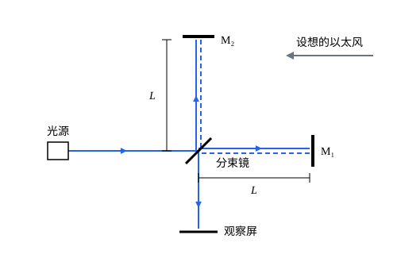

## 这一节要回答的问题

在匀速行驶、拉上窗帘的火车里，做任何力学实验都看不出车在动。光是不是也这样？如果光只相对某种介质以速度$c$传播，在地面和在火车上测得的光速就该不同，用光就能分辨出谁在「真正」运动。19 世纪末的实验给出的答案却是：测不出来。

## 讲解

### 惯性系、事件与世界线

描述运动要先选参考系（frame of reference）：一套刚性的尺子确定位置，一套钟确定时刻。

::anchor{id="def-inertial-frame"}
不受力的物体在其中保持静止或做匀速直线运动的参考系，叫作:term[惯性系]{id="physics.special-relativity.inertial-frame"}（inertial frame）。

为什么这样定义：牛顿第一定律（Newton's first law）只在这样的参考系里成立；相对一个惯性系做匀速直线运动的参考系也是惯性系，相对它加速或转动的就不是（见[牛顿运动定律](lesson:physics.newtonian-mechanics.newtons-laws)）。惯性系有无穷多个，下面会看到，物理定律不偏爱其中任何一个。边界情况：地面只是近似的惯性系，地球自转使赤道上的地面有约$0.034\,\mathrm{m/s^2}$的向心加速度，在短时间、小范围的实验里可以忽略。

::anchor{id="def-event"}
在某个地点、某个时刻发生的一件事，例如一次闪光、两个粒子相撞，叫作一个:term[事件]{id="physics.special-relativity.event"}（event）；在一个惯性系里，它由四个数$(t,x,y,z)$确定。

为什么这样定义：相对论讨论的都是事件之间的关系。事件本身和参考系无关，闪光就是闪光，不同的惯性系只是给同一个事件不同的坐标。边界情况：一个物体不是事件，它在每个时刻都有一个位置，经过一连串事件。

::anchor{id="def-worldline"}
一个质点经过的全部事件组成的集合，叫作它的:term[世界线]{id="physics.special-relativity.worldline"}（world line）；在一个惯性系里，它由位置随时间变化的函数$\vb r(t)$给出。

为什么这样定义：它把「物体在运动」换成了「一串事件」，这样就能谈不同的惯性系怎样看同一段运动。静止在原点的质点，世界线是$x=y=z=0$、$t$任意的那些事件；匀速运动的质点，世界线上$x=x_0+ut$。边界情况：两条世界线相交，就是两个质点在同一时刻到了同一地点，比如相撞，这是一个事件，和参考系无关。

### 伽利略变换

::anchor{id="def-standard-configuration"}
:term[惯性系]{id="physics.special-relativity.inertial-frame"}$S'$相对$S$以速度$v$沿$x$轴正方向运动，两套坐标轴两两平行，并且$t=t'=0$时两个原点重合，这样的两个惯性系叫作处于:term[标准位形]{id="physics.special-relativity.standard-configuration"}（standard configuration）。

为什么这样约定：任何两个惯性系，转一转坐标轴、挪一挪原点和计时零点，都能摆成这个样子，而相对运动的方向沿$x$轴时公式最简单。以后两个惯性系不加说明时都按标准位形摆放。边界情况：$v$可以是负数，表示$S'$沿$x$轴负方向运动；$v=0$时两个惯性系的坐标完全一样。

牛顿力学用伽利略变换（Galilean transformation）在标准位形的两个惯性系之间换算同一个:term[事件]{id="physics.special-relativity.event"}的坐标：

$$
t'=t ,\qquad x'=x-vt ,\qquad y'=y ,\qquad z'=z .
$$

对时间求导，速度的换算是$u_x'=u_x-v$、$u_y'=u_y$、$u_z'=u_z$；再求一次导，加速度不变。物体之间的作用力只依赖它们的相对位置和相对速度，这些在两个惯性系里一样，所以$\vb F=m\vb a$在两个惯性系里形式相同：做力学实验分辨不出哪个惯性系在「真正」运动（详细的论证见 p5）。

### 光速的困难

麦克斯韦方程组（Maxwell's equations）预言电磁波（electromagnetic wave）在真空中以$c=1/\sqrt{\mu_0\varepsilon_0}\approx3.00\times10^8\,\mathrm{m/s}$传播，光就是电磁波（见[真空中的电磁波](lesson:physics.electromagnetism.em-waves)）。方程里只出现$c$，没有说是相对什么的速度。

::anchor{id="thm-galilean-light"}
定理（伽利略变换和光速不能两全）：如果伽利略变换成立，并且$v\ne0$，那么不可能在$S$和$S'$里，沿每个方向传播的光速都是$c$。

证明：设在$S$里沿$x$轴正方向和负方向各有一束光，速度分别是$u_x=c$和$u_x=-c$。按伽利略变换，在$S'$里它们的速度是$u_x'=c-v$和$u_x'=-c-v$，速率分别是$|c-v|$和$|c+v|$。$v\ne0$时这两个数不相等，所以它们不可能都等于$c$。

这就留下三条路：电磁学只在某一个特殊的:term[惯性系]{id="physics.special-relativity.inertial-frame"}里成立，那里光速是$c$；或者麦克斯韦方程组要修改；或者伽利略变换要修改。19 世纪的物理学家多数相信第一条：空间里充满传光的以太（ether），那个特殊的惯性系就是以太静止的参考系。它给出了可以检验的预言：地球绕太阳以约$30\,\mathrm{km/s}$运动，相对以太的速度一年之中总有一段时间不为零，沿不同方向传播的光应当快慢不同。1887 年迈克耳孙（Albert Michelson）和莫雷（Edward Morley）用干涉仪（interferometer）做了这个实验，预期的效应比仪器能分辨的大几十倍，结果却没有看到（例 1）。

### 两条基本假设

1905 年，爱因斯坦（Albert Einstein）在《论动体的电动力学》（Zur Elektrodynamik bewegter Körper，6 月 30 日收稿，同年 9 月发表在《物理年鉴》上）里选了第三条路，把下面两条当作出发点。

::anchor{id="def-principle-of-relativity"}
假设一（:term[相对性原理]{id="physics.special-relativity.principle-of-relativity"}，principle of relativity）：物理定律在所有:term[惯性系]{id="physics.special-relativity.inertial-frame"}里形式相同，任何实验都分辨不出哪个惯性系「真正静止」。

::anchor{id="def-light-postulate"}
假设二（:term[光速不变原理]{id="physics.special-relativity.light-postulate"}，constancy of the speed of light）：真空中的光速在所有惯性系里都是$c$，和光源的运动无关。

为什么这样假设：假设一把力学里已经成立的相对性推广到电磁学和全部物理，不再有以太那样的特殊参考系；假设二是实验直接告诉我们的。最干净的检验之一是 1964 年在欧洲核子研究中心（CERN）做的：速度不低于$0.99975c$的$\pi^0$介子（neutral pion）衰变放出光子（photon），测得光子的速度是$(2.9977\pm0.0004)\times10^8\,\mathrm{m/s}$，和静止光源发的光一样。边界情况：两条假设合起来和伽利略变换矛盾（上面的定理），所以要换掉的是伽利略变换，代价是时间不再是各个惯性系共用的，这是后面几节的内容。

## 几何图像

光被分束镜（beam splitter）分成两束，一束沿水平的臂到$M_1$再返回，一束沿竖直的臂到$M_2$再返回，回到分束镜后一起射向观察屏，两束光的路程差决定屏上的干涉条纹（interference fringe）。如果仪器随地球在以太里运动，「以太风」（ether wind）会使两条臂的往返时间略有不同；把整台仪器转$90^\circ$，两条臂的角色互换，条纹应当移动。实验看到的移动不到预期的二十分之一。

## 例题

### 例 1　迈克耳孙-莫雷实验的预期

设仪器以速度$v$相对以太运动，臂 1 沿运动方向，臂 2 垂直于运动方向，两臂长都是$L$。按以太理论（以太里光速是$c$，速度按伽利略变换合成），求两束光往返时间之差；再估计把仪器转$90^\circ$时条纹移动多少条，取$L=11\,\mathrm{m}$（光多次反射后的有效臂长）、$\lambda=5.5\times10^{-7}\,\mathrm{m}$、$v=3\times10^4\,\mathrm{m/s}$。

**为什么想到这么做**：在以太参考系里光速处处是$c$，仪器在动，所以在以太系里算光追镜子、镜子迎光的时间最方便。转$90^\circ$后两臂互换，时间差反号，条纹移动的条数是总的时间差乘以光的频率$c/\lambda$。

**推导**：臂 1：去程光相对仪器的速度是$c-v$，回程是$c+v$，往返时间$t_1=\frac{L}{c-v}+\frac{L}{c+v}=\frac{2L}{c}\cdot\frac{1}{1-v^2/c^2}$。臂 2：在以太系里，光要斜着走才能追上横向移动的镜子，去程和回程都走长为$\frac{c\,t_2}{2}$的斜边，仪器同时移动$\frac{v\,t_2}{2}$，由勾股定理$\bigl(\frac{ct_2}{2}\bigr)^2=L^2+\bigl(\frac{vt_2}{2}\bigr)^2$，所以$t_2=\frac{2L}{c}\cdot\frac{1}{\sqrt{1-v^2/c^2}}$。$v\ll c$时，$t_1-t_2\approx\frac{2L}{c}\bigl(1+\frac{v^2}{c^2}\bigr)-\frac{2L}{c}\bigl(1+\frac{v^2}{2c^2}\bigr)=\frac{L}{c}\cdot\frac{v^2}{c^2}$。

转$90^\circ$后时间差变成$-\frac{L}{c}\cdot\frac{v^2}{c^2}$，总共变化$\frac{2L}{c}\cdot\frac{v^2}{c^2}$，条纹移动$N=\frac{c}{\lambda}\cdot\frac{2Lv^2}{c^3}=\frac{2Lv^2}{\lambda c^2}=\frac{2\times11\times10^{-8}}{5.5\times10^{-7}}=0.4$条。迈克耳孙和莫雷估计仪器能分辨约$0.01$到$0.02$条，实测的移动肯定小于预期值的二十分之一，很可能小于四十分之一。

### 例 2　伽利略变换下横向传播的光

在$S$里一束光沿$y$轴正方向传播。按伽利略变换，在:term[标准位形]{id="physics.special-relativity.standard-configuration"}的$S'$里它的速度是多少、往哪个方向？

**为什么想到这么做**：速度按伽利略变换逐个分量换算，$x$分量减去$v$，$y$分量不变。

**推导**：在$S$里$u_x=0$、$u_y=c$；在$S'$里$u_x'=-v$、$u_y'=c$，速率$\sqrt{c^2+v^2}>c$，方向向$x$轴负方向偏过一个角$\theta$，$\tan\theta=\frac vc$。按:term[光速不变原理]{id="physics.special-relativity.light-postulate"}，$S'$里这束光的速率仍应是$c$，伽利略变换在横向也和它冲突；方向确实会偏，天文上观测到的光行差（aberration of light）就来自这种偏转，正确的偏角要用相对论的:term[速度变换]{id="physics.special-relativity.velocity-transformation"}（velocity transformation）来算（见[速度变换](lesson:physics.special-relativity.velocity-transformation)）。

## 常见误区

- 「:term[相对性原理]{id="physics.special-relativity.principle-of-relativity"}是说一切都是相对的。」它说的是物理定律在各个:term[惯性系]{id="physics.special-relativity.inertial-frame"}里相同。有些量在所有惯性系里都一样，真空光速就是一个；以后还会看到别的。
- 「光速不变是说光在任何介质里都以$c$传播。」只说真空中。光在水里的速度约是$c/1.33$，而且在不同的惯性系里测得的值不同。
- 「迈克耳孙-莫雷实验直接证明了光速和光源的运动无关。」它说明的是测不出以太风；光速和光源运动无关，要靠运动光源的实验检验，例如上面说的 1964 年的实验。
- 「惯性系就是静止的参考系。」没有绝对的静止；相对一个惯性系匀速直线运动的参考系都是惯性系，地面、匀速行驶的火车都可以近似地当作惯性系。
