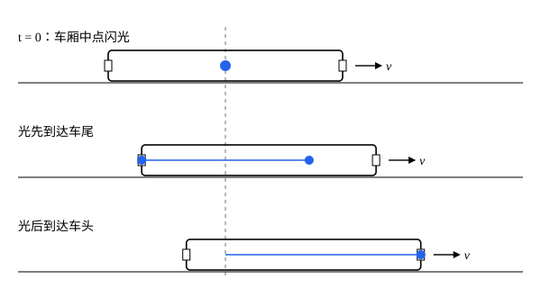

## 这一节要回答的问题

「两件事同时发生」看起来不需要解释。可是两件事发生在不同地点时，要判断是否同时，得先把两地的钟对准，而对钟要传信号，信号又要花时间。用光来对钟，再加上:term[光速不变原理]{id="physics.special-relativity.light-postulate"}（constancy of the speed of light），会得出什么？

## 讲解

### 用光对钟

在一个:term[惯性系]{id="physics.special-relativity.inertial-frame"}（inertial frame）的每个地点都放一只静止的钟，钟的构造相同，走得一样快。剩下的问题是把它们的读数对准：A 处的钟和 B 处的钟相隔一段距离，不能拿到一起比。

::anchor{id="def-synchronization"}
从 A 在 A 钟读数为$t_A$时发出一束光，光到达 B 时 B 钟读数为$t_B$并立即被反射，回到 A 时 A 钟读数为$t_A'$；如果$t_B=\frac{t_A+t_A'}{2}$，就说这两只钟是:term[同步]{id="physics.special-relativity.synchronization"}（synchronized）的。

为什么这样定义：在这个惯性系里，光去程和回程走的距离一样，按:term[光速不变原理]{id="physics.special-relativity.light-postulate"}速率也都是$c$，所用的时间相等，所以光到达 B 的时刻正好在发出和收回的正中间。这个办法只用到光和静止的钟，不需要事先知道两地「真正」的时刻。爱因斯坦（Albert Einstein）在 1905 年的论文里把它当作同时的定义；庞加莱（Henri Poincaré）1900 年已经讨论过用光信号对钟，但仍认为只有相对以太（ether）静止的钟才给出「真正」的时间。边界情况：同步是在一个惯性系里定义的，用的是在这个惯性系里静止的钟和这个惯性系里的光速；在另一个惯性系里同步，要用那个惯性系里静止的钟重做一遍，下面会看到结果不同。

钟对准以后，惯性系里每个:term[事件]{id="physics.special-relativity.event"}（event）的时刻$t$，就是当地那只钟在事件发生时的读数。

::anchor{id="def-simultaneous"}
在一个惯性系里，如果两个事件发生时当地同步好的钟读数相同，就说这两个事件在这个惯性系里同时（simultaneous）。

为什么这样定义：发生在同一地点的两个事件，同一只钟就能判断是否同时；不同地点的，只能靠同步好的钟。下面的判别法把「同时」直接翻译成光信号：

::anchor{id="thm-midpoint-criterion"}
定理（中点判别法）：设两个事件分别发生在惯性系里静止的 A、B 两点，M 是线段 AB 的中点。这两个事件在这个惯性系里同时，当且仅当它们各自发出的光同时到达 M。

证明：设 AB 长$2d$，两个事件的时刻分别是$t_1$、$t_2$。在这个惯性系里光速是$c$，两束光到达 M 的时刻分别是$t_1+\frac dc$和$t_2+\frac dc$。这两个时刻相等当且仅当$t_1=t_2$。

### 同时的相对性

::anchor{id="thm-relativity-of-simultaneity"}
定理（:term[同时的相对性]{id="physics.special-relativity.relativity-of-simultaneity"}，relativity of simultaneity）：设:term[惯性系]{id="physics.special-relativity.inertial-frame"}$S'$相对$S$以速度$v\ne0$运动。在$S'$里同时、沿运动方向相隔一段距离发生的两个:term[事件]{id="physics.special-relativity.event"}，在$S$里不同时：沿运动方向靠后的那个事件先发生。

证明：设两个事件 P、Q 在$S'$里同时发生，地点是$S'$里一节沿运动方向放置的静止车厢的车尾和车头，车厢中点到两端的距离都是$d$。在 P、Q 发生之前$\frac dc$（按$S'$的钟）在车厢中点闪光，按中点判别法，光在 P、Q 发生的时刻正好到达车尾和车头；光到达车尾和 P 发生在同一地点、同一时刻，是同一个事件，在任何惯性系里都是，车头同理。所以只要看$S$里光到达车尾、车头的先后。

在$S$里，车厢以速度$v$运动，长度记作$\ell$。车厢的前半节和后半节构造相同、运动相同，在$S$里一样长，所以闪光仍发生在车厢的中点。取闪光时$t=0$、闪光位置$x=0$，车尾在$x=-\frac\ell2+vt$，车头在$x=\frac\ell2+vt$；按:term[光速不变原理]{id="physics.special-relativity.light-postulate"}，两束光在$S$里的速率都是$c$。

向后的光在$-ct=-\frac\ell2+vt$时追上车尾，$t_{\text{尾}}=\frac{\ell}{2(c+v)}$；向前的光在$ct=\frac\ell2+vt$时追上车头，$t_{\text{头}}=\frac{\ell}{2(c-v)}$。$v>0$时$t_{\text{尾}}<t_{\text{头}}$，相差$t_{\text{头}}-t_{\text{尾}}=\frac{\ell v}{c^2-v^2}\ne0$。所以这两个事件在$S$里不同时，靠后的车尾那个先发生；$v<0$时同样的计算表明，沿运动方向靠后的仍是先发生的那个。

这个定理用到的只有两条基本假设，没有用到任何关于钟或尺的特殊性质。它说明「同时」不是事件本身的属性，而是事件和惯性系一起决定的；牛顿力学里各个惯性系共用一个时间，这一点在相对论里不再成立。时间差的一般公式要用:term[洛伦兹变换]{id="physics.special-relativity.lorentz-transformation"}（Lorentz transformation）求，见[洛伦兹变换](lesson:physics.special-relativity.lorentz-transformation)。

## 几何图像

三行是站台参考系（frame of reference）$S$里的三个时刻，竖直的虚线标出闪光发生的位置。在$S$里光向两边的速率都是$c$，可车尾迎着光走过来，车头背着光跑开，所以车尾先收到光。在车厢参考系$S'$里车厢不动，两端同时收到光；站台上的人并不认为车上的人测错了，两个:term[惯性系]{id="physics.special-relativity.inertial-frame"}各自用自己:term[同步]{id="physics.special-relativity.synchronization"}好的钟，结论都对。

## 例题

### 例 1　雷击车厢的两端

车厢以速度$v$沿站台向右行驶。站台上的人看到两道闪电同时击中车厢的两端，在站台上留下 A（左）、B（右）两个焦痕，也在车厢两端留下焦痕。车厢中点的乘客认为哪一道闪电先发生？

**为什么想到这么做**：用中点判别法。先在$S$里看光什么时候到达乘客，再回到$S'$里，用乘客在车厢中点、两束光都以$c$传播来判断。

**推导**：在站台系$S$里，两道闪电同时发生，闪电发生时乘客在 AB 的中点。乘客向右运动，迎着 B 来的光、背着 A 来的光，所以先收到 B 的光、后收到 A 的光，这两个「收到」是乘客身上的:term[事件]{id="physics.special-relativity.event"}，和参考系无关。在车厢系$S'$里，乘客一直在车厢两个焦痕的中点，两束光的速率都是$c$；先收到 B 的光，按中点判别法，B 那一端的闪电先发生。站台上同时的两个事件，在车厢里是右边那道先发生；把定理里的$S$和$S'$对调，站台相对车厢向左运动，右边那一端正是沿这个运动方向靠后的，和定理一致。

### 例 2　垂直于运动方向分开的事件

车厢里沿$y'$方向（垂直于运动方向）放两个探测器，到车厢中线上的闪光点距离相等。在车厢系$S'$里两个探测器同时收到光。在站台系$S$里呢？

**为什么想到这么做**：在$S$里看，这两束光的路径关于运动方向那条直线对称，用对称性就够了。

**推导**：在$S$里，两个探测器随车厢向右运动，一个在闪光点上方、一个在下方，距离运动直线一样远。把整个场景沿运动直线做镜面反射，上方的探测器和光路变成下方的，运动方向不变，光速仍是$c$，所以两束光到达的时刻相同。在$S$里这两个:term[事件]{id="physics.special-relativity.event"}也同时：:term[同时的相对性]{id="physics.special-relativity.relativity-of-simultaneity"}只发生在沿运动方向分开的事件之间。

## 常见误区

- 「:term[同时的相对性]{id="physics.special-relativity.relativity-of-simultaneity"}是因为光传过来要花时间，看到的时刻比真正发生的晚。」不是。传播时间已经扣掉了：中点判别法比较的是光同时到达中点，结论说的是:term[事件]{id="physics.special-relativity.event"}本身发生的时刻，和观察者在哪、什么时候看到无关。
- 「两个:term[惯性系]{id="physics.special-relativity.inertial-frame"}里总有一个是对的。」两个惯性系都用自己:term[同步]{id="physics.special-relativity.synchronization"}好的钟，结论都对；没有哪个惯性系更「正确」，这正是:term[相对性原理]{id="physics.special-relativity.principle-of-relativity"}（principle of relativity）的要求。
- 「在一个惯性系里同时的事件，在任何惯性系里都不同时。」同一地点发生的事件，以及垂直于运动方向分开的事件，在两个惯性系里都同时；不同时的是沿运动方向分开的。
