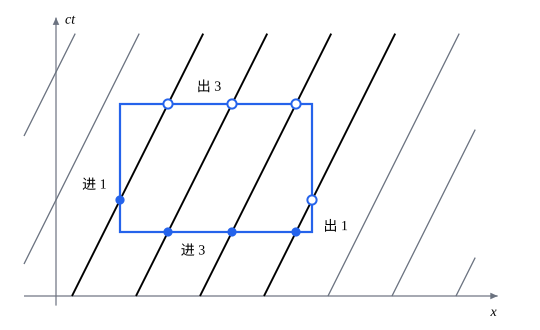

## 这一节要回答的问题

一个质点的能量和动量合成:term[四维动量]{id="physics.special-relativity.four-momentum"}（four-momentum）。一团:term[尘埃]{id="physics.special-relativity.dust"}（dust）、一罐气体、一颗恒星里，物质连续分布，要描述的是单位体积里有多少能量和动量，以及它们怎样从一处流到另一处。单位体积里的能量换一个:term[惯性系]{id="physics.special-relativity.inertial-frame"}（inertial frame）会怎样变？能量守恒、动量守恒在每一点上该怎样写，才能在所有惯性系里都成立？

## 讲解

### 四维张量

两个:term[四维矢量]{id="physics.special-relativity.four-vector"}（four-vector）$A^\mu$、$B^\nu$的分量两两相乘，得到 16 个数$A^\mu B^\nu$。换一个:term[惯性系]{id="physics.special-relativity.inertial-frame"}，它们变成$A'^\mu B'^\nu=\Lambda^\mu{}_\rho\Lambda^\nu{}_\sigma A^\rho B^\sigma$，每个指标各乘一次:term[洛伦兹变换]{id="physics.special-relativity.lorentz-transformation"}（Lorentz transformation）的矩阵。下面会看到，能量密度（energy density）就是这样一个带两个指标的量的分量。

::anchor{id="def-four-tensor"}
16 个量$T^{\mu\nu}$（$\mu,\nu=0,1,2,3$），如果换:term[惯性系]{id="physics.special-relativity.inertial-frame"}时总按$T'^{\mu\nu}=\Lambda^\mu{}_\rho\Lambda^\nu{}_\sigma T^{\rho\sigma}$变换，就叫作一个（二阶）:term[四维张量]{id="physics.special-relativity.four-tensor"}（four-tensor）；把它排成$4\times4$矩阵$T$，第$\mu$行、第$\nu$列是$T^{\mu\nu}$，变换就是$T'=\Lambda T\Lambda\T$。

为什么这样定义：四维矢量的一个指标按一个$\Lambda$变换，张量的每个指标各按一个$\Lambda$变换。两个四维张量在一个惯性系里相等，换到任何惯性系时两边做的是同一个变换，仍然相等，所以写成张量等式的物理定律在所有惯性系里形式相同。用线性代数的话说，$T=T^{\mu\nu}e_\mu\otimes e_\nu$是四维矢量空间和自己的张量积（tensor product）里的元素，$e_\mu$是四个坐标方向的基矢量（basis vector），换基时分量的两个指标各变换一次（见[张量积](lesson:math.linear-algebra.tensor-product)）。边界情况：随便 16 个数排成矩阵不一定是四维张量，例如在每个惯性系里都取$\mathrm{diag}(1,0,0,0)$的那组数就不是，因为$\Lambda(\beta)\,\mathrm{diag}(1,0,0,0)\,\Lambda(\beta)\T$的第$0$行第$1$列是$-\gamma^2\beta\ne0$。

::anchor{id="thm-metric-tensor"}
定理（$\eta$与标量）：（1）$\Lambda\eta\Lambda\T=\eta$，所以:term[闵可夫斯基度规]{id="physics.special-relativity.minkowski-metric"}（Minkowski metric）的分量$\eta^{\mu\nu}$按四维张量的规律变换后不变；（2）对四维张量$T^{\mu\nu}$，$\eta_{\mu\nu}T^{\mu\nu}$是:term[洛伦兹标量]{id="physics.special-relativity.lorentz-scalar"}（Lorentz scalar）。

证明：（1）由[洛伦兹变换保持度规](lesson:physics.special-relativity.four-vectors#thm-metric-preserved)，$\Lambda\T\eta\Lambda=\eta$。两边求逆得$\Lambda^{-1}\eta^{-1}(\Lambda\T)^{-1}=\eta^{-1}$，左乘$\Lambda$、右乘$\Lambda\T$，再用$\eta^{-1}=\eta$，就是$\eta=\Lambda\eta\Lambda\T$。（2）$\eta_{\mu\nu}T'^{\mu\nu}=\Lambda^\mu{}_\rho\,\eta_{\mu\nu}\Lambda^\nu{}_\sigma\,T^{\rho\sigma}=\eta_{\rho\sigma}T^{\rho\sigma}$，最后一步是$\Lambda\T\eta\Lambda=\eta$写成分量。

张量的指标也可以照[四维矢量](lesson:physics.special-relativity.four-vectors#def-lower-index)的办法用度规降下来：$T^\mu{}_\nu=T^{\mu\rho}\eta_{\rho\nu}$，$T_{\mu\nu}=\eta_{\mu\rho}\eta_{\nu\sigma}T^{\rho\sigma}$，它们和$T^{\mu\nu}$描述的是同一个张量。上面的标量就是$T^\mu{}_\mu$：一上一下配对求和，结果和惯性系无关。如果$T^{\mu\nu}=T^{\nu\mu}$，即矩阵$T$是对称的，那么$T'=\Lambda T\Lambda\T$的转置$\Lambda T\T\Lambda\T$还是$T'$，换了惯性系仍然对称。

### 四维梯度

物质连续分布时，能量密度、粒子数密度（number density）这些量随时间和地点变化，是四个坐标的函数。守恒定律要比较它们随时间的变化率和在空间里的散度（divergence），这四个偏导数（partial derivative）也要有相对论的写法。

::anchor{id="def-four-gradient"}
对四个坐标的函数$f$，记$\partial_\mu f=\pdv{f}{x^\mu}$，即$\partial_0=\frac1c\pdv{}{t}$，$(\partial_1,\partial_2,\partial_3)=\nabla$；这四个求导合在一起叫作:term[四维梯度]{id="physics.special-relativity.four-gradient"}（four-gradient），升指标得$\partial^\mu=\eta^{\mu\nu}\partial_\nu$，即$\bigl(\frac1c\pdv{}{t},-\nabla\bigr)$。

为什么这样定义：对$x^0=ct$求导，就是对$t$求导再除以$c$；把四个偏导数排在一起，它们换:term[惯性系]{id="physics.special-relativity.inertial-frame"}时和:term[四维矢量]{id="physics.special-relativity.four-vector"}的下标分量（covariant components，也叫协变分量）一样变换（下面的定理），可以和上标分量配成:term[洛伦兹标量]{id="physics.special-relativity.lorentz-scalar"}。指标写在下面，正是提醒这一点：$\partial_\mu$和上标配对，$\partial^\mu$和下标配对。边界情况：$\partial^\mu$的空间部分是$-\nabla$，不是$\nabla$，这个负号来自:term[度规]{id="physics.special-relativity.minkowski-metric"}。

::anchor{id="thm-four-gradient"}
定理（四维梯度的变换）：换到$x'^\mu=\Lambda^\mu{}_\nu x^\nu$的惯性系，$\partial'_\mu=(\Lambda^{-1})^\nu{}_\mu\,\partial_\nu$，和下标分量的变换一样；所以对随时空点变化的四维矢量$A^\mu$，$\partial_\mu A^\mu=\frac1c\pdv{A^0}{t}+\divg\vb A$是洛伦兹标量，其中$\vb A=(A^1,A^2,A^3)$。

证明：由$x^\nu=(\Lambda^{-1})^\nu{}_\rho\,x'^\rho$和多元复合函数的链式法则（chain rule），$\pdv{f}{x'^\mu}=\pdv{x^\nu}{x'^\mu}\pdv{f}{x^\nu}=(\Lambda^{-1})^\nu{}_\mu\,\partial_\nu f$。$\Lambda$是常数矩阵，可以提到求导外面：$\partial'_\mu A'^\mu=(\Lambda^{-1})^\nu{}_\mu\Lambda^\mu{}_\rho\,\partial_\nu A^\rho=\delta^\nu{}_\rho\,\partial_\nu A^\rho=\partial_\rho A^\rho$，$\delta^\nu{}_\rho$是克罗内克符号（Kronecker delta）。下标分量按$\Lambda^{-1}$变换，见[四维矢量与闵可夫斯基度规](lesson:physics.special-relativity.four-vectors#def-lower-index)。

### 尘埃与粒子数守恒

先看最简单的一种连续分布的物质。

::anchor{id="def-dust"}
一团粒子，如果每一点附近的粒子速度都相同，粒子之间又没有相互作用，就叫作:term[尘埃]{id="physics.special-relativity.dust"}（dust）；在和某一点的粒子一起运动的:term[惯性系]{id="physics.special-relativity.inertial-frame"}里量到的单位体积粒子数，叫作那里的静止数密度（rest number density），记作$n_0$。

为什么这样定义：粒子之间没有相对运动，就没有压强（pressure），气体的压强正来自分子杂乱的运动；没有相互作用，每个粒子都做匀速直线运动。这样每一点只有一个速度$\vb u$，物质的状态由$n_0$和$\vb u$两个随时空点变化的量描述，$n_0$是在粒子的静止系里量的，是:term[洛伦兹标量]{id="physics.special-relativity.lorentz-scalar"}。边界情况：粒子速度略有分散的稀薄气体，分散一大就有压强，不能再当作尘埃，要用下面的:term[理想流体]{id="physics.special-relativity.perfect-fluid"}（perfect fluid）描述。

::anchor{id="thm-number-flux"}
定理（四维粒子流，number-flux four-vector）：在尘埃速度为$\vb u$的地方，$N^\mu=n_0U^\mu=(\gamma_un_0c,\gamma_un_0\vb u)$是:term[四维矢量]{id="physics.special-relativity.four-vector"}；它的时间分量除以$c$是这个惯性系里的数密度$n=\gamma_un_0$，空间分量$n\vb u$是粒子流密度（particle flux density），即单位时间穿过垂直于$\vb u$的单位面积的粒子数。

证明：$n_0$是洛伦兹标量，:term[四维速度]{id="physics.special-relativity.four-velocity"}（four-velocity）$U^\mu=\gamma_u(c,\vb u)$是四维矢量，所以$N^\mu$是四维矢量。取一小块在静止系里体积为$V_0$、含$n_0V_0$个粒子的尘埃，在它以$\vb u$运动的惯性系里，它沿运动方向按:term[长度收缩]{id="physics.special-relativity.length-contraction"}（length contraction）缩成原来的$\frac1{\gamma_u}$，横向不变，体积是$\frac{V_0}{\gamma_u}$，粒子数不变，所以$n=\gamma_un_0$。在$\dd t$时间里穿过垂直于$\vb u$的小面积$\dd a$的粒子，正是以$\dd a$为底、长为$u\,\dd t$的柱体里的那些，共$nu\,\dd t\,\dd a$个，所以粒子流密度是$n\vb u$。

::anchor{id="thm-number-conservation"}
定理（粒子数守恒）：粒子既不产生也不消灭，当且仅当$\partial_\mu N^\mu=0$，即连续性方程（continuity equation）$\pdv nt+\divg(n\vb u)=0$成立；这个方程在一个惯性系里成立，就在所有惯性系里成立。

证明：任取一块固定的区域$V$，里面的粒子数是$\int_Vn\,\dd V$。粒子既不产生也不消灭时，它只因粒子穿过边界$\partial V$而变：$\dv{}{t}\int_Vn\,\dd V=-\oint_{\partial V}n\vb u\cdot\dd\vb a$，$\dd\vb a$是指向外面的面元（area element）。由散度定理（divergence theorem），右边是$-\int_V\divg(n\vb u)\,\dd V$，所以$\int_V\bigl(\pdv nt+\divg(n\vb u)\bigr)\dd V=0$对每一块区域都成立，被积函数连续，只能处处为零。

反过来，被积函数处处为零时，每块区域里的粒子数都只因边界上的流动而变。$\partial_\mu N^\mu=\frac1c\pdv{(cn)}{t}+\divg(n\vb u)$正是连续性方程的左边，它是洛伦兹标量（:term[四维梯度]{id="physics.special-relativity.four-gradient"}的变换定理），在一个惯性系里为零，在所有惯性系里都为零。

### 能量-动量张量

:term[尘埃]{id="physics.special-relativity.dust"}里每个粒子带着:term[四维动量]{id="physics.special-relativity.four-momentum"}$P^\mu=mU^\mu$。在尘埃以$\vb u$运动的:term[惯性系]{id="physics.special-relativity.inertial-frame"}里，单位体积有$n=\gamma_un_0$个粒子，每个的能量是$\gamma_umc^2$，所以能量密度是$\gamma_u^2mn_0c^2$：一个$\gamma_u$来自粒子变密，一个来自每个粒子的能量变大。单个粒子的能量只带一个$\gamma_u$，能量密度却带两个，所以它不是某个:term[四维矢量]{id="physics.special-relativity.four-vector"}的分量，而是两个:term[四维速度]{id="physics.special-relativity.four-velocity"}相乘这样的量的分量：

$$
T^{\mu\nu}=mn_0U^\mu U^\nu=\gamma_u^2mn_0\begin{pmatrix}c^2&cu_x&cu_y&cu_z\\cu_x&u_x^2&u_xu_y&u_xu_z\\cu_y&u_yu_x&u_y^2&u_yu_z\\cu_z&u_zu_x&u_zu_y&u_z^2\end{pmatrix} .
$$

记$\vb u=(u^1,u^2,u^3)$。$T^{00}$是能量密度；$cT^{0i}=nu^i\cdot\gamma_umc^2$是粒子流密度乘每个粒子的能量，即能量的流密度；$\frac1cT^{i0}=n\cdot\gamma_umu^i$是单位体积里的动量。$T^{ij}=(nu^j)(\gamma_umu^i)$是沿$x^j$方向的粒子流密度乘每个粒子动量的第$i$个分量，也就是第$i$个动量分量沿$x^j$方向的流密度。

::anchor{id="def-stress-energy-tensor"}
描述连续分布的物质的一个对称:term[四维张量]{id="physics.special-relativity.four-tensor"}$T^{\mu\nu}$，如果在每个惯性系里，$T^{00}$是能量密度，$cT^{0i}$是能流密度（energy flux density）的第$i$个分量，$\frac1cT^{i0}$是动量密度（momentum density）的第$i$个分量，$T^{ij}$是第$i$个动量分量沿$x^j$方向的流密度（也叫应力，stress），就叫作这团物质的:term[能量-动量张量]{id="physics.special-relativity.stress-energy-tensor"}（stress–energy tensor，也叫应力-能量张量）。

为什么这样定义：两个指标各管一件事，第一个说是四维动量的哪个分量（$0$是能量除以$c$，$i$是第$i$个动量分量）；第二个是$0$时，$\frac1cT^{\mu0}$是这个分量的密度，是$j$时，$T^{\mu j}$是它沿$x^j$方向的流密度。对称性$T^{0i}=T^{i0}$说的是能流密度除以$c^2$等于动量密度：能量流到哪里，就把动量带到哪里，尘埃里这正是每个粒子的$\vb p=\frac{E\vb u}{c^2}$；$T^{ij}=T^{ji}$和角动量守恒有关，这里不证。静止的物质里，第$i$个动量分量沿$x^j$方向的流密度，就是垂直于$x^j$轴的单位面积受的力的第$i$个分量，所以叫应力。边界情况：粒子的速度各不相同时，把速度相近的粒子分成一组，每组像尘埃那样算出张量再相加，静止系里$T^{ij}$就会有对角元（见 p5）。

### 理想流体

::anchor{id="def-perfect-fluid"}
如果一团连续介质（continuous medium）在每一点的局部静止系（local rest frame，那一点动量密度为零的:term[惯性系]{id="physics.special-relativity.inertial-frame"}）里，:term[能量-动量张量]{id="physics.special-relativity.stress-energy-tensor"}都是$\mathrm{diag}(\varepsilon,p,p,p)$，就叫作:term[理想流体]{id="physics.special-relativity.perfect-fluid"}（perfect fluid）；$\varepsilon$是局部静止系里的能量密度，包括粒子静止时的能量$mc^2$，$p$是压强。

为什么这样定义：在局部静止系里没有整体的流动，动量密度为零，能流密度也为零，这要求没有热传导（heat conduction）。各个方向都一样（各向同性，isotropic），又没有粘性（viscosity）产生的切向的力，动量流密度只能是$p\delta^{ij}$：压强就是单位时间穿过单位面积的动量，也就是单位面积受的力。边界情况：:term[尘埃]{id="physics.special-relativity.dust"}是$p=0$、$\varepsilon=mn_0c^2$的理想流体；光子组成的各向同性的气体是$p=\frac\varepsilon3$（见 p5）。

::anchor{id="thm-perfect-fluid"}
定理（理想流体的能量-动量张量）：流体在某点的:term[四维速度]{id="physics.special-relativity.four-velocity"}为$U^\mu$时，在任何惯性系里，那一点的$T^{\mu\nu}=(\varepsilon+p)\frac{U^\mu U^\nu}{c^2}-p\,\eta^{\mu\nu}$。

证明：右边是:term[四维张量]{id="physics.special-relativity.four-tensor"}：$U^\mu U^\nu$是两个:term[四维矢量]{id="physics.special-relativity.four-vector"}的分量相乘，$\eta^{\mu\nu}$按张量的规律变换后不变，$\varepsilon$、$p$是在局部静止系里量的，是:term[洛伦兹标量]{id="physics.special-relativity.lorentz-scalar"}。在局部静止系里$U^\mu=(c,0,0,0)$，右边是$(\varepsilon+p)\,\mathrm{diag}(1,0,0,0)-p\,\mathrm{diag}(1,-1,-1,-1)=\mathrm{diag}(\varepsilon,p,p,p)$，和定义一致。两个四维张量在一个惯性系里相等，在所有惯性系里都相等。

流体以$u$沿$x$轴运动时，$U^\mu=\gamma_u(c,u,0,0)$，代入得$T^{00}=\gamma_u^2\bigl(\varepsilon+\frac{u^2}{c^2}p\bigr)$，$T^{01}=\gamma_u^2(\varepsilon+p)\frac uc$，$T^{11}=\gamma_u^2\bigl(\frac{u^2}{c^2}\varepsilon+p\bigr)$，$T^{22}=T^{33}=p$。动量密度是$\frac{T^{01}}c=\gamma_u^2(\varepsilon+p)\frac u{c^2}$：压强也贡献惯性，同样的能量密度，压强越大，推动它越难。

### 局部守恒定律

整体的能量守恒说：孤立系统的总能量不变。在相对论里，只有这种整体的说法还不够：设想一份能量在$A$处消失，同时在远处的$B$处出现，总能量没变；可是由:term[同时的相对性]{id="physics.special-relativity.relativity-of-simultaneity"}（relativity of simultaneity），在另一个:term[惯性系]{id="physics.special-relativity.inertial-frame"}里这两件事不同时，总能量就会有一段时间少了或多了一份。所以能量只能像粒子那样，从一处连续地流到相邻的地方。

::anchor{id="thm-local-conservation"}
定理（能量和动量的局部守恒）：$\partial_\mu T^{\mu\nu}=0$的$\nu=0$分量是$\pdv{T^{00}}{t}+\partial_i\bigl(cT^{i0}\bigr)=0$，$\nu=i$分量是$\pdv{}{t}\Bigl(\frac{T^{0i}}c\Bigr)+\partial_jT^{ji}=0$：任何一块固定区域里能量（或某个动量分量）的增加，都等于从边界流进来的那么多。这四个方程在一个惯性系里成立，就在所有惯性系里成立。

证明：$\partial_\mu T^{\mu0}=\frac1c\pdv{T^{00}}t+\partial_iT^{i0}$，乘以$c$就是第一式；$\partial_\mu T^{\mu i}=\frac1c\pdv{T^{0i}}t+\partial_jT^{ji}$就是第二式。和粒子数守恒一样，在区域$V$上积分再用散度定理，第一式说$V$里的能量$\int_VT^{00}\,\dd V$的增加率，等于以$cT^{i0}$为分量的能流密度穿过边界向里的通量（flux），第二式对动量说同样的话。最后，$\partial'_\mu T'^{\mu\nu}=(\Lambda^{-1})^\lambda{}_\mu\Lambda^\mu{}_\rho\Lambda^\nu{}_\sigma\,\partial_\lambda T^{\rho\sigma}=\Lambda^\nu{}_\sigma\,\partial_\rho T^{\rho\sigma}$，四个量$\partial_\mu T^{\mu\nu}$按:term[四维矢量]{id="physics.special-relativity.four-vector"}变换，在一个惯性系里都为零，在所有惯性系里都为零。

::anchor{id="thm-dust-motion"}
定理（:term[尘埃]{id="physics.special-relativity.dust"}的运动）：对尘埃，$\partial_\mu T^{\mu\nu}=0$当且仅当粒子数守恒（$\partial_\mu N^\mu=0$），并且在有尘埃的地方，每个粒子的:term[四维速度]{id="physics.special-relativity.four-velocity"}沿它的:term[世界线]{id="physics.special-relativity.worldline"}（world line）不变（$U^\mu\partial_\mu U^\nu=0$）。

证明：$T^{\mu\nu}=mN^\mu U^\nu$，按乘积求导，$\partial_\mu T^{\mu\nu}=mU^\nu\partial_\mu N^\mu+mN^\mu\partial_\mu U^\nu$。由$U_\nu U^\nu=c^2$处处成立（见[四维速度](lesson:physics.special-relativity.four-momentum#def-four-velocity)），$U_\nu\partial_\mu U^\nu=\frac12\partial_\mu(U_\nu U^\nu)=0$，所以上式乘以$U_\nu$再对$\nu$求和，第二项消失，得$U_\nu\partial_\mu T^{\mu\nu}=mc^2\partial_\mu N^\mu$。于是$\partial_\mu T^{\mu\nu}=0$时$\partial_\mu N^\mu=0$，代回去又得$mn_0U^\mu\partial_\mu U^\nu=0$；反过来两者都成立时$\partial_\mu T^{\mu\nu}=0$。

沿一个粒子的世界线$x^\mu(\tau)$，由链式法则，$\dv{U^\nu}{\tau}=\dv{x^\mu}{\tau}\partial_\mu U^\nu=U^\mu\partial_\mu U^\nu$，所以第二个条件说的是每个粒子做匀速直线运动。尘埃的粒子之间没有相互作用，这正是对的：$\partial_\mu T^{\mu\nu}=0$不只是守恒定律，还包含了物质的运动方程。有外力（例如带电的尘埃处在电磁场里）时，$\partial_\mu T^{\mu\nu}$不再是零，而等于外力的密度，见[麦克斯韦方程组的协变形式](lesson:physics.special-relativity.covariant-maxwell)。

## 几何图像

横轴是$x$，纵轴是$ct$；:term[尘埃]{id="physics.special-relativity.dust"}以$0.5c$向右运动，每条斜线是一个粒子的:term[世界线]{id="physics.special-relativity.worldline"}，同一时刻相邻两条相距一个单位。矩形的下边、上边是两个时刻，数到的条数是数密度乘边长；左边、右边是两个地点，数到的条数是粒子流密度乘这段时间。从下边、左边进来的 4 条都从上边、右边出去，对任何一块区域都是这样，这就是$\partial_\mu N^\mu=0$。

每条世界线带着粒子的:term[四维动量]{id="physics.special-relativity.four-momentum"}。把「数条数」换成「把穿过的粒子的四维动量加起来」，下边加出的是$T^{\mu0}$乘边长再除以$c$，左边加出的是$T^{\mu1}$乘这段时间，进出相等就是能量和动量的局部守恒。

## 例题

### 例 1　运动的尘埃

:term[尘埃]{id="physics.special-relativity.dust"}的粒子质量是$m$，静止数密度是$n_0$。在尘埃以$0.8c$沿$x$轴运动的:term[惯性系]{id="physics.special-relativity.inertial-frame"}里，求$N^\mu$和$T^{\mu\nu}$，并用$T=\Lambda T_0\Lambda\T$核对，$T_0$是尘埃静止系里的:term[能量-动量张量]{id="physics.special-relativity.stress-energy-tensor"}。

**为什么想到这么做**：$N^\mu=n_0U^\mu$、$T^{\mu\nu}=mn_0U^\mu U^\nu$直接代入。尘埃的静止系相对这个惯性系以$-0.8c$运动，所以从静止系变过来用$\Lambda(-0.8)$。

**推导**：$\gamma_u=\frac53$，$U^\mu=\bigl(\frac53c,\frac43c,0,0\bigr)$，所以$N^\mu=\bigl(\frac53n_0c,\frac43n_0c,0,0\bigr)$：数密度是$\frac53n_0$，粒子流密度是$\frac43n_0c$。$T^{00}=\frac{25}9mn_0c^2$，$T^{01}=T^{10}=\frac{20}9mn_0c^2$，$T^{11}=\frac{16}9mn_0c^2$，其余为零。核对：$T_0=mn_0c^2\,e_0e_0\T$，$e_0=(1,0,0,0)\T$，而$\Lambda(-0.8)$的第$0$列是$\Lambda e_0=\bigl(\frac53,\frac43,0,0\bigr)\T$，所以$\Lambda T_0\Lambda\T=mn_0c^2\,(\Lambda e_0)(\Lambda e_0)\T$，正是上面这些分量。能量密度是静止时的$\frac{25}9\approx2.78$倍，比粒子变密的$\frac53$倍又多乘了一个$\frac53$。

### 例 2　光束照在平板上的力

功率为$1\,\mathrm W$、截面积为$1\,\mathrm{mm^2}$的一束平行光沿$x$轴传播，垂直照在一块把光全部吸收的平板上。把光看成一群沿$x$轴以$c$运动的光子，求光束的:term[能量-动量张量]{id="physics.special-relativity.stress-energy-tensor"}，以及平板受的力。

**为什么想到这么做**：光子是:term[无质量粒子]{id="physics.special-relativity.massless-particle"}（massless particle），能量为$E$时动量是$\frac Ec$，按能量-动量张量各分量的意义直接数。平板吸收了光，光带来的动量全部交给平板，单位时间交出的动量就是力。

**推导**：设单位体积有$n$个光子，每个能量$E$，记$w=nE$。能量密度$T^{00}=w$；能流密度是$nc\cdot E$，所以$T^{01}=w$；动量密度是$\frac{nE}c$，所以$T^{10}=w$；沿$x$方向的$x$动量流密度是$nc\cdot\frac Ec$，所以$T^{11}=w$，其余分量为零。光强（intensity，单位面积的功率）是$I=\frac{1\,\mathrm W}{10^{-6}\,\mathrm{m^2}}=10^6\,\mathrm{W/m^2}$，等于能流密度$cw$；平板单位面积受的力是$T^{11}=\frac Ic\approx3.34\times10^{-3}\,\mathrm{Pa}$，总的力是$\frac Ic\times10^{-6}\,\mathrm{m^2}=\frac{1\,\mathrm W}{c}\approx3.34\times10^{-9}\,\mathrm N$。

## 常见误区

- 「能量密度和:term[四维矢量]{id="physics.special-relativity.four-vector"}的时间分量一样，换:term[惯性系]{id="physics.special-relativity.inertial-frame"}时乘一个$\gamma$。」能量密度是$T^{00}$，有两个指标；:term[尘埃]{id="physics.special-relativity.dust"}运动时它是静止时的$\gamma_u^2$倍（例 1）。
- 「静止的物质只有$T^{00}$不为零。」只有:term[尘埃]{id="physics.special-relativity.dust"}是这样；静止的气体有压强，$T^{11}=T^{22}=T^{33}=p$。
- 「:term[理想流体]{id="physics.special-relativity.perfect-fluid"}的$\varepsilon$只算动能。」$\varepsilon$是局部静止系里的全部能量密度，包括粒子静止时的能量$mc^2$和内能（internal energy）。
- 「$\partial_\mu T^{\mu\nu}=0$只是能量守恒。」它有四个分量，一个是能量守恒，三个是动量守恒；对尘埃，它还包含了粒子的运动方程。
- 「压强只是一种力，和惯性无关。」运动的理想流体，动量密度是$\gamma_u^2(\varepsilon+p)\frac u{c^2}$，压强也让流体更难推动。
