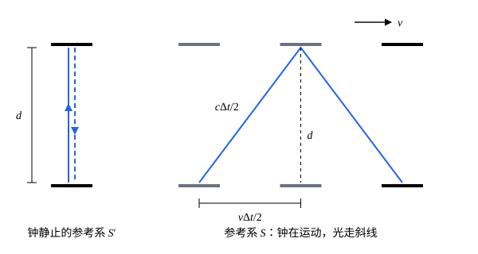

## 这一节要回答的问题

宇宙射线（cosmic rays）打在十几千米高的大气层上，产生大量缪子（muon，也写作$\mu$子）。缪子很快衰变，静止时平均只能存在约$2.2\,\mu\mathrm s$，即使以接近光速飞行，在这段时间里也只能走六七百米。可是地面上每分钟都能测到大量缪子，它们是怎么飞下来的？

## 讲解

### 垂直于运动方向的长度

推导:term[时间延缓]{id="physics.special-relativity.time-dilation"}（time dilation）要先知道：垂直于相对运动方向的长度，在两个:term[惯性系]{id="physics.special-relativity.inertial-frame"}（inertial frame）里量得一样。

::anchor{id="thm-transverse-length"}
定理（横向长度不变）：两根杆在各自静止的惯性系里一样长，都垂直于两个惯性系相对运动的方向放置，下端沿同一条直线运动。那么两杆相遇时，上端也正好相遇。

证明：在两根杆的上端各装一支刷子，相遇时如果上端不齐，较高的那根的刷子就在较矮的那根上留下一道漆印，有没有这道漆印是一个:term[事件]{id="physics.special-relativity.event"}（event）有没有发生，和参考系（frame of reference）无关。假设在$S$里看，运动的杆（$S'$的杆）比静止的杆矮，那么$S'$的杆的刷子在$S$的杆上留下漆印，$S$的杆的刷子什么也碰不到。按:term[相对性原理]{id="physics.special-relativity.principle-of-relativity"}（principle of relativity），在$S'$里看，运动的是$S$的杆，它也该比静止的杆矮，于是该是$S$的杆的刷子在$S'$的杆上留印、$S'$的杆的刷子什么也碰不到，和$S$里的结论矛盾。假设运动的杆更高，同样矛盾，所以两根杆一样高。

### 光钟与固有时

::anchor{id="def-light-clock"}
两面平行的镜子相距$d$，一束光在它们之间来回反射，光每往返一次就算钟走了一下，这样的钟叫作光钟（light clock）。

为什么用光钟：在钟静止的:term[惯性系]{id="physics.special-relativity.inertial-frame"}里，光往返一次用时$\frac{2d}{c}$，只用到光速；在别的惯性系里，:term[光速不变原理]{id="physics.special-relativity.light-postulate"}（constancy of the speed of light）告诉我们光速仍是$c$，于是能算出它走一下用多长时间。边界情况：光钟只是推导用的工具，下面会证明，任何钟的快慢都和光钟一样变化。

::anchor{id="def-proper-time"}
在某个:term[惯性系]{id="physics.special-relativity.inertial-frame"}里发生在同一地点的两个:term[事件]{id="physics.special-relativity.event"}之间，这个惯性系里放在那一点的钟测得的时间间隔，叫作这两个事件之间的:term[固有时]{id="physics.special-relativity.proper-time"}（proper time），记作$\Delta\tau$。

为什么这样定义：两个事件发生在同一地点，用一只钟就能量出间隔，不需要把不同地点的钟对准，所以不受:term[同时的相对性]{id="physics.special-relativity.relativity-of-simultaneity"}（relativity of simultaneity）的影响。一只匀速运动的钟，在它静止的惯性系里，它的两次读数总发生在同一地点，所以它读出的就是固有时。边界情况：如果没有一个惯性系让两个事件发生在同一地点，这两个事件之间就谈不上固有时，例如在某个惯性系里同时发生、但不同地点的两个事件。

### 时间延缓公式

::anchor{id="def-lorentz-factor"}
对速度$v$（$|v|<c$），$\gamma=\frac{1}{\sqrt{1-v^2/c^2}}$叫作:term[洛伦兹因子]{id="physics.special-relativity.lorentz-factor"}（Lorentz factor），常把$\frac vc$记作$\beta$，于是$\gamma=\frac1{\sqrt{1-\beta^2}}$。

为什么这样定义：下面的定理里，两个:term[惯性系]{id="physics.special-relativity.inertial-frame"}之间时间的比例正是这个数。它总是不小于$1$，$v=0$时等于$1$，$|v|$接近$c$时趋于无穷大；$|v|\ll c$时$\gamma\approx1+\frac{v^2}{2c^2}$，因为$\bigl(1+\frac{v^2}{2c^2}\bigr)^2\bigl(1-\frac{v^2}{c^2}\bigr)=1-\frac{3v^4}{4c^4}-\frac{v^6}{4c^6}$和$1$只差$\frac{v^4}{c^4}$量级。边界情况：$|v|\ge c$时根号里不是正数，$\gamma$没有定义，以后会看到这和物体不能达到光速有关。

::anchor{id="thm-time-dilation"}
定理（:term[时间延缓]{id="physics.special-relativity.time-dilation"}，time dilation）：两个:term[事件]{id="physics.special-relativity.event"}在惯性系$S'$里发生在同一地点，:term[固有时]{id="physics.special-relativity.proper-time"}为$\Delta\tau$；$S'$相对惯性系$S$以速度$v$运动，那么在$S$里这两个事件相隔$\Delta t=\gamma\Delta\tau$。

证明：在$S'$里放一只静止的光钟，两面镜子垂直于运动方向放置、相距$d$，取「光从下面的镜子出发」和「光回到下面的镜子」这两个事件，它们在$S'$里同地，相隔$\Delta\tau=\frac{2d}{c}$。在$S$里，镜子以$v$横向运动，按横向长度不变定理，两面镜子仍相距$d$；光从下面的镜子出发，要斜着走才能碰到上面的镜子（见几何图像），前半段光走$\frac{c\Delta t}2$，镜子同时移动$\frac{v\Delta t}2$，由勾股定理$\bigl(\frac{c\Delta t}{2}\bigr)^2=d^2+\bigl(\frac{v\Delta t}2\bigr)^2$。解出$\Delta t=\frac{2d}{c}\cdot\frac{1}{\sqrt{1-v^2/c^2}}=\gamma\Delta\tau$，对光钟定理成立。

再看任意两个在$S'$里同地的事件。在那一点放一只光钟和一只别的钟（原子钟（atomic clock）、心跳都行），在$S'$里它们静止在一起、走得一样快，否则按:term[相对性原理]{id="physics.special-relativity.principle-of-relativity"}，两种钟的快慢之比就能测出$S'$的运动速度；「两只钟并排放、读数一起变」是同地发生的事，在$S$里也成立。所以在$S$里每只钟都和光钟一样，读数变化$\Delta\tau$时$S$的钟走了$\gamma\Delta\tau$，定理对任意两个同地事件成立。

这个效应是双方的：$S$里静止的钟，在$S'$里看也走慢了，比例同样是$\gamma$，两个惯性系的地位完全对称。这并不矛盾：比较时，一方用的是一只钟，另一方用的是两只不同地点、在自己的惯性系里:term[同步]{id="physics.special-relativity.synchronization"}（synchronized）好的钟，而按:term[同时的相对性]{id="physics.special-relativity.relativity-of-simultaneity"}，另一个惯性系并不认为这两只钟同步（见 p6）。

## 几何图像

左图是钟静止的参考系，光在两面镜子之间竖直往返；右图是钟以$v$运动的参考系，三组镜子是发光、反射、收回时钟所在的位置。光速在两个参考系里都是$c$，可右图的光要走更长的斜线，所以走完一个来回要更长的时间。斜边、竖直边、水平边正好构成勾股定理的三角形，$\gamma$就从这里来。

## 例题

### 例 1　宇宙射线里的缪子

缪子在离地面$15\,\mathrm{km}$处产生，以$v=0.998c$竖直向下飞行，它在自己静止的参考系里平均寿命（mean lifetime）$\tau=2.2\,\mu\mathrm s$。在地面参考系里，它平均能飞多远？如果没有:term[时间延缓]{id="physics.special-relativity.time-dilation"}又能飞多远？取$c=3.0\times10^8\,\mathrm{m/s}$。

**为什么想到这么做**：缪子的产生和衰变是它身上的两个:term[事件]{id="physics.special-relativity.event"}，在缪子静止的参考系里同地，相隔的平均值就是:term[固有时]{id="physics.special-relativity.proper-time"}$\tau$。地面参考系里这两个事件相隔$\gamma\tau$，飞过的距离是$v\gamma\tau$。

**推导**：$\gamma=\frac{1}{\sqrt{1-0.998^2}}=\frac1{\sqrt{0.003996}}\approx15.8$。地面参考系里平均寿命$\gamma\tau\approx35\,\mu\mathrm s$，平均飞行距离$v\gamma\tau\approx0.998\times3.0\times10^8\times35\times10^{-6}\,\mathrm m\approx10\,\mathrm{km}$。没有时间延缓时只有$v\tau\approx660\,\mathrm m$。所以大量缪子能飞到地面附近。

这个解释有过多次直接检验。1963 年弗里施（David Frisch）和史密斯（James Smith）比较了华盛顿山顶（海拔约$1.9\,\mathrm{km}$）和海平面每小时测到的速度约为$0.995c$的缪子数：山顶每小时约 560 个，海平面还有 400 多个，不计时间延缓只该剩二三十个，结果和时间延缓的预言一致。1977 年欧洲核子研究中心（CERN）让$\gamma=29.33$的缪子在储存环（storage ring）里绕圈，测得平均寿命$64.4\,\mu\mathrm s$，正是静止寿命$2.197\,\mu\mathrm s$的$29.33$倍，符合到千分之一的量级。

### 例 2　低速时的时间延缓

全球定位系统（Global Positioning System，GPS）的卫星以约$3.87\,\mathrm{km/s}$绕地球运动。只考虑速度带来的:term[时间延缓]{id="physics.special-relativity.time-dilation"}，卫星上的钟和地面的钟相比，一天慢多少？取$c=3.00\times10^8\,\mathrm{m/s}$，不计地球自转。

**为什么想到这么做**：$v\ll c$，$\gamma$非常接近$1$，直接算$\gamma$会把差别淹没在舍入误差里，要用近似$\gamma-1\approx\frac{v^2}{2c^2}$。

**推导**：地面参考系的一天$\Delta t=86400\,\mathrm s$里，卫星的钟走了$\frac{\Delta t}{\gamma}$，少走$\Delta t\bigl(1-\frac1\gamma\bigr)\approx\Delta t\cdot\frac{v^2}{2c^2}=86400\times\frac{(3.87\times10^3)^2}{2\times(3.00\times10^8)^2}\,\mathrm s\approx7.2\,\mu\mathrm s$。光在$7.2\,\mu\mathrm s$里走两千多米，GPS 靠钟的读数测距离，不修正就完全不能用。卫星所在处引力比地面弱，这又使卫星的钟快一些，而且这个效应更大，见[全球定位系统里的相对论](lesson:physics.general-relativity.gps-clocks)。

## 常见误区

- 「:term[时间延缓]{id="physics.special-relativity.time-dilation"}只是光钟的特点，换一种钟就不慢了。」证明的第二步说明，所有的钟都一样慢，否则:term[相对性原理]{id="physics.special-relativity.principle-of-relativity"}就被破坏了；慢下来的是时间本身。
- 「$S$看$S'$的钟慢，那么$S'$看$S$的钟就该快。」双方都看对方的钟慢，比例都是$\gamma$；这并不矛盾，比较的方式不同（见 p6）。
- 「运动的人会觉得自己的时间过得慢、动作变迟缓。」在他自己的参考系里一切照常，心跳、钟表、思维都按:term[固有时]{id="physics.special-relativity.proper-time"}正常进行；慢是另一个:term[惯性系]{id="physics.special-relativity.inertial-frame"}拿自己的钟比较出来的。
- 「$\Delta t=\gamma\Delta\tau$里哪个是固有时可以随便定。」固有时是同地发生的两个:term[事件]{id="physics.special-relativity.event"}在那个惯性系里的间隔，它总是较小的那个；先找出两个事件在哪个惯性系里同地。
