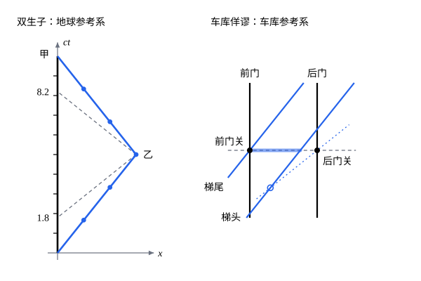

## 这一节要回答的问题

双胞胎甲留在地球上，乙乘飞船以$0.8c$飞到 4 光年外的恒星，立即掉头飞回。地球上算，乙的钟走慢了，回来时乙比甲年轻；可在乙看来，运动的是地球，该是甲的钟走慢、甲更年轻。到底谁年轻？两人重逢时并排站着比年龄，答案只能有一个。

## 讲解

### 双生子佯谬

::anchor{id="def-twin-paradox"}
两只起初在一起的钟（或一对双胞胎），一只一直做惯性运动，另一只出发后再返回；按:term[时间延缓]{id="physics.special-relativity.time-dilation"}（time dilation），似乎每一方都能说对方的钟慢，重逢时却只能有一个结论。这个表面上的矛盾叫作:term[双生子佯谬]{id="physics.special-relativity.twin-paradox"}（twin paradox）。

为什么叫佯谬（paradox）：它只是看起来矛盾，毛病出在把两只钟当成了对称的。爱因斯坦（Albert Einstein）在 1905 年的论文里就指出，沿闭合曲线运动一圈回到原处的钟，比一直留在原处的钟走得少；1911 年朗之万（Paul Langevin）把它说成一个人的太空旅行，劳厄（Max von Laue）随后用时空的几何说明了其中的道理。边界情况：两只钟如果都一直做惯性运动，分开以后就不会再相遇，「谁的钟慢」只能借助各自:term[同步]{id="physics.special-relativity.synchronization"}（synchronized）好的一排钟来比，结论是相互的（见[时间延缓](lesson:physics.special-relativity.time-dilation)）。

### 两只钟并不对称

在:term[时空图]{id="physics.special-relativity.spacetime-diagram"}（spacetime diagram）上，甲的:term[世界线]{id="physics.special-relativity.worldline"}（world line）从出发:term[事件]{id="physics.special-relativity.event"}（event）O 到重逢事件 R 是一条直线。乙的世界线在掉头事件 T 处折了一下：去程乙静止在:term[惯性系]{id="physics.special-relativity.inertial-frame"}（inertial frame）$S'$里，回程静止在另一个惯性系$S''$里。:term[时间延缓]{id="physics.special-relativity.time-dilation"}说的是一个惯性系怎样看运动的钟，乙在整个旅程中并不静止在同一个惯性系里，所以不能把「在乙看来甲的钟慢」用到整个旅程上。

两只钟各走了多少，要沿各自的世界线算:term[固有时]{id="physics.special-relativity.proper-time"}（proper time）。由[时空间隔与固有时](lesson:physics.special-relativity.spacetime-interval#thm-max-proper-time)里的定理，连接两个事件的世界线中，匀速直线的那条固有时最长，所以重逢时甲比乙老。

乙掉头时要加速，可这一段可以短到忽略：按[时钟假设](lesson:physics.special-relativity.spacetime-interval#def-clock-hypothesis)（clock hypothesis），钟的快慢只取决于此刻的速度，掉头那一会儿对乙的钟几乎没有贡献。造成年龄差的，是两条世界线的形状不同，不是加速度本身让钟变慢。

### 沿世界线累加固有时

::anchor{id="thm-compare-clocks"}
定理（比较两只钟）：两只钟从同一个:term[事件]{id="physics.special-relativity.event"}出发，在另一个事件重逢时，各自走过的时间是沿各自:term[世界线]{id="physics.special-relativity.worldline"}的:term[固有时]{id="physics.special-relativity.proper-time"}$\tau=\int\sqrt{1-u^2/c^2}\,\dd t$；任选一个:term[惯性系]{id="physics.special-relativity.inertial-frame"}来算这两个积分，结果都相同。

证明：把世界线分成许多小段，每一小段近似匀速，钟走的时间$\Delta\tau=\frac{\sqrt{\Delta s^2}}{c}$由这一小段两端的:term[时空间隔]{id="physics.special-relativity.spacetime-interval"}（spacetime interval）决定。时空间隔在所有惯性系里相同，所以每一小段的$\Delta\tau$和惯性系无关，加起来、取极限得到的积分也和惯性系无关。两只钟的读数在重逢事件 R 处并排比较，比的是两个和惯性系无关的数，所以每个惯性系都得到同一个结论。

具体算的时候：选一个方便的惯性系，写出每只钟的速度$u(t)$，分段匀速的就逐段算$\Delta t\sqrt{1-u^2/c^2}$再相加。例 1 在地球参考系和乙去程的惯性系里各算一遍，两次结果一样。

### 乙心里的「此刻」

乙在去程中按$S'$的同时线（line of simultaneity，见[时空图与光锥](lesson:physics.special-relativity.spacetime-diagrams#def-line-of-simultaneity)）判断「此刻地球上是几点」。掉头前一瞬，$S'$里和 T 同时的地球:term[事件]{id="physics.special-relativity.event"}在地球时间$1.8$年处；掉头后乙换到$S''$，同时线朝另一边倾斜，和 T 同时的地球事件变成了$8.2$年处。去程、回程中乙都认为甲的钟慢，各只走了$1.8$年，掉头时乙心里的地球「此刻」一下跳过了$6.4$年，合起来$1.8+6.4+1.8=10$年，和甲自己的钟一致。

这个跳变是:term[同时的相对性]{id="physics.special-relativity.relativity-of-simultaneity"}（relativity of simultaneity）造成的，不是乙看到的景象。乙用望远镜看到的是从地球传来的光，掉头时并不会看到甲突然变老；看到的钟怎样变化，见[相对论多普勒效应](lesson:physics.special-relativity.relativistic-doppler)。

### 车库佯谬

::anchor{id="def-ladder-paradox"}
一架:term[固有长度]{id="physics.special-relativity.proper-length"}（proper length）为$L$的梯子以速度$v$冲进固有长度为$D<L$的车库，车库的前、后各有一扇门。在车库系里梯子缩短成$\frac L\gamma$，速度够大时两扇门可以同时关上，把梯子关在里面；在梯子系里车库缩短成$\frac D\gamma$，梯子更装不下。这对看起来互相矛盾的说法叫作:term[车库佯谬]{id="physics.special-relativity.ladder-paradox"}（ladder paradox）。

为什么不矛盾：「两扇门同时关上」是车库系里的同时。在梯子系里，后门先关，那时梯子头还没到后门；前门后关，那时梯子尾已经进来了，所以梯子系里没有哪一刻两扇门都关着、梯子在里面（例 2）。边界情况：如果后门是一堵墙，梯子头撞上就停下，梯子会被压缩，它最后确实整个进了车库，两个参考系对这个结局的说法一致（见 p6）。

## 几何图像

左图是地球参考系的:term[时空图]{id="physics.special-relativity.spacetime-diagram"}（单位是年和光年）。甲的:term[世界线]{id="physics.special-relativity.worldline"}是竖直线，乙的是折线，乙的世界线上每个圆点表示乙的钟又走了 1 年，去程、回程各 3 年；两条虚线是乙掉头前后的同时线，交甲的世界线于$1.8$年和$8.2$年。右图是车库参考系的时空图（单位是米）：两条竖直线是前门、后门，两条斜线是梯子的尾和头；水平虚线是车库系的同时线，前门关、后门关在这条线上；过「后门关」的斜虚线是梯子系的同时线，它和梯子头的世界线交在空心圆处，那时梯子头离后门还远。

## 例题

### 例 1　在乙去程的惯性系里算年龄

按这一节开头的数据，分别在地球参考系$S$和乙去程所在的:term[惯性系]{id="physics.special-relativity.inertial-frame"}$S'$里，算出重逢时甲、乙各过了多少年。

**为什么想到这么做**：按比较两只钟的定理，任选一个惯性系都行。在$S'$里算一遍，正好回答「在乙看来该是甲年轻」的那个疑问。

**推导**：在$S$里，甲的钟走$10$年。乙去程、回程各用$5$年（地球时间），$\gamma=\frac53$，每段乙的钟走$5\times0.6=3$年，共$6$年。

在$S'$里（$\beta=0.8$，单位取年和光年，$c=1$）：掉头:term[事件]{id="physics.special-relativity.event"} T 在$S$里是$(t,x)=(5,4)$，变换后$t'=\frac53(5-0.8\times4)=3$，$x'=\frac53(4-0.8\times5)=0$；重逢事件 R 是$(10,0)$，变换后$t'=\frac{50}3$，$x'=-\frac{40}3$。甲以$0.8c$运动了$\frac{50}3$年，走过$\frac{50}3\times0.6=10$年。乙先静止$3$年；再从 T 到 R，$\Delta t'=\frac{41}3$，$\Delta x'=-\frac{40}3$，走过$\sqrt{(41/3)^2-(40/3)^2}=3$年，共$6$年。

在$S'$里，去程时确实是甲的钟慢；可回程乙要以$\frac{40}{41}c$追赶地球，这一段乙的钟慢得更厉害。总账和$S$里一样：甲$10$年，乙$6$年。

### 例 2　梯子到底进没进车库

梯子的:term[固有长度]{id="physics.special-relativity.proper-length"}$L=5\,\mathrm m$，车库的固有长度$D=4\,\mathrm m$，梯子以$0.8c$冲进车库。在车库系里，梯子尾经过前门的那一刻两扇门同时关上、随即打开。在梯子系里两扇门是什么时候关的？梯子撞门了吗？

**为什么想到这么做**：两次关门是两个:term[事件]{id="physics.special-relativity.event"}，用:term[洛伦兹变换]{id="physics.special-relativity.lorentz-transformation"}（Lorentz transformation）把它们换到梯子系里，再看那时梯子在哪里。

**推导**：车库系里取前门为原点，关门时$t=0$，梯子长$\frac{5}{5/3}=3\,\mathrm m$，正好在两扇门之间。取梯子系的原点在梯子尾，前门关的事件在两个参考系里都是$(0,0)$。后门关的事件在车库系里是$(t,x)=(0,4\,\mathrm m)$，在梯子系里$t'=\gamma\bigl(0-\frac{v\cdot4\,\mathrm m}{c^2}\bigr)=-\frac{16}{3}\,\frac{\mathrm m}{c}\approx-17.8\,\mathrm{ns}$，$x'=\gamma\times4\,\mathrm m=\frac{20}3\,\mathrm m\approx6.67\,\mathrm m$。

梯子系里梯子占据$0\le x'\le5\,\mathrm m$，后门在梯子头前方$1.67\,\mathrm m$处、提前约$17.8\,\mathrm{ns}$关上又打开，碰不到梯子；前门在$t'=0$关上，正好在梯子尾经过的时候。两扇门不同时关，梯子系里从来没有「梯子关在车库里」的那一刻，也就没有矛盾。

## 常见误区

- 「乙年轻是因为加速使钟变慢。」掉头的时间可以短到忽略，钟的快慢只看速度；年龄差来自两条:term[世界线]{id="physics.special-relativity.worldline"}的形状不同（见 p7）。
- 「要用广义相对论（general relativity）才能解释:term[双生子佯谬]{id="physics.special-relativity.twin-paradox"}。」在任何一个:term[惯性系]{id="physics.special-relativity.inertial-frame"}里沿世界线累加:term[固有时]{id="physics.special-relativity.proper-time"}就够了，加速的过程狭义相对论也能处理。
- 「:term[时空图]{id="physics.special-relativity.spacetime-diagram"}上乙的世界线画得比甲的长，所以乙经历的时间长。」纸面上的长度不代表固有时；在时空图上，越是斜着走的世界线，固有时越短。
- 「掉头时乙会看到甲一下子老了$6.4$岁。」跳变的是乙按同时线推算的地球「此刻」，乙看到的光是连续变化的。
- 「:term[车库佯谬]{id="physics.special-relativity.ladder-paradox"}里总有一个参考系的说法是错的。」两个说法都对，它们对「两扇门同时关上」的判断不同；两个参考系都同意的，是梯子和门在各个:term[事件]{id="physics.special-relativity.event"}上的先后。
