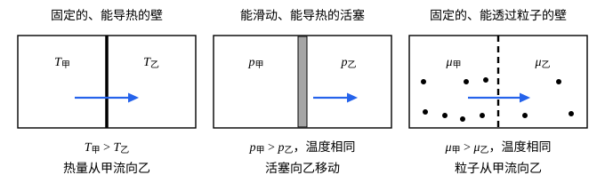

## 这一节要回答的问题

敞口放着的一杯水，水分子不断跑进空气里；开着窗的房间，空气进进出出。粒子数会变时，:term[热力学基本方程]{id="physics.thermal-physics.fundamental-relation"}（fundamental thermodynamic relation）$\dd U=T\dd S-p\,\dd V$该怎样改？粒子往哪边跑，又由什么决定？

## 讲解

### 开放系统

气缸里的气体粒子数不变；开着窗的房间里，空气分子却随时进出。

::anchor{id="def-open-system"}
和外界（surroundings）能交换物质的系统（system）叫作:term[开放系统]{id="physics.thermal-physics.open-system"}（open system）；只交换能量、不交换物质的叫作封闭系统（closed system）；:term[孤立系统]{id="physics.thermal-physics.isolated-system"}（isolated system）两样都不交换。

为什么这样分：粒子数能变，能量的账多了随粒子进出的一项，:term[热力学基本方程]{id="physics.thermal-physics.fundamental-relation"}也要多一项。边界情况：带活塞的气缸和外界交换功（work）和:term[热量]{id="physics.thermal-physics.heat"}（heat），气体却出不去，仍是封闭系统；是不是开放系统，只看物质能不能进出。

### 化学势

往气缸里再放进一点气体，即使:term[熵]{id="physics.thermal-physics.entropy"}（entropy）和体积都不变，:term[内能]{id="physics.thermal-physics.internal-energy"}（internal energy）一般也会变。

::anchor{id="def-chemical-potential"}
只有一种粒子时，把内能看成熵$S$、体积$V$和粒子数$N$的函数，$\mu=\pdvc UN{S,V}$叫作:term[化学势]{id="physics.thermal-physics.chemical-potential"}（chemical potential）。只做体积变化的功、粒子数又能变时，相邻两个:term[平衡态]{id="physics.thermal-physics.equilibrium-state"}（equilibrium state）之间的:term[热力学基本方程]{id="physics.thermal-physics.fundamental-relation"}就成为$\dd U=T\dd S-p\,\dd V+\mu\,\dd N$。

为什么这样定义：$N$不变时，$U$对$S$、$V$的偏导数（partial derivative）就是[克劳修斯不等式与熵](lesson:physics.thermal-physics.entropy#thm-fundamental-relation)里的$T$和$-p$；粒子数能变，全微分（total differential）里就多出对$N$的一项，系数就是$\mu$。$\mu$按每个粒子算，化学里常按每摩尔算，是$N_{\mathrm A}\mu$。有几种粒子时，第$j$种有自己的$\mu_j$（$S$、$V$和别的粒子数都不变时，$U$对$N_j$的偏导数），基本方程里那一项换成$\sum_j\mu_j\dd N_j$。

边界情况：$N$是整数，求偏导数时把它当连续变量；宏观系统里粒子极多，加一个只是极小的改变，只有几个分子时就不行了。

::anchor{id="thm-mu-free-energy"}
定理：只有一种粒子、只做体积变化的功、粒子数能变时，$\dd F=-S\dd T-p\,\dd V+\mu\,\dd N$，$\dd G=-S\dd T+V\dd p+\mu\,\dd N$，所以$\mu=\pdvc FN{T,V}=\pdvc GN{T,p}$：:term[温度]{id="physics.thermal-physics.temperature"}（temperature）、体积不变时增加一个粒子，:term[亥姆霍兹自由能]{id="physics.thermal-physics.helmholtz-free-energy"}（Helmholtz free energy）增加$\mu$；温度、压强（pressure）不变时，:term[吉布斯自由能]{id="physics.thermal-physics.gibbs-free-energy"}（Gibbs free energy）增加$\mu$。

证明思路：由$F=U-TS$，$\dd F=\dd U-T\dd S-S\dd T$，代入上面的基本方程得第一式；$G=F+pV$，$\dd G=\dd F+p\,\dd V+V\dd p$，得第二式。这就是「增加一个粒子引起的自由能变化」的确切意思：$T$、$V$固定时指$F$，$T$、$p$固定时指$G$。

### $G=\mu N$

::anchor{id="thm-g-mu-n"}
定理：不计重力、只做体积变化的功、只有一种粒子（单一成分）的系统处在:term[平衡态]{id="physics.thermal-physics.equilibrium-state"}时，$G=\mu N$：:term[化学势]{id="physics.thermal-physics.chemical-potential"}就是每个粒子的:term[吉布斯自由能]{id="physics.thermal-physics.gibbs-free-energy"}，只由:term[温度]{id="physics.thermal-physics.temperature"}和压强决定。

证明思路：温度、压强不变时，物质变成原来的$\lambda$倍，$U$、$S$、$V$、$N$都是:term[广延量]{id="physics.thermal-physics.extensive-quantity"}（extensive quantity），都变成$\lambda$倍，$G=U-TS+pV$也变成$\lambda$倍。所以$G$和$N$成正比，$G=N\,g(T,p)$；对$N$求偏导数，$\mu=\pdvc GN{T,p}=g(T,p)$。

$\mu$和温度、压强一样，两份合成一份时不变，是:term[强度量]{id="physics.thermal-physics.intensive-quantity"}（intensive quantity）。由$G=U-TS+pV$，定理也就是$U=TS-pV+\mu N$；直接由$U(\lambda S,\lambda V,\lambda N)=\lambda U(S,V,N)$也能证明它（第 6 题）。边界情况：几种粒子混在一起时，一个$\mu$不够用，$G=\sum_j\mu_jN_j$（见第 6 题）。

### 粒子往哪边流

一个装在刚性容器里的:term[孤立系统]{id="physics.thermal-physics.isolated-system"}只有一种粒子，不计重力，分成甲、乙两部分，各自处在:term[平衡态]{id="physics.thermal-physics.equilibrium-state"}，中间的壁让它们交换能量、体积和粒子。由:term[开放系统]{id="physics.thermal-physics.open-system"}的:term[热力学基本方程]{id="physics.thermal-physics.fundamental-relation"}，每一部分都有$\dd S=\frac{\dd U+p\,\dd V-\mu\,\dd N}T$。甲的:term[内能]{id="physics.thermal-physics.internal-energy"}、体积、粒子数各增加$\dd U_{\text{甲}}$、$\dd V_{\text{甲}}$、$\dd N_{\text{甲}}$时，乙各减少同样多，:term[总熵]{id="physics.thermal-physics.entropy"}的改变是

$$
\dd S_{\text{总}}=\Bigl(\frac1{T_{\text{甲}}}-\frac1{T_{\text{乙}}}\Bigr)\dd U_{\text{甲}}+\Bigl(\frac{p_{\text{甲}}}{T_{\text{甲}}}-\frac{p_{\text{乙}}}{T_{\text{乙}}}\Bigr)\dd V_{\text{甲}}-\Bigl(\frac{\mu_{\text{甲}}}{T_{\text{甲}}}-\frac{\mu_{\text{乙}}}{T_{\text{乙}}}\Bigr)\dd N_{\text{甲}} .
$$

由:term[熵增原理]{id="physics.thermal-physics.entropy-increase-principle"}（principle of entropy increase），孤立系统自发（spontaneous）进行的变化使$\dd S_{\text{总}}>0$，最后到达平衡时总熵最大（见[熵变的计算与熵增原理](lesson:physics.thermal-physics.entropy-increase)）。$\dd U_{\text{甲}}$、$\dd V_{\text{甲}}$、$\dd N_{\text{甲}}$能各自取正负，有一个系数不是零，就有微小的变化使总熵增加，所以平衡时三个系数都得是零。

::anchor{id="thm-mu-flow"}
定理：设只有一种粒子，不计重力，只做体积变化的功。孤立系统分成各自处在平衡态的两部分，能交换能量、体积和粒子，平衡时两部分的:term[温度]{id="physics.thermal-physics.temperature"}、压强、:term[化学势]{id="physics.thermal-physics.chemical-potential"}分别相等；两部分温度相同、体积都不变时，粒子从化学势高的一边流向低的一边。

温度相同、体积不变时前两项是零，$\dd S_{\text{总}}=-\frac{\mu_{\text{甲}}-\mu_{\text{乙}}}T\dd N_{\text{甲}}$；$\mu_{\text{甲}}>\mu_{\text{乙}}$时，要它为正，$\dd N_{\text{甲}}$只能是负的。温度差推动:term[热量]{id="physics.thermal-physics.heat"}，压强差推动活塞，化学势差推动粒子（几何图像），就像物体往势能低处落。有重力的情形见第 3 题。

有几种粒子时，$-\mu\,\dd N$换成$-\sum_j\mu_j\dd N_j$：平衡时，能穿过壁的每一种化学势各自相等；同温、定容、只有一种能穿过时，它流向自己化学势低的一边，几种同时穿过时却不一定，熵增原理只管总和。

## 几何图像

左：:term[热量]{id="physics.thermal-physics.heat"}穿过壁，从:term[温度]{id="physics.thermal-physics.temperature"}高的一边流向低的一边。中：两边温度相同，活塞向压强低的一边滑动。右：两边温度相同，粒子（圆点）穿过壁，从:term[化学势]{id="physics.thermal-physics.chemical-potential"}高的一边流向低的一边。平衡时，三种壁依次使两边温度、压强、化学势相等；箭头长短不按比例。

## 例题

### 例 1　理想气体的化学势

一定:term[温度]{id="physics.thermal-physics.temperature"}下，:term[理想气体]{id="physics.thermal-physics.ideal-gas"}（ideal gas）的:term[化学势]{id="physics.thermal-physics.chemical-potential"}怎样随压强变？几种理想气体混在一起时，第$j$种的化学势由什么决定？

**为什么想到这么做**：只有一种粒子时$G=\mu N$，又知道$N$不变时$\pdvc GpT=V$（见[热力学势](lesson:physics.thermal-physics.thermodynamic-potentials#def-gibbs)）；两边除以$N$，就是$\mu$对$p$的偏导数。

**推导**：由:term[理想气体状态方程]{id="physics.thermal-physics.ideal-gas-law"}（ideal gas law）$pV=N\kB T$，$\pdvc\mu pT=\frac VN=\frac{\kB T}p$。温度不变时从参考压强$p_0$积到$p$：

$$
\mu(T,p)=\mu(T,p_0)+\kB T\ln\frac p{p_0} .
$$

压强越高，化学势越高；不计重力、温度相同、体积不变时，单独一种气体从压强高处流向低处。混在一起的理想气体，分子之间除了碰撞没有相互作用，每一种都像别的不存在一样：第$j$种的化学势就是它单独占满容器时的值，只和$T$、它的分压（partial pressure，见[理想气体状态方程](lesson:physics.thermal-physics.ideal-gas-law)第 5 题）$p_j$有关，$\mu_j(T,p_j)=\mu_j(T,p_0)+\kB T\ln\frac{p_j}{p_0}$。

## 常见误区

- 「:term[化学势]{id="physics.thermal-physics.chemical-potential"}就是一个粒子的能量。」只有一种粒子时，$\mu=\frac GN=\frac{U-TS+pV}N$，除了每个粒子分到的:term[内能]{id="physics.thermal-physics.internal-energy"}，还有$-\frac{TS}N$、$\frac{pV}N$两部分；它是每个粒子的:term[吉布斯自由能]{id="physics.thermal-physics.gibbs-free-energy"}。
