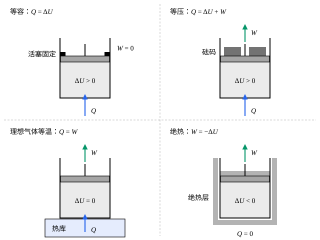

## 这一节要回答的问题

搓手会热，烤火也会热，这两种办法是一回事吗？气体吸收的:term[热量]{id="physics.thermal-physics.heat"}（heat）去了哪里？不消耗能量、却能不断对外做功（work）的机器，为什么造不成？

## 讲解

### 做功和传热

焦耳（James Prescott Joule）用下落的重物带动叶轮，搅动隔热容器里的水，水的:term[温度]{id="physics.thermal-physics.temperature"}（temperature）升高；给水里的电阻丝通电或用火加热，水也能升到同样的温度。他测得约$4.15\,\mathrm J$的功和加热 1 卡（calorie，约让$1\,\mathrm g$水升温$1\,\mathrm K$的热）的效果相同；现在规定$1\,\mathrm{cal}=4.184\,\mathrm J$，课本常写$4.18\,\mathrm J$。

::anchor{id="def-adiabatic-process"}
如果隔着一层壁，外界（surroundings）只能靠做功（推活塞、搅拌、通电）改变系统（system）的状态，这层壁叫作绝热壁（adiabatic wall），保温瓶的真空夹层近似如此；被绝热壁包着的系统经历的过程，叫作:term[绝热过程]{id="physics.thermal-physics.adiabatic-process"}（adiabatic process）。

为什么这样定义：冷热的影响进不来，做功的效果才能单独看。边界情况：绝热过程不要求缓慢，焦耳搅拌水、后面的:term[自由膨胀]{id="physics.thermal-physics.free-expansion"}（free expansion）都不是:term[准静态过程]{id="physics.thermal-physics.quasi-static-process"}（quasi-static process）；准静态的绝热过程见[绝热过程](lesson:physics.thermal-physics.adiabatic-processes)。

::anchor{id="thm-adiabatic-work"}
实验事实：绝热过程中，外界对系统做的功只由初、末两个:term[平衡态]{id="physics.thermal-physics.equilibrium-state"}（equilibrium state）决定，和怎样做功、经过哪些中间状态都无关。

### 内能与热量

::anchor{id="def-internal-energy"}
于是可以给每个:term[平衡态]{id="physics.thermal-physics.equilibrium-state"}配一个数$U$，使系统经:term[绝热过程]{id="physics.thermal-physics.adiabatic-process"}从状态 1 变到状态 2 时，外界做的功等于$U_2-U_1$；$U$叫作系统的:term[内能]{id="physics.thermal-physics.internal-energy"}（internal energy）。从分子看，它是分子无规则运动的动能（kinetic energy）、分子之间的势能（分子势能，intermolecular potential energy）和分子内部原子之间的势能（见[能量均分定理](lesson:physics.thermal-physics.equipartition)）的总和，不含系统整体运动的动能，也不含:term[静能]{id="physics.special-relativity.rest-energy"}（rest energy）。

为什么这样定义：外界做的功只看两头，$U$才定得下来，就像重力做功只看高低，才有重力势能（gravitational potential energy）；$U$只定到差一个常数，有意义的是$\Delta U$。边界情况：端着一杯水快走，水整体有了动能，内能并没有变。本领域的$U$只表示内能，不是牛顿力学$E=K+U$里的势能。

::anchor{id="def-state-function"}
像$U$这样由平衡态的:term[状态参量]{id="physics.thermal-physics.state-variable"}（state variable）唯一确定的量，叫作:term[状态函数]{id="physics.thermal-physics.state-function"}（state function）；$p$、$V$、$T$也是。

为什么这样定义：它的改变量只看初、末状态，算起来方便。反例：功不是状态函数，[准静态过程与气体的功](lesson:physics.thermal-physics.quasi-static-processes)例 1 两条路线的始末状态相同，功却不同。

::anchor{id="def-heat"}
:term[温度]{id="physics.thermal-physics.temperature"}不同的两个系统，只要没被绝热壁隔开，即使不做功，内能也会从温度高的一方转到低的一方，这样转移的能量叫作:term[热量]{id="physics.thermal-physics.heat"}，记作$Q$，系统吸热时$Q>0$。热量在直接接触的物体之间或物体内部由高温处传到低温处，这种方式叫作:term[热传导]{id="physics.thermal-physics.heat-conduction"}（heat conduction），如铁勺的柄在热汤里变烫；传热的方式还有对流（convection）和热辐射（thermal radiation）。

为什么这样定义：传热靠温度差，做功靠力推着物体移动，两者要分开记账；热传导单独起名，是因为以后要讲导热的快慢。边界情况：物体并不「含有」热量；热辐射隔着真空也能传，保温瓶的真空夹层挡住的是热传导和对流。

搓手靠做功，烤火靠传热，都使手的内能增加，只看结果分不出是哪一种。[势能与机械能守恒](lesson:physics.newtonian-mechanics.potential-energy#thm-mechanical-energy)里摩擦力做负功、机械能（mechanical energy）「变成了内能」，说的就是这里的内能。

### 热力学第一定律

::anchor{id="thm-first-law"}
:term[热力学第一定律]{id="physics.thermal-physics.first-law"}（first law of thermodynamics）：系统从一个:term[平衡态]{id="physics.thermal-physics.equilibrium-state"}变到另一个平衡态时，吸收的:term[热量]{id="physics.thermal-physics.heat"}等于:term[内能]{id="physics.thermal-physics.internal-energy"}的增加加上对外做的功，$Q=\Delta U+W$。

它是能量守恒（conservation of energy）在热现象里的说法，依据是大量实验。:term[绝热过程]{id="physics.thermal-physics.adiabatic-process"}中$Q=0$，外界做的功$-W$等于$\Delta U$，正是内能的定义。

一小段过程写成$\delta Q=\dd U+\delta W$。:term[准静态过程]{id="physics.thermal-physics.quasi-static-process"}中只做体积变化的功时，$\delta W=p\,\dd V$（见[准静态过程与气体的功](lesson:physics.thermal-physics.quasi-static-processes#thm-gas-work)），于是

$$
\delta Q=\dd U+p\,\dd V .
$$

热量也和路线有关（例 1），不是:term[状态函数]{id="physics.thermal-physics.state-function"}的微小改变，所以和$\delta W$一样写$\delta$。没有热量出入时$\dd U=-p\,\dd V$，[能量-动量张量](lesson:physics.special-relativity.stress-energy-tensor)第 6 题得到的正是这个式子。

高中课本把第一定律写成$\Delta U=Q+W$，那里的$W$是外界做的功，正好是本领域$W$的相反数。本领域的$Q$只表示热量，不是电荷、:term[品质因数]{id="physics.oscillations-waves.quality-factor"}（quality factor）或:term[广义力]{id="physics.analytical-mechanics.generalized-force"}（generalized force）$Q_j$；$\delta W$和:term[虚功]{id="physics.analytical-mechanics.virtual-work"}（virtual work）无关，$\delta$也不表示变分（variation）。电磁学的焦耳热（Joule heating，见[电流与欧姆定律](lesson:physics.electromagnetism.current-density#thm-joule)）是电场对电阻丝做的功，使它的内能增加，电阻丝再把热量传给周围。

::anchor{id="def-perpetual-motion"}
不消耗任何能量、却能不断对外做功的机器，叫作第一类永动机（perpetual motion machine of the first kind）。

为什么要专门说它：机器要不停地工作就得:term[循环]{id="physics.thermal-physics.cyclic-process"}（cyclic process），回到原来的状态时$\Delta U=0$，$W=Q$，不吸热就做不出功。边界情况：第一定律并不禁止机器在循环中从一个:term[热库]{id="physics.thermal-physics.heat-reservoir"}（heat reservoir）吸热、全部变成功；这样的机器也造不成，原因见[热力学第二定律](lesson:physics.thermal-physics.second-law)。

### 理想气体的内能

::anchor{id="def-free-expansion"}
包着绝热壁的刚性容器用隔板分成两半，一半是气体，一半是真空；抽掉隔板，气体冲进真空，过一会儿又处在:term[平衡态]{id="physics.thermal-physics.equilibrium-state"}。这叫作:term[自由膨胀]{id="physics.thermal-physics.free-expansion"}（free expansion）：它是:term[绝热过程]{id="physics.thermal-physics.adiabatic-process"}，$Q=0$；气体没有推动任何东西，$W=0$；所以$\Delta U=0$。

为什么起这个名字：气体膨胀时不推动任何东西；体积变了、:term[内能]{id="physics.thermal-physics.internal-energy"}不变，正好用来检验内能和体积有没有关系。边界情况：它不是:term[准静态过程]{id="physics.thermal-physics.quasi-static-process"}，:term[$p$-$V$图]{id="physics.thermal-physics.pv-diagram"}（$p$-$V$ diagram）上只能标出起点和终点。

::anchor{id="thm-ideal-gas-energy"}
定理：一定量的:term[理想气体]{id="physics.thermal-physics.ideal-gas"}（ideal gas）的内能只和:term[温度]{id="physics.thermal-physics.temperature"}有关，$U=U(T)$，温度越高，内能越大。

证明思路：一定量的气体，$p$由$T$、$V$定下，$U$就是$T$、$V$的函数。焦耳让气体自由膨胀，没测出温度的变化；更精确的实验表明，气体越稀薄，内能随体积的变化越小（第 6 题用近似式算了氩气的例子），理想气体是它的极限：$V$变了，$U$、$T$都不变，所以$U$和$V$无关。体积不变时加热，$Q=\Delta U>0$，温度升高，所以温度越高内能越大。

从分子看，理想气体的分子之间除了碰撞没有相互作用，内能里没有分子之间的势能，是各个分子自身能量的总和；单原子分子（monatomic molecule）只有平动动能（translational kinetic energy），$U=\frac32nRT$（见[气体动理论](lesson:physics.thermal-physics.kinetic-theory)）。

## 几何图像

左上起依次是:term[等容过程]{id="physics.thermal-physics.isochoric-process"}（isochoric process）、:term[等压过程]{id="physics.thermal-physics.isobaric-process"}（isobaric process）、:term[理想气体]{id="physics.thermal-physics.ideal-gas"}的:term[等温过程]{id="physics.thermal-physics.isothermal-process"}（isothermal process）、:term[绝热过程]{id="physics.thermal-physics.adiabatic-process"}；蓝色箭头是吸收的:term[热量]{id="physics.thermal-physics.heat"}$Q$，绿色箭头是对外做的功$W$，长短不按比例，:term[内能]{id="physics.thermal-physics.internal-energy"}的改变总是$Q-W$。

## 例题

### 例 1　两条路线的热量

一定量的气体沿路线一从状态 1 变到状态 2，吸热$800\,\mathrm J$，对外做功$300\,\mathrm J$；沿路线二从状态 1 变到状态 2，对外做功$120\,\mathrm J$。沿路线二吸收了多少:term[热量]{id="physics.thermal-physics.heat"}？

**为什么想到这么做**：热量和功都和路线有关，不能直接搬过来；:term[内能]{id="physics.thermal-physics.internal-energy"}是:term[状态函数]{id="physics.thermal-physics.state-function"}，两条路线的$\Delta U$相同，先由路线一求出它。

**推导**：路线一，$\Delta U=Q-W=800\,\mathrm J-300\,\mathrm J=500\,\mathrm J$。路线二，$Q=\Delta U+W=500\,\mathrm J+120\,\mathrm J=620\,\mathrm J$。两条路线吸的热差$180\,\mathrm J$，正好是功的差。

### 例 2　一个循环的账

$1.00\,\mathrm{mol}$单原子:term[理想气体]{id="physics.thermal-physics.ideal-gas"}，:term[内能]{id="physics.thermal-physics.internal-energy"}$U=\frac32nRT$。它从 A（$10.0\,\mathrm L$，$300\,\mathrm K$）出发，:term[等压膨胀]{id="physics.thermal-physics.isobaric-process"}到 B（$20.0\,\mathrm L$），再:term[等容降温]{id="physics.thermal-physics.isochoric-process"}到 C（$300\,\mathrm K$），最后在$300\,\mathrm K$的:term[热库]{id="physics.thermal-physics.heat-reservoir"}里:term[等温压缩]{id="physics.thermal-physics.isothermal-process"}回到 A。求每一段的$W$、$\Delta U$、$Q$和一个:term[循环]{id="physics.thermal-physics.cyclic-process"}的净功。

**为什么想到这么做**：每一段先求$W$，$\Delta U$只看:term[温度]{id="physics.thermal-physics.temperature"}的变化，再由:term[第一定律]{id="physics.thermal-physics.first-law"}求$Q$。

**推导**：A→B 压强（pressure）不变、体积加倍，温度升到$600\,\mathrm K$。$W=nR(T_{\mathrm B}-T_{\mathrm A})\approx2.49\times10^3\,\mathrm J$，$\Delta U=\frac32nR(T_{\mathrm B}-T_{\mathrm A})\approx3.74\times10^3\,\mathrm J$，$Q=\Delta U+W\approx6.24\times10^3\,\mathrm J$。B→C 不做功，$Q=\Delta U\approx-3.74\times10^3\,\mathrm J$。C→A 温度不变，$\Delta U=0$，$Q=W=nRT_{\mathrm A}\ln\frac{10.0}{20.0}\approx-1.73\times10^3\,\mathrm J$。

一个循环内能不变，净吸热等于净功：

$$
W_{\text{净}}=nRT_{\mathrm A}+nRT_{\mathrm A}\ln\frac12=nRT_{\mathrm A}(1-\ln2)\approx765\,\mathrm J .
$$

这正是[准静态过程与气体的功](lesson:physics.thermal-physics.quasi-static-processes)例 1 的路线二加上倒着走的路线一，净功就是两条路线的功之差。

## 常见误区

- 「物体吸收了:term[热量]{id="physics.thermal-physics.heat"}，:term[温度]{id="physics.thermal-physics.temperature"}一定升高。」:term[理想气体]{id="physics.thermal-physics.ideal-gas"}:term[等温膨胀]{id="physics.thermal-physics.isothermal-process"}时吸热，温度不变，吸的热全部变成了对外做的功；冰在$0\,^\circ\mathrm C$熔化时吸热，温度也不变。
- 「一定量的理想气体的:term[内能]{id="physics.thermal-physics.internal-energy"}只和温度有关，所以温度从$T_1$变到$T_2$，吸收的热量是确定的。」$\Delta U$确定，$Q=\Delta U+W$还要加上和路线有关的功：同样升温，:term[等压过程]{id="physics.thermal-physics.isobaric-process"}比:term[等容过程]{id="physics.thermal-physics.isochoric-process"}多吸收$nR(T_2-T_1)$的热。
