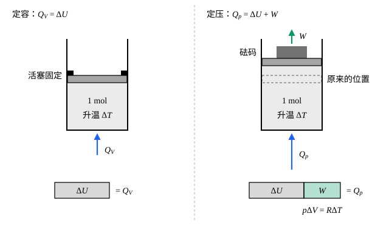

## 这一节要回答的问题

同样让$1\,\mathrm{mol}$气体升高$1\,\mathrm K$，体积不变和压强（pressure）不变时，吸收的:term[热量]{id="physics.thermal-physics.heat"}（heat）一样多吗？化学和工程手册常列出「:term[焓]{id="physics.thermal-physics.enthalpy"}」（enthalpy）的变化，为什么不直接给:term[内能]{id="physics.thermal-physics.internal-energy"}（internal energy）的变化？

## 讲解

### 热容

同样是$1\,\mathrm{kg}$，水升高$1\,\mathrm K$要吸收约$4.18\times10^3\,\mathrm J$的:term[热量]{id="physics.thermal-physics.heat"}，铁只要约$450\,\mathrm J$。

::anchor{id="def-heat-capacity"}
一个物体在一小段过程中吸收热量$\delta Q$，:term[温度]{id="physics.thermal-physics.temperature"}（temperature）升高$\dd T$，比值$C=\frac{\delta Q}{\dd T}$叫作这个物体的:term[热容]{id="physics.thermal-physics.heat-capacity"}（heat capacity），单位是$\mathrm{J/K}$。热容除以质量$m$，$c=\frac Cm$叫作:term[比热容]{id="physics.thermal-physics.specific-heat-capacity"}（specific heat capacity，也简称比热），单位是$\mathrm{J/(kg\cdot K)}$；除以:term[物质的量]{id="physics.thermal-physics.amount-of-substance"}（amount of substance）$n$，$\frac Cn$叫作:term[摩尔热容]{id="physics.thermal-physics.molar-heat-capacity"}（molar heat capacity），单位是$\mathrm{J/(mol\cdot K)}$。

为什么这样定义：温度变化不大时，吸的热和升温成正比，比值说明升温要吸多少热；除以质量或物质的量，才好比较材料，水的比热容约$4.18\times10^3\,\mathrm{J/(kg\cdot K)}$。边界情况：冰在$0\,^\circ\mathrm C$熔化时吸热，温度却不变，比值$\frac{\delta Q}{\dd T}$说不出是多少。

### 定容热容与定压热容

气体吸热时可以膨胀、对外做功（work）：体积不变时，吸的热全部用来增加:term[内能]{id="physics.thermal-physics.internal-energy"}；压强不变时，还要分一部分去做功（几何图像）。所以只说「升温$\dd T$」，$\delta Q$还定不下来。

::anchor{id="def-cv-cp"}
体积保持不变时，$C_V=\Bigl(\frac{\delta Q}{\dd T}\Bigr)_V$叫作:term[定容热容]{id="physics.thermal-physics.constant-volume-heat-capacity"}（heat capacity at constant volume）；压强保持不变时，$C_p=\Bigl(\frac{\delta Q}{\dd T}\Bigr)_p$叫作:term[定压热容]{id="physics.thermal-physics.constant-pressure-heat-capacity"}（heat capacity at constant pressure）。$1\,\mathrm{mol}$物质的写成$C_{V,\mathrm m}$、$C_{p,\mathrm m}$，叫作定容摩尔热容、定压摩尔热容（molar heat capacity at constant volume、at constant pressure）；单位质量的写成$c_V$、$c_p$，叫作定容比热容、定压比热容（specific heat capacity at constant volume、at constant pressure）。

为什么这样定义：说清什么保持不变（右下角的$V$、$p$注明的就是它），:term[热容]{id="physics.thermal-physics.heat-capacity"}才定得下来；体积不变、压强不变是最常见的两种条件。边界情况：沿别的过程加热，热容又是别的值（第 5 题）；:term[等温过程]{id="physics.thermal-physics.isothermal-process"}（isothermal process）、:term[绝热过程]{id="physics.thermal-physics.adiabatic-process"}（adiabatic process）的热容见第 7 题。

::anchor{id="thm-cv"}
定理：一定量的物质，除了体积变化的功不做别的功时，把内能$U$看成$T$、$V$的函数，定容热容$C_V=\pdvc UTV$。:term[理想气体]{id="physics.thermal-physics.ideal-gas"}（ideal gas）的$C_V=\dv UT$只和$T$有关，不管走什么路线，内能的改变都是$\dd U=nC_{V,\mathrm m}\dd T$；在:term[准静态过程]{id="physics.thermal-physics.quasi-static-process"}（quasi-static process）中，吸收的:term[热量]{id="physics.thermal-physics.heat"}$\delta Q=nC_{V,\mathrm m}\dd T+p\,\dd V$。

证明思路：:term[等容过程]{id="physics.thermal-physics.isochoric-process"}（isochoric process）中不做功，由:term[热力学第一定律]{id="physics.thermal-physics.first-law"}（first law of thermodynamics），$\delta Q=\dd U$；$V$固定时$U$只随$T$变，$\frac{\delta Q}{\dd T}$正是$U$对$T$的偏导数（partial derivative）。理想气体的$U$只和$T$有关（见[热力学第一定律](lesson:physics.thermal-physics.first-law#thm-ideal-gas-energy)），这个偏导数就是$\dv UT$；再代进$\delta Q=\dd U+p\,\dd V$即得。

$C_{V,\mathrm m}$不随:term[温度]{id="physics.thermal-physics.temperature"}变时，$\Delta U=nC_{V,\mathrm m}\Delta T$。取$n=1\,\mathrm{mol}$，上面的$\delta Q$就是[恰当方程](lesson:math.ode.exact-equations)第 7 题里的$\delta Q=C_V\dd T+\frac{RT}V\dd V$，那里的$C_V$是这里的$C_{V,\mathrm m}$；为什么写$\delta Q$不写$\dd Q$，见第 8 题。

理想气体的分子之间没有势能；单原子分子（monatomic molecule）又没有转动和振动，内能就是平动动能（translational kinetic energy）的总和。[气体动理论](lesson:physics.thermal-physics.kinetic-theory#thm-temperature-ke)里已经算出，每个分子的:term[平均平动动能]{id="physics.thermal-physics.mean-translational-kinetic-energy"}（mean translational kinetic energy）是$\frac32\kB T$，所以$U=N\cdot\frac32\kB T=\frac32nRT$，$C_{V,\mathrm m}=\frac32R\approx12.5\,\mathrm{J/(mol\cdot K)}$。

### 焓

敞口的锅里烧水，压强就是大气压（atmospheric pressure），不变。:term[等压过程]{id="physics.thermal-physics.isobaric-process"}（isobaric process）中$p\,\dd V=\dd(pV)$，所以吸收的:term[热量]{id="physics.thermal-physics.heat"}

$$
\delta Q=\dd U+p\,\dd V=\dd(U+pV),
$$

正好是$U+pV$的增加。

::anchor{id="def-enthalpy"}
$H=U+pV$叫作系统（system）的:term[焓]{id="physics.thermal-physics.enthalpy"}。$U$、$p$、$V$都是:term[状态函数]{id="physics.thermal-physics.state-function"}（state function），所以焓也是状态函数；在等压过程中，如果除了体积变化的功不做别的功，系统吸收的热量就等于焓的增加，$Q=\Delta H$。

为什么这样定义：等压时体积变化的功已经算在焓里，看焓的改变就知道吸了多少热，手册列出的「焓变」就是它。边界情况：压强在变或有别的功时，吸的热一般不等于焓的增加。本节的$H$专指焓，不是分析力学的:term[哈密顿量]{id="physics.analytical-mechanics.hamiltonian"}（Hamiltonian）。

以后会看到，把$U$看成熵（entropy）和体积的函数时，焓是它的一种:term[勒让德变换]{id="math.vector-calculus.legendre-transform"}（Legendre transform），自变量从体积换成了压强，见[热力学势](lesson:physics.thermal-physics.thermodynamic-potentials)。

::anchor{id="thm-cp"}
定理：一定量的物质，除了体积变化的功不做别的功时，把焓$H$看成$T$、$p$的函数，:term[定压热容]{id="physics.thermal-physics.constant-pressure-heat-capacity"}$C_p=\pdvc HTp$。

证明思路：压强不变时$\delta Q=\dd H$；$p$固定时$H$只随$T$变，$\frac{\delta Q}{\dd T}$正是$H$对$T$的偏导数。

下标不能省。$U$也可以看成$T$、$p$的函数，可$\pdvc UTp$不是定压热容：由$H=U+pV$，

$$
C_p=\pdvc UTp+p\pdvc VTp ,
$$

压强不变时升温，物体通常会膨胀、对外做功，多出后面一项；偏导数的值取决于另外哪个量保持不变，正是[偏导数](lesson:math.vector-calculus.partial-derivatives)第 7 题说的事。

### 理想气体的热容

::anchor{id="thm-mayer"}
定理（:term[迈耶公式]{id="physics.thermal-physics.mayers-relation"}，Mayer's relation）：:term[理想气体]{id="physics.thermal-physics.ideal-gas"}的$C_p=C_V+nR$，即$C_{p,\mathrm m}-C_{V,\mathrm m}=R$，$R$是:term[摩尔气体常量]{id="physics.thermal-physics.molar-gas-constant"}（molar gas constant）；这个差和气体的种类、:term[温度]{id="physics.thermal-physics.temperature"}都无关。

证明思路：由$pV=nRT$，$H=U+nRT$。$U$只和$T$有关，所以$H$也只和$T$有关，$C_p=\dv HT=\dv UT+nR=C_V+nR$。多出的$nR\,\dd T$正是压强不变时对外做的功$p\,\dd V$（几何图像）。

::anchor{id="def-heat-capacity-ratio"}
:term[定压热容]{id="physics.thermal-physics.constant-pressure-heat-capacity"}与:term[定容热容]{id="physics.thermal-physics.constant-volume-heat-capacity"}之比$\gamma=\frac{C_p}{C_V}=\frac{C_{p,\mathrm m}}{C_{V,\mathrm m}}$叫作:term[比热容比]{id="physics.thermal-physics.heat-capacity-ratio"}（heat capacity ratio），也叫绝热指数（adiabatic index）。

为什么这样定义：准静态的:term[绝热过程]{id="physics.thermal-physics.adiabatic-process"}中，压强随体积变得多快由它决定（见[绝热过程](lesson:physics.thermal-physics.adiabatic-processes)），「绝热指数」的名字由此而来。边界情况：固体、常温的水受热时体积变化很小，$\gamma$很接近 1。

室温（约$300\,\mathrm K$）、压强不大时，几种气体的:term[摩尔热容]{id="physics.thermal-physics.molar-heat-capacity"}（单位$\mathrm{J/(mol\cdot K)}$）和比热容比：

| 气体 | $C_{V,\mathrm m}$ | $C_{p,\mathrm m}$ | $\gamma$ |
| --- | --- | --- | --- |
| 氦气 | 12.5 | 20.8 | 1.67 |
| 氩气 | 12.5 | 20.8 | 1.67 |
| 氢气 | 20.5 | 28.8 | 1.41 |
| 氮气 | 20.8 | 29.1 | 1.40 |
| 氧气 | 21.1 | 29.4 | 1.39 |
| 二氧化碳 | 28.8 | 37.1 | 1.29 |

每一行的$C_{p,\mathrm m}-C_{V,\mathrm m}$都约是$8.3\,\mathrm{J/(mol\cdot K)}$，正是$R$。氦、氩的$C_{V,\mathrm m}$、$C_{p,\mathrm m}$正好是$\frac32R$、$\frac52R$，$\gamma=\frac53$；氢、氮、氧是双原子分子（diatomic molecule），$C_{V,\mathrm m}$约是$\frac52R$，多出的$R$来自分子的转动，见[能量均分定理](lesson:physics.thermal-physics.equipartition)。空气主要是氮和氧，$\gamma\approx1.40$。

## 几何图像

两个气缸里各有$1\,\mathrm{mol}$单原子:term[理想气体]{id="physics.thermal-physics.ideal-gas"}，都升温$\Delta T$。左边体积不变，吸的:term[热量]{id="physics.thermal-physics.heat"}$Q_V$全部变成:term[内能]{id="physics.thermal-physics.internal-energy"}的增加；右边压强不变，内能增加得一样多（内能只和:term[温度]{id="physics.thermal-physics.temperature"}有关），多吸的热$Q_p-Q_V$正好是对外做的功$p\Delta V=R\Delta T$，这就是:term[迈耶公式]{id="physics.thermal-physics.mayers-relation"}。箭头和长条各自按比例画，$\Delta U=\frac32R\Delta T$。

## 例题

### 例 1　水烧成水蒸气

1 标准大气压（standard atmosphere）下，$1.00\,\mathrm{kg}$、$100\,^\circ\mathrm C$的水全部变成$100\,^\circ\mathrm C$的水蒸气，要吸收$2.26\times10^6\,\mathrm J$的:term[热量]{id="physics.thermal-physics.heat"}。水的:term[焓]{id="physics.thermal-physics.enthalpy"}和:term[内能]{id="physics.thermal-physics.internal-energy"}各增加了多少？水的:term[摩尔质量]{id="physics.thermal-physics.molar-mass"}（molar mass）取$18.0\,\mathrm{g/mol}$，水蒸气当作:term[理想气体]{id="physics.thermal-physics.ideal-gas"}。

**为什么想到这么做**：压强不变，吸的热就是焓的增加；内能的增加还要扣掉对外做的功。

**推导**：$\Delta H=Q=2.26\times10^6\,\mathrm J$。水的:term[物质的量]{id="physics.thermal-physics.amount-of-substance"}$n=\frac{1000}{18.0}\,\mathrm{mol}\approx55.6\,\mathrm{mol}$，变成水蒸气后体积$V=\frac{nRT}p\approx1.70\,\mathrm{m^3}$，原来的水只有约$1\times10^{-3}\,\mathrm{m^3}$，可以不计。对外做功$p\Delta V\approx nRT\approx1.72\times10^5\,\mathrm J$，所以

$$
\Delta U=\Delta H-p\Delta V\approx2.26\times10^6\,\mathrm J-0.17\times10^6\,\mathrm J\approx2.09\times10^6\,\mathrm J .
$$

吸的热九成多用来增加内能：水分子互相吸引，把它们拉开，分子势能（intermolecular potential energy）要增加很多。

## 常见误区

- 「:term[焓]{id="physics.thermal-physics.enthalpy"}就是物体含有的:term[热量]{id="physics.thermal-physics.heat"}。」物体并不「含有」热量，热量是过程中传递的能量（见[内能与热量](lesson:physics.thermal-physics.internal-energy#def-heat)）；焓是:term[状态函数]{id="physics.thermal-physics.state-function"}$U+pV$。
