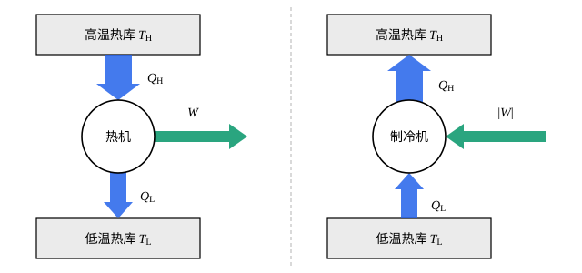

## 这一节要回答的问题

汽油机（gasoline engine）烧汽油放出的:term[热量]{id="physics.thermal-physics.heat"}（heat），只有三成左右变成了推动汽车的功（work）。能不能把吸收的热量全部变成功？在两个:term[温度]{id="physics.thermal-physics.temperature"}（temperature）之间工作的机器，最多能把几成变成功？

## 讲解

### 热机与热机效率

蒸汽机（steam engine）里，水从炉火吸热变成蒸汽，推动活塞做功，再放热给冷却水，凝结后回到锅炉。炉火和冷却水可以看成两个:term[热库]{id="physics.thermal-physics.heat-reservoir"}（heat reservoir）。

::anchor{id="def-heat-engine"}
让一种物质重复同一个:term[循环]{id="physics.thermal-physics.cyclic-process"}（cyclic process），每个循环从高温热库吸热、对外做功、向低温热库放热，这样的装置叫作:term[热机]{id="physics.thermal-physics.heat-engine"}（heat engine），这种物质叫作它的:term[工作物质]{id="physics.thermal-physics.working-substance"}（working substance）。

为什么这样定义：机器要一直做功，工作物质就得一次次回到原来的状态。边界情况：:term[理想气体]{id="physics.thermal-physics.ideal-gas"}（ideal gas）:term[等温膨胀]{id="physics.thermal-physics.isothermal-process"}（isothermal expansion）时吸的热全部变成了功，可气体胀大了，没回到原来的状态，单独一次膨胀不是热机。

一个循环里，工作物质从:term[温度]{id="physics.thermal-physics.temperature"}为$T_{\mathrm H}$的高温热库吸热$Q_{\mathrm H}$，向温度为$T_{\mathrm L}$的低温热库放热$Q_{\mathrm L}$（都取正值），对外做净功$W$；:term[内能]{id="physics.thermal-physics.internal-energy"}（internal energy）不变，由:term[热力学第一定律]{id="physics.thermal-physics.first-law"}（first law of thermodynamics），$W=Q_{\mathrm H}-Q_{\mathrm L}$。

::anchor{id="def-thermal-efficiency"}
热机一个循环对外做的净功$W$和从高温热库吸收的:term[热量]{id="physics.thermal-physics.heat"}$Q_{\mathrm H}$之比叫作:term[热机效率]{id="physics.thermal-physics.thermal-efficiency"}（thermal efficiency），记作$\eta=\frac W{Q_{\mathrm H}}=1-\frac{Q_{\mathrm L}}{Q_{\mathrm H}}$。

为什么这样定义：$Q_{\mathrm H}$要烧燃料得来，$\eta$就是它变成功的比例。边界情况：第一定律不禁止$Q_{\mathrm L}=0$、$\eta=1$，可这样的热机从来没有造出过，原因见[热力学第二定律](lesson:physics.thermal-physics.second-law)。这里的$\eta$不是:term[黏度]{id="physics.thermal-physics.viscosity"}（coefficient of viscosity）。

滑动摩擦力把动能（kinetic energy）变成内能，这些内能不会自己变回动能（[势能与机械能守恒](lesson:physics.newtonian-mechanics.potential-energy)第 8 题）；要变回一部分，就得用热机（第 7 题）。

### 卡诺循环

卡诺（Sadi Carnot）设想的理想:term[热机]{id="physics.thermal-physics.heat-engine"}，只在:term[工作物质]{id="physics.thermal-physics.working-substance"}的:term[温度]{id="physics.thermal-physics.temperature"}和:term[热库]{id="physics.thermal-physics.heat-reservoir"}相同时才让两者交换:term[热量]{id="physics.thermal-physics.heat"}。

::anchor{id="def-carnot-cycle"}
由两个准静态的:term[等温过程]{id="physics.thermal-physics.isothermal-process"}（isothermal process）和两个准静态的:term[绝热过程]{id="physics.thermal-physics.adiabatic-process"}（adiabatic process）交替组成的:term[循环]{id="physics.thermal-physics.cyclic-process"}，两个等温过程的温度分别等于两个热库的温度$T_{\mathrm H}$、$T_{\mathrm L}$，叫作:term[卡诺循环]{id="physics.thermal-physics.carnot-cycle"}（Carnot cycle）；按卡诺循环工作的热机叫作:term[卡诺热机]{id="physics.thermal-physics.carnot-engine"}（Carnot engine）。

以:term[理想气体]{id="physics.thermal-physics.ideal-gas"}为工作物质时，四段在:term[$p$-$V$图]{id="physics.thermal-physics.pv-diagram"}（$p$-$V$ diagram）上沿顺时针走（几何图像）：

- 1→2：等温膨胀，从高温热库吸热$Q_{\mathrm H}$；
- 2→3：绝热膨胀，降到$T_{\mathrm L}$；
- 3→4：等温压缩，向低温热库放热$Q_{\mathrm L}$；
- 4→1：绝热压缩，回到状态 1。

为什么这样定义：热量不隔着温差白白流过去；四段都是:term[准静态过程]{id="physics.thermal-physics.quasi-static-process"}（quasi-static process），没有摩擦时还能倒过来运行，各段的热量和功只改变正负。边界情况：准静态过程无限缓慢，照它造的热机每秒做的功趋于零（第 8 题）。

::anchor{id="thm-carnot-efficiency"}
定理：卡诺热机的工作物质是一定量的理想气体，它的:term[定容摩尔热容]{id="physics.thermal-physics.constant-volume-heat-capacity"}（molar heat capacity at constant volume）$C_{V,\mathrm m}$不随温度变，又只做体积变化的功时，一个循环里$\frac{Q_{\mathrm L}}{Q_{\mathrm H}}=\frac{T_{\mathrm L}}{T_{\mathrm H}}$，所以:term[热机效率]{id="physics.thermal-physics.thermal-efficiency"}$\eta=1-\frac{T_{\mathrm L}}{T_{\mathrm H}}$。

证明思路：理想气体等温时:term[内能]{id="physics.thermal-physics.internal-energy"}不变（见[热力学第一定律](lesson:physics.thermal-physics.first-law#thm-ideal-gas-energy)），吸的热等于对外做的功。记四个状态的体积为$V_1$到$V_4$，由[准静态过程与气体的功](lesson:physics.thermal-physics.quasi-static-processes#thm-gas-work)，

$$
Q_{\mathrm H}=nRT_{\mathrm H}\ln\frac{V_2}{V_1} ,\qquad Q_{\mathrm L}=nRT_{\mathrm L}\ln\frac{V_3}{V_4} .
$$

两段绝热过程中$TV^{\gamma-1}$不变（见[绝热过程](lesson:physics.thermal-physics.adiabatic-processes#thm-adiabatic)），$T_{\mathrm H}V_2^{\gamma-1}=T_{\mathrm L}V_3^{\gamma-1}$，$T_{\mathrm H}V_1^{\gamma-1}=T_{\mathrm L}V_4^{\gamma-1}$，相除得$\frac{V_2}{V_1}=\frac{V_3}{V_4}$，所以$\frac{Q_{\mathrm L}}{Q_{\mathrm H}}=\frac{T_{\mathrm L}}{T_{\mathrm H}}$。

结果里没有$\gamma$，只有:term[热力学温度]{id="physics.thermal-physics.thermodynamic-temperature"}（thermodynamic temperature）$T_{\mathrm H}$、$T_{\mathrm L}$，不能代摄氏温度（Celsius temperature）。以后会证明，不管工作物质是什么，卡诺热机的热机效率都是$1-\frac{T_{\mathrm L}}{T_{\mathrm H}}$，工作在两个热库之间的热机都不会超过它，由它还能规定和物质无关的:term[温标]{id="physics.thermal-physics.temperature-scale"}（temperature scale），见[卡诺定理与热力学温标](lesson:physics.thermal-physics.carnot-theorem)。

### 制冷机

冰箱靠压缩机（compressor）做功，把冷藏室里的:term[热量]{id="physics.thermal-physics.heat"}搬出来，从背后放掉。

::anchor{id="def-refrigerator"}
外界（surroundings）对:term[工作物质]{id="physics.thermal-physics.working-substance"}做功，使它在每个:term[循环]{id="physics.thermal-physics.cyclic-process"}里从:term[低温热库]{id="physics.thermal-physics.heat-reservoir"}吸收热量$Q_{\mathrm L}$、向高温热库放出热量$Q_{\mathrm H}$，这样的装置叫作:term[制冷机]{id="physics.thermal-physics.refrigerator"}（refrigerator）；外界一个循环做的净功是$-W=|W|$，比值$\frac{Q_{\mathrm L}}{|W|}$叫作:term[制冷系数]{id="physics.thermal-physics.coefficient-of-performance"}（coefficient of performance）。

为什么这样定义：制冷要的是取走的热量，付出的是外界做的功。边界情况：:term[热力学第二定律]{id="physics.thermal-physics.second-law"}（second law of thermodynamics）说，热量不会自发地从低温物体传到高温物体（见[热力学第二定律](lesson:physics.thermal-physics.second-law#thm-clausius)），所以只靠两个热库，制冷机离不开外界做功。

::anchor{id="thm-carnot-refrigerator"}
定理：把:term[卡诺循环]{id="physics.thermal-physics.carnot-cycle"}倒过来运行，就得到一台制冷机，叫作:term[卡诺制冷机]{id="physics.thermal-physics.carnot-refrigerator"}（Carnot refrigerator）；工作物质满足上面:term[卡诺热机]{id="physics.thermal-physics.carnot-engine"}那条定理的条件时，它的制冷系数$\frac{Q_{\mathrm L}}{|W|}=\frac{T_{\mathrm L}}{T_{\mathrm H}-T_{\mathrm L}}$。

证明思路：倒过来运行时各段的热量和功只改变正负，仍有$\frac{Q_{\mathrm L}}{Q_{\mathrm H}}=\frac{T_{\mathrm L}}{T_{\mathrm H}}$，代入$|W|=Q_{\mathrm H}-Q_{\mathrm L}$即得。以后会证明，不管工作物质是什么，卡诺制冷机的制冷系数都是这个值。

$T_{\mathrm H}$不变时，$T_{\mathrm L}$越接近:term[绝对零度]{id="physics.thermal-physics.absolute-zero"}（absolute zero），制冷系数越小，制冷越费功。

## 几何图像

左图是:term[热机]{id="physics.thermal-physics.heat-engine"}，:term[热机效率]{id="physics.thermal-physics.thermal-efficiency"}是 40%；右图是:term[制冷机]{id="physics.thermal-physics.refrigerator"}。蓝色箭头是:term[热量]{id="physics.thermal-physics.heat"}，绿色箭头是功，宽度按能量的比例画。

:::anim{component="function-plot"}
range: { x: [0, 9], y: [0, 4.4] }
functions:
  - expr: "4/x + 0*sqrt((x-1)*(2-x))"
    label: |
      1→2 等温膨胀
  - expr: "2*(2/x)^(5/3) + 0*sqrt((x-2)*(2*(4/TL)^1.5-x))"
    label: |
      2→3 绝热膨胀
  - expr: "TL/x + 0*sqrt((x-(4/TL)^1.5)*(2*(4/TL)^1.5-x))"
    label: |
      3→4 等温压缩
  - expr: "4*x^(-5/3) + 0*sqrt((x-1)*((4/TL)^1.5-x))"
    label: |
      4→1 绝热压缩
points:
  - { x: 1, y: 4 }
  - { x: 2, y: 2 }
  - { x: "2*(4/TL)^1.5", y: "TL/(2*(4/TL)^1.5)" }
  - { x: "(4/TL)^1.5", y: "TL/((4/TL)^1.5)" }
sliders:
  - name: TL
    min: 1.5
    max: 3.5
    step: 0.1
    default: 2
    label: |
      低温热库的温度$T_{\mathrm L}$
:::

图上是单原子:term[理想气体]{id="physics.thermal-physics.ideal-gas"}（monatomic ideal gas，$\gamma=\frac53$）的:term[卡诺循环]{id="physics.thermal-physics.carnot-cycle"}，$nR=1$、$T_{\mathrm H}=4$，任意单位；横轴 x 是体积$V$，纵轴 y 是压强（pressure）$p$，四个圆点从左上角起顺时针依次是状态 1 到 4。调低$T_{\mathrm L}$，$Q_{\mathrm H}=4\ln2$不变，围成的面积（净功）变大，热机效率$1-\frac{T_{\mathrm L}}4$变高。

## 例题

### 例 1　卡诺热机的功

:term[卡诺热机]{id="physics.thermal-physics.carnot-engine"}在$800\,\mathrm K$和$300\,\mathrm K$的两个:term[热库]{id="physics.thermal-physics.heat-reservoir"}之间工作，每个:term[循环]{id="physics.thermal-physics.cyclic-process"}吸热$2000\,\mathrm J$，:term[热机效率]{id="physics.thermal-physics.thermal-efficiency"}是多少？做多少功、放多少热？

**为什么想到这么做**：卡诺热机的热机效率只看两个热库的:term[热力学温度]{id="physics.thermal-physics.thermodynamic-temperature"}，再由$W=\eta Q_{\mathrm H}$、$Q_{\mathrm L}=Q_{\mathrm H}-W$求功和:term[热量]{id="physics.thermal-physics.heat"}。

**推导**：$\eta=1-\frac{300}{800}=0.625$，$W=0.625\times2000\,\mathrm J=1250\,\mathrm J$，$Q_{\mathrm L}=2000\,\mathrm J-1250\,\mathrm J=750\,\mathrm J$。火力发电厂的蒸汽约$800\,\mathrm K$、冷却水约$300\,\mathrm K$，实际的热机效率却只有约 40%，原因之一见第 8 题。

## 常见误区

- 「把摩擦、漏热都减到零，:term[热机效率]{id="physics.thermal-physics.thermal-efficiency"}就能达到 100%。」没有摩擦、不漏热的:term[卡诺热机]{id="physics.thermal-physics.carnot-engine"}，热机效率也只有$1-\frac{T_{\mathrm L}}{T_{\mathrm H}}$：3→4 必须向:term[低温热库]{id="physics.thermal-physics.heat-reservoir"}放热，:term[工作物质]{id="physics.thermal-physics.working-substance"}才回得到原来的状态。
- 「:term[制冷系数]{id="physics.thermal-physics.coefficient-of-performance"}大于 1，说明:term[制冷机]{id="physics.thermal-physics.refrigerator"}凭空多出了能量。」能量照样守恒，$Q_{\mathrm H}=Q_{\mathrm L}+|W|$：制冷机不只是把功变成:term[热量]{id="physics.thermal-physics.heat"}，还靠做功把热量从低温热库搬到高温热库，搬走的可以比做的功多，冰箱的制冷系数通常就大于 1。
