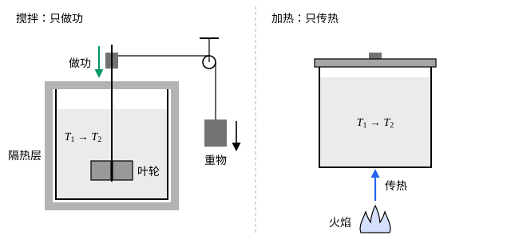

## 这一节要回答的问题

搓手会热，烤火也会热，这两种办法是一回事吗？说一杯热水「含有」多少热，有没有意义？

## 讲解

### 做功和传热

焦耳（James Prescott Joule）用下落的重物带动叶轮，搅动隔热容器里的水，水的:term[温度]{id="physics.thermal-physics.temperature"}（temperature）升高；给水里的电阻丝通电或用火加热，水也能升到同样的温度。他测得约$4.15\,\mathrm J$的功（work）和加热 1 卡（calorie，约让$1\,\mathrm g$水升温$1\,\mathrm K$的热）的效果相同；现在规定$1\,\mathrm{cal}=4.184\,\mathrm J$，课本常写$4.18\,\mathrm J$。

::anchor{id="def-adiabatic-process"}
如果隔着一层壁，外界（surroundings）只能靠做功（推活塞、搅拌、通电）改变系统（system）的状态，这层壁叫作绝热壁（adiabatic wall），保温瓶的真空夹层近似如此；被绝热壁包着的系统经历的过程，叫作:term[绝热过程]{id="physics.thermal-physics.adiabatic-process"}（adiabatic process）。

为什么这样定义：冷热的影响进不来，做功的效果才能单独看。边界情况：绝热过程不要求缓慢，焦耳搅拌水时水流翻滚，不是:term[准静态过程]{id="physics.thermal-physics.quasi-static-process"}（quasi-static process）；准静态的绝热过程见[绝热过程](lesson:physics.thermal-physics.adiabatic-processes)。

::anchor{id="thm-adiabatic-work"}
实验事实：系统整体不动时，绝热过程中外界对系统做的功只由初、末两个:term[平衡态]{id="physics.thermal-physics.equilibrium-state"}（equilibrium state）决定，和怎样做功、经过哪些中间状态都无关。实验还表明，同一个系统的任意两个平衡态之间，至少能从其中一个绝热地变到另一个。

### 内能

::anchor{id="def-internal-energy"}
于是可以给每个:term[平衡态]{id="physics.thermal-physics.equilibrium-state"}配一个数$U$，使系统整体不动、经:term[绝热过程]{id="physics.thermal-physics.adiabatic-process"}从状态 1 变到状态 2 时，外界做的功等于$U_2-U_1$；$U$叫作系统的:term[内能]{id="physics.thermal-physics.internal-energy"}（internal energy）。从分子看，它是分子无规则运动的动能（kinetic energy）、分子之间的势能（分子势能，intermolecular potential energy）和分子内部原子之间的势能（见[能量均分定理](lesson:physics.thermal-physics.equipartition)）的总和，不含系统整体运动的动能，也不含:term[静能]{id="physics.special-relativity.rest-energy"}（rest energy）。

为什么这样定义：外界做的功只看两头，$U$才定得下来，就像重力做功只看高低，才有重力势能（gravitational potential energy）；$U$只定到差一个常数，有意义的是$\Delta U$。边界情况：端着一杯水快走或把它举高，手做的功变成了水整体的动能或重力势能，内能并没有变。本领域的$U$只表示内能，不是牛顿力学$E=K+U$里的势能。

::anchor{id="def-state-function"}
像$U$这样由平衡态的:term[状态参量]{id="physics.thermal-physics.state-variable"}（state variable）唯一确定的量，叫作:term[状态函数]{id="physics.thermal-physics.state-function"}（state function）；$p$、$V$、$T$也是。

为什么这样定义：它的改变量只看初、末状态，算起来方便。反例：功不是状态函数，[准静态过程与气体的功](lesson:physics.thermal-physics.quasi-static-processes)例 1 两条路线的始末状态相同，功却不同。

### 热量

::anchor{id="def-heat"}
:term[温度]{id="physics.thermal-physics.temperature"}不同的两个系统，只要没被绝热壁隔开，即使不做功，:term[内能]{id="physics.thermal-physics.internal-energy"}也会从温度高的一方转到低的一方，这样转移的能量叫作:term[热量]{id="physics.thermal-physics.heat"}（heat），记作$Q$，系统吸热时$Q>0$。热量在直接接触的物体之间或物体内部由高温处传到低温处、物质本身并不流动，这种方式叫作:term[热传导]{id="physics.thermal-physics.heat-conduction"}（heat conduction），如铁勺的柄在热汤里变烫；传热的方式还有靠液体、气体的流动把热量带走的对流（convection）和热辐射（thermal radiation）。

为什么这样定义：传热靠温度差，做功靠力推着物体移动，两者要分开记账；热传导单独起名，是因为以后要讲导热的快慢。边界情况：物体并不「含有」热量；热辐射隔着真空也能传，保温瓶的真空夹层挡住的是热传导和对流。

搓手靠做功，烤火靠传热，都使手的内能增加，只看结果分不出是哪一种。[势能与机械能守恒](lesson:physics.newtonian-mechanics.potential-energy#thm-mechanical-energy)里摩擦力做负功、机械能（mechanical energy）「变成了内能」，说的就是这里的内能。既做功又传热时内能怎样变，见[热力学第一定律](lesson:physics.thermal-physics.first-law)。

## 几何图像

左边重物下落，带动叶轮搅拌隔热容器里的水，只做功；右边同样的水放在火上加热，只传热。两边的水都从$T_1$升到$T_2$，末态相同，:term[内能]{id="physics.thermal-physics.internal-energy"}的增加也相同，只看末态分不出是哪一种。

## 例题

### 例 1　焦耳实验的数

两个各$10.0\,\mathrm{kg}$的重物匀速下落$1.50\,\mathrm m$，带动叶轮搅拌隔热容器里$4.00\,\mathrm{kg}$的水，这样重复 20 次。绳和滑轮的摩擦、容器和叶轮吸收的能量都不计，取$g=9.8\,\mathrm{m/s^2}$。水温升高多少？不搅拌、只用火加热，要让水升温同样多，水要吸收多少:term[热量]{id="physics.thermal-physics.heat"}？

**为什么想到这么做**：容器隔热，外界做的功等于水的:term[内能]{id="physics.thermal-physics.internal-energy"}的增加；不做功时，吸收的热量也等于内能的增加。内能增加同样多，不管靠做功还是传热，水升温一样：每克水升温约$1\,\mathrm K$要$1\,\mathrm{cal}=4.184\,\mathrm J$。

**推导**：重物匀速下落，绳子的拉力等于重物的重力，绳子每放下$h$，就对叶轮做功$mgh$。两个重物各下落一次，绳子共做功$2mgh=2\times10.0\times9.8\times1.50\,\mathrm J=294\,\mathrm J$，20 次共$5880\,\mathrm J$，水的内能增加$5880\,\mathrm J$。只用火加热时，水要吸收同样多的热量，$5880\,\mathrm J$合$\frac{5880}{4.184}\,\mathrm{cal}\approx1405\,\mathrm{cal}$；$4000\,\mathrm g$水升温$\Delta T\approx\frac{1405}{4000}\,\mathrm K\approx0.351\,\mathrm K$。

升温这样小，焦耳要用很精密的温度计才测得出来。

## 常见误区

- 「热是物体里含有的一种物质，传热就是它从热的物体流到冷的物体。」焦耳的叶轮只靠做功就能让水一直变热，物体里含有的物质不会这样越搅越多。传热转移的是能量，它和做功一样，改变的都是:term[内能]{id="physics.thermal-physics.internal-energy"}。
- 「棉衣能保暖，是因为它会产生:term[热量]{id="physics.thermal-physics.heat"}。」棉衣自己并不产生热量：纤维之间困住了许多空气，空气导热很差，又不容易流动形成对流，身体向外传热就慢了。
