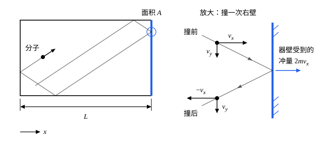

## 这一节要回答的问题

给轮胎打气，轮胎越打越硬，可谁也看不见分子怎样把它往外撑。一个分子撞一下器壁微不足道，气体的压强（pressure）为什么又稳又均匀？:term[温度]{id="physics.thermal-physics.temperature"}（temperature）的高低，在分子层面意味着什么？

## 讲解

### 分子的热运动

往清水里滴一滴墨水，不搅也会慢慢散开。显微镜下的布朗运动（Brownian motion，见[布朗运动与扩散](lesson:physics.thermal-physics.brownian-motion)）更直接：悬浮在水里的小颗粒被水分子撞得不停地乱抖。

::anchor{id="def-thermal-motion"}
大量分子永不停息的无规则运动叫作:term[热运动]{id="physics.thermal-physics.thermal-motion"}（thermal motion）；:term[温度]{id="physics.thermal-physics.temperature"}越高，热运动越剧烈。

为什么这样定义：墨水散开、气体有压强，都来自这种杂乱的运动。边界情况：刮风时空气整体的流动不算热运动，分子相对于整体流动的杂乱运动才算。

::anchor{id="def-kinetic-theory"}
用力学规律加上对大量分子求平均，来解释压强、温度这些宏观（macroscopic）性质，这样的理论叫作:term[气体动理论]{id="physics.thermal-physics.kinetic-theory"}（kinetic theory of gases）。

为什么这样定义：$1\,\mathrm{cm^3}$空气里约有$2.5\times10^{19}$个分子，没法一个个追踪，可分子越多，平均值越稳定。边界情况：液体和稠密的气体里，分子之间的力不能不管。

::anchor{id="def-ideal-gas-model"}
把:term[理想气体]{id="physics.thermal-physics.ideal-gas"}（ideal gas）的分子想成这样：分子是质点，除了碰撞的瞬间互不作用；碰壁是弹性碰撞（elastic collision），垂直于器壁的速度分量反向、大小不变，平行的分量不变；分子很多，没有哪个方向特殊。这叫作理想气体的微观模型（microscopic model of an ideal gas）。

为什么这样定义：这是能算出压强的最简单的模型。边界情况：压强很大、温度很低时，分子本身的大小和分子之间的吸引不能忽略（[理想气体状态方程](lesson:physics.thermal-physics.ideal-gas-law)第 7 题）。

第$i$个分子的速度是$\vb v_i=(v_{ix},v_{iy},v_{iz})$，记$\langle v_x^2\rangle=\frac1N\sum_iv_{ix}^2$：尖括号表示同一时刻对所有分子求平均；课本常把$\langle v^2\rangle$写成$\overline{v^2}$，本领域的横线留给对时间的平均。由点积（dot product），$v^2=v_x^2+v_y^2+v_z^2$；没有哪个方向特殊，所以

$$
\langle v_x^2\rangle=\langle v_y^2\rangle=\langle v_z^2\rangle=\frac13\langle v^2\rangle .
$$

### 压强从哪里来

本领域的$p$只表示压强，分子的动量（momentum）写成$mv_x$；面积写$A$，$S$留给:term[熵]{id="physics.thermal-physics.entropy"}（entropy）；时间间隔写$\Delta t$，$T$是:term[温度]{id="physics.thermal-physics.temperature"}。

长方体盒子沿$x$方向长$L$，右壁的面积是$A$（下图）。第$i$个分子以$v_{ix}>0$撞上右壁，弹回后是$-v_{ix}$；由动量定理（impulse–momentum theorem）和牛顿第三定律（Newton's third law），右壁受到沿$x$方向、大小为$2mv_{ix}$的冲量（impulse）。

它飞到左壁再飞回来，沿$x$方向走$2L$，碰到其余侧壁时$v_x$不变，所以每隔$\frac{2L}{v_{ix}}$撞一次右壁。很长的时间$\Delta t$里撞约$\frac{v_{ix}\Delta t}{2L}$次，冲量共约$\frac{mv_{ix}^2}L\Delta t$，平均力（average force，见[动量与冲量](lesson:physics.newtonian-mechanics.momentum-impulse#def-average-force)）是$\frac{mv_{ix}^2}L$。$N$个分子加起来，右壁受的力是$F=\frac{Nm}L\langle v_x^2\rangle$。

::anchor{id="def-mean-translational-ke"}
分子整体的平移叫作平动（translation），一个分子的平动动能（translational kinetic energy）是$\varepsilon_{\mathrm t}=\frac12mv^2$，它对所有分子的平均值$\langle\varepsilon_{\mathrm t}\rangle=\frac12m\langle v^2\rangle$叫作:term[平均平动动能]{id="physics.thermal-physics.mean-translational-kinetic-energy"}（mean translational kinetic energy）。

为什么这样定义：分子的动量只由整个分子平移的速度决定，压强也就只和平动有关。边界情况：单原子分子（monatomic molecule）的动能就是平动动能，别的分子还会转动、振动（见[能量均分定理](lesson:physics.thermal-physics.equipartition)）。

::anchor{id="thm-pressure"}
定理：在:term[理想气体]{id="physics.thermal-physics.ideal-gas"}的微观模型里，压强$p=\frac13\cdot\frac NV\,m\langle v^2\rangle=\frac23\cdot\frac NV\langle\varepsilon_{\mathrm t}\rangle$，$\frac NV$是:term[数密度]{id="physics.thermal-physics.number-density"}（number density）。

证明思路：$p=\frac FA=\frac{Nm}{LA}\langle v_x^2\rangle$，$LA=V$，再用$\langle v_x^2\rangle=\frac13\langle v^2\rangle$和平均平动动能的定义。推导里没管分子之间的碰撞：相撞时总动量不变，结果不受影响（第 8 题）。

所以压强来自分子的:term[热运动]{id="physics.thermal-physics.thermal-motion"}。$0\,^\circ\mathrm C$、1 标准大气压（standard atmosphere）下，每平方厘米的器壁每秒挨$10^{23}$次量级的撞击（温度不变时和数密度成正比），平均下来就成了稳定、均匀的压强。

### 温度的微观意义

::anchor{id="thm-temperature-ke"}
定理：:term[理想气体]{id="physics.thermal-physics.ideal-gas"}分子的:term[平均平动动能]{id="physics.thermal-physics.mean-translational-kinetic-energy"}只由:term[温度]{id="physics.thermal-physics.temperature"}决定，$\langle\varepsilon_{\mathrm t}\rangle=\frac32\kB T$，和气体的种类无关；$\kB$是:term[玻尔兹曼常量]{id="physics.thermal-physics.boltzmann-constant"}（Boltzmann constant），$T$是:term[热力学温度]{id="physics.thermal-physics.thermodynamic-temperature"}（thermodynamic temperature）。

证明思路：把压强公式和$p=\frac NV\kB T$（见[理想气体状态方程](lesson:physics.thermal-physics.ideal-gas-law#def-number-density)）比较，约掉$\frac NV$即得。

这就是温度的微观意义：温度是分子平均平动动能的量度，温度越高，:term[热运动]{id="physics.thermal-physics.thermal-motion"}越剧烈。$300\,\mathrm K$时$\kB T\approx4.14\times10^{-21}\,\mathrm J$，$\langle\varepsilon_{\mathrm t}\rangle\approx6.21\times10^{-21}\,\mathrm J$。这里只对理想气体推了出来；温度不太低时，液体、固体里分子的平均平动动能也是$\frac32\kB T$（见[能量均分定理](lesson:physics.thermal-physics.equipartition)），所以热茶里的分子平均确实比冷茶里的快。

同温下各种分子的平均平动动能相同，所以压强只由:term[数密度]{id="physics.thermal-physics.number-density"}和温度决定，和分子的种类、轻重无关。

### 方均根速率

::anchor{id="def-rms-speed"}
$v_{\mathrm{rms}}=\sqrt{\langle v^2\rangle}$叫作:term[方均根速率]{id="physics.thermal-physics.rms-speed"}（root-mean-square speed）：先平方，再对分子求平均，再开方。由$\frac12m\langle v^2\rangle=\frac32\kB T$，$v_{\mathrm{rms}}=\sqrt{\frac{3\kB T}m}=\sqrt{\frac{3RT}M}$（$\kB=\frac R{N_{\mathrm A}}$，$m=\frac M{N_{\mathrm A}}$），$R$是:term[摩尔气体常量]{id="physics.thermal-physics.molar-gas-constant"}（molar gas constant），$M$是:term[摩尔质量]{id="physics.thermal-physics.molar-mass"}（molar mass）。

为什么这样定义：压强和:term[温度]{id="physics.thermal-physics.temperature"}管的都是$\langle v^2\rangle$，开方后就是一个速率，能直接说分子跑得多快。$300\,\mathrm K$时氮分子的方均根速率约$517\,\mathrm{m/s}$，氢分子约$1.93\,\mathrm{km/s}$。

边界情况：它不是速率的平均值$\langle v\rangle$。$\langle v^2\rangle-\langle v\rangle^2=\bigl\langle(v-\langle v\rangle)^2\bigr\rangle\ge0$，所以$\langle v\rangle\le v_{\mathrm{rms}}$，分子的速率全都相同时才相等；单个分子的速率相差很远（见[麦克斯韦速率分布](lesson:physics.thermal-physics.maxwell-speed-distribution)）。

## 几何图像

:::anim{component="function-plot"}
range: { x: [0, 1000], y: [0, 4000] }
functions:
  - expr: "sqrt(3*8.314*x/0.002016)"
    label: |
      氢气
  - expr: "sqrt(3*8.314*x/0.004003)"
    label: |
      氦气
  - expr: "sqrt(3*8.314*x/0.028013)"
    label: |
      氮气
  - expr: "sqrt(3*8.314*x/0.031999)"
    label: |
      氧气
  - expr: "2370 + 0*x"
    label: |
      月球的逃逸速度
:::

横轴是:term[热力学温度]{id="physics.thermal-physics.thermodynamic-temperature"}$T$（$\mathrm K$，图上写作 x），纵轴是:term[方均根速率]{id="physics.thermal-physics.rms-speed"}（$\mathrm{m/s}$，图上写作 y）；四条曲线从上到下是氢气、氦气、氮气、氧气，水平线是月球的逃逸速度（escape velocity）$2.37\,\mathrm{km/s}$。同一:term[温度]{id="physics.thermal-physics.temperature"}下，越轻的分子跑得越快；月球为什么几乎没有大气，见第 4 题。

## 例题

### 例 1　不知道是什么气体，也能求方均根速率

$0\,^\circ\mathrm C$、1 标准大气压下，空气的密度（density）是$1.29\,\mathrm{kg/m^3}$。把空气当成一种气体，空气分子的:term[方均根速率]{id="physics.thermal-physics.rms-speed"}是多少？

**为什么想到这么做**：压强公式里的$\frac NVm$是单位体积里分子的总质量，也就是密度$\rho$，所以$p=\frac13\rho\langle v^2\rangle$，用不着知道分子是什么。

**推导**：$v_{\mathrm{rms}}=\sqrt{\frac{3p}\rho}=\sqrt{\frac{3\times1.013\times10^5}{1.29}}\,\mathrm{m/s}\approx485\,\mathrm{m/s}$。用$\sqrt{\frac{3RT}M}$、$M=29\,\mathrm{g/mol}$验算，也是约$485\,\mathrm{m/s}$。

## 常见误区

- 「:term[温度]{id="physics.thermal-physics.temperature"}升高，每个分子都运动得更快。」温度只管平均：任何时刻都有快有慢，升温以后照样有分子比升温前慢。
- 「密封容器里气体的压强是重力压出来的，和液体一样。」压强来自分子的:term[热运动]{id="physics.thermal-physics.thermal-motion"}：失重的飞船舱里，空气照样有压强；在地面上，高$1\,\mathrm m$的一箱空气，上下的压强也只差约$12\,\mathrm{Pa}$。
