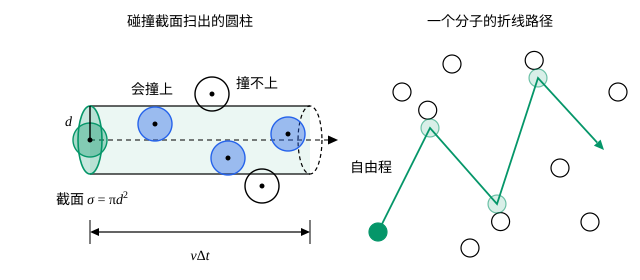

## 这一节要回答的问题

室温下空气分子的:term[方均根速率]{id="physics.thermal-physics.rms-speed"}（root-mean-square speed）约$500\,\mathrm{m/s}$，可在房间一角打开香水瓶，另一角的人要过好一会儿才闻到。分子飞得这么快，为什么「走」得这么慢？一个分子平均飞多远，就会撞上另一个分子？

## 讲解

### 碰撞截面

把分子想成直径为$d$的硬球（hard sphere），两个分子的中心相距$d$时恰好撞上。盯住一个分子，先假定别的分子都不动：别的分子的中心离它的中心走的直线不到$d$，就会被撞上（几何图像的左图）。

::anchor{id="def-cross-section"}
把分子看成小球时，小球的直径$d$叫作分子的:term[有效直径]{id="physics.thermal-physics.effective-diameter"}（effective diameter）；以飞行分子的中心为圆心、$d$为半径，垂直于运动方向的圆，面积$\sigma=\pi d^2$叫作:term[碰撞截面]{id="physics.thermal-physics.collision-cross-section"}（collision cross section）。

为什么这样定义：撞不撞只看两个中心离得多近，把两个分子的大小都算进这个圆，别的分子就成了点，撞几次就是有几个点落进圆扫过的地方。圆的半径是$d$，不是$\frac d2$，$\sigma$是一个分子横截面的 4 倍。

边界情况：真实的分子不是硬球，「碰撞」没有清楚的边界；$d$是由实验数据反推的等效值（见[气体的黏性](lesson:physics.thermal-physics.viscosity)），:term[温度]{id="physics.thermal-physics.temperature"}（temperature）升高时略微变小，常见气体分子的$d$大多在$(2\sim4)\times10^{-10}\,\mathrm m$之间。

### 平均自由程

飞行分子以速率$v$飞了$\Delta t$，:term[碰撞截面]{id="physics.thermal-physics.collision-cross-section"}扫出底面积为$\sigma$、长$v\Delta t$的圆柱。:term[数密度]{id="physics.thermal-physics.number-density"}（number density）为$\frac NV$时，圆柱里约有$\frac NV\sigma v\Delta t$个分子的中心，它就撞这么多次；每撞一次，圆柱拐个弯，只要每段都比$d$长得多，体积还是这么大。路程$v\Delta t$除以撞的次数，平均每飞$\frac1{\sigma N/V}$就撞一次。

::anchor{id="def-mean-free-path"}
一个分子相邻两次碰撞之间走过的直线路程叫作自由程（free path）；大量分子的许多段自由程的平均值叫作:term[平均自由程]{id="physics.thermal-physics.mean-free-path"}（mean free path），记作$\lambda$。

为什么这样定义：每段自由程长短不一，没法一一预言，平均值却由气体的状态定下来。边界情况：液体里分子挨着分子，谈不上「自由地飞一段」。这里的$\lambda$不是波长。

### 相对速度与碰撞频率

别的分子其实也在动。在分子 2 的参考系（reference frame）里看，分子 1 的速度是$\vb v_1-\vb v_2$（见[参考系与相对运动](lesson:physics.newtonian-mechanics.relative-motion#thm-galilean)），撞得多勤要看这个相对速度（relative velocity）。由点积（dot product）展开，再对所有的分子对求平均：

$$
\bigl\langle|\vb v_1-\vb v_2|^2\bigr\rangle=\langle v_1^2\rangle+\langle v_2^2\rangle-2\langle\vb v_1\cdot\vb v_2\rangle=2\langle v^2\rangle .
$$

气体由同一种分子组成时，$\langle v_1^2\rangle=\langle v_2^2\rangle=\langle v^2\rangle$（两种分子见第 5 题）；固定分子 1、先对分子 2 求平均，气体整体不流动，速度矢量平均起来是零，$\vb v_1\cdot\vb v_2$平均起来也是零。所以相对速率的方均根是$\sqrt2\,v_{\mathrm{rms}}$，$v_{\mathrm{rms}}$是:term[方均根速率]{id="physics.thermal-physics.rms-speed"}。

::anchor{id="def-mean-free-time"}
分子平均每隔多长时间撞一次，叫作平均自由时间（mean free time），记作$\tau$；它的倒数$\frac1\tau$是一个分子每秒平均撞几次，叫作碰撞频率（collision frequency）。

为什么这样定义：$\lambda$说走多远撞一次，$\tau$说多久撞一次，按方均根速率估算，$\lambda\approx v_{\mathrm{rms}}\tau$。边界情况：碰撞不按固定的间隔发生，碰撞频率不是振动那样的频率。

::anchor{id="thm-mean-free-path"}
定理：:term[理想气体]{id="physics.thermal-physics.ideal-gas"}（ideal gas）由同一种分子组成时，把分子看成:term[有效直径]{id="physics.thermal-physics.effective-diameter"}为$d$的小球，按方均根速率估算，:term[平均自由程]{id="physics.thermal-physics.mean-free-path"}$\lambda\approx\frac1{\sqrt2\,\sigma N/V}=\frac{\kB T}{\sqrt2\,\sigma p}$，碰撞频率$\frac1\tau\approx\sqrt2\,\sigma\frac NVv_{\mathrm{rms}}$。

证明思路：$\Delta t$里分子 1 走约$v_{\mathrm{rms}}\Delta t$；相对别的分子，它以约$\sqrt2\,v_{\mathrm{rms}}$的相对速率扫圆柱，撞约$\sqrt2\,\sigma\frac NVv_{\mathrm{rms}}\Delta t$次。路程除以次数得$\lambda$，次数除以$\Delta t$得$\frac1\tau$；第二个等号用了$p=\frac NV\kB T$（见[理想气体状态方程](lesson:physics.thermal-physics.ideal-gas-law#def-number-density)）。

$\lambda$只由:term[数密度]{id="physics.thermal-physics.number-density"}和:term[碰撞截面]{id="physics.thermal-physics.collision-cross-section"}决定：数密度一定时，分子跑得再快，两次碰撞之间也飞得一样远，只是撞得更勤。:term[温度]{id="physics.thermal-physics.temperature"}不变时，$\lambda$和压强（pressure）成反比（例 2）；碰撞频率正比于$\frac NVv_{\mathrm{rms}}$，数密度一定时随$\sqrt T$增大。

### 平均自由程有多长

常温常压下，空气分子的$\lambda$只有几十纳米（例 1）。分子靠:term[热运动]{id="physics.thermal-physics.thermal-motion"}（thermal motion）把动量（momentum）、能量和分子本身带到别处，每次只带出约一个$\lambda$远（见[气体的黏性](lesson:physics.thermal-physics.viscosity)、[热传导与扩散](lesson:physics.thermal-physics.heat-conduction-diffusion)）。香水分子就这样东一步、西一步地挪，离开瓶口的距离增加得极慢；香味几分钟就飘过房间，靠的主要是空气的流动。

压强很低时，算出的$\lambda$能和容器差不多大（例 2），这时分子撞器壁和互相碰撞差不多一样勤；$\lambda$比容器大得多时，分子在器壁之间来回飞，很少互相碰撞。气体的不少性质也跟着变（第 8 题）。

## 几何图像

左图：绿色的分子带着:term[碰撞截面]{id="physics.thermal-physics.collision-cross-section"}往前走，中心落在圆柱里的分子（蓝色）会被撞上，中心在圆柱外的撞不上，哪怕身子伸进了圆柱。右图：它每撞一次就拐个弯，每段直线是一段自由程；淡绿色的圆是撞上时它的位置，和被撞的分子相切。两幅都不按比例。

## 例题

### 例 1　常温常压下氮分子的平均自由程

$300\,\mathrm K$、1 标准大气压（standard atmosphere，取$1.013\times10^5\,\mathrm{Pa}$）的氮气，分子的:term[有效直径]{id="physics.thermal-physics.effective-diameter"}取$3.7\times10^{-10}\,\mathrm m$。求:term[平均自由程]{id="physics.thermal-physics.mean-free-path"}、平均自由时间和碰撞频率，并和分子之间的平均距离、有效直径比较。

**为什么想到这么做**：$\lambda$只由:term[数密度]{id="physics.thermal-physics.number-density"}和:term[碰撞截面]{id="physics.thermal-physics.collision-cross-section"}决定，先由$p=\frac NV\kB T$求出数密度。

**推导**：数密度是

$$
\frac NV=\frac p{\kB T}=\frac{1.013\times10^5}{1.381\times10^{-23}\times300}\,\mathrm{m^{-3}}\approx2.45\times10^{25}\,\mathrm{m^{-3}},
$$

碰撞截面$\sigma=\pi d^2\approx4.30\times10^{-19}\,\mathrm{m^2}$，所以

$$
\lambda\approx\frac1{\sqrt2\,\sigma N/V}\approx\frac{1}{1.414\times4.30\times10^{-19}\times2.45\times10^{25}}\,\mathrm m\approx6.71\times10^{-8}\,\mathrm m ,
$$

约$67\,\mathrm{nm}$。$300\,\mathrm K$时氮分子的:term[方均根速率]{id="physics.thermal-physics.rms-speed"}约$517\,\mathrm{m/s}$（见[气体动理论](lesson:physics.thermal-physics.kinetic-theory#def-rms-speed)），平均自由时间$\tau\approx\frac\lambda{v_{\mathrm{rms}}}\approx1.3\times10^{-10}\,\mathrm s$，碰撞频率约$7.7\times10^9\,\mathrm{s^{-1}}$。

每个分子平均占有$\frac VN$的体积，分子之间的平均距离约是$\bigl(\frac VN\bigr)^{1/3}\approx3.4\,\mathrm{nm}$。$\lambda$约是它的 20 倍，是有效直径的约 180 倍：分子很小，要飞过许多空隙才撞上一个。

### 例 2　真空室里的平均自由程

例 1 的氮气保持$300\,\mathrm K$，压强要降到多少，$\lambda$才有$10\,\mathrm{cm}$，和一个真空室差不多大？

**为什么想到这么做**：:term[温度]{id="physics.thermal-physics.temperature"}不变时$\lambda$和压强成反比，由例 1 按比例算最快。

**推导**：$\lambda$要变为例 1 的$\frac{0.10}{6.71\times10^{-8}}\approx1.49\times10^6$倍，压强就要降到$\frac{1.013\times10^5}{1.49\times10^6}\,\mathrm{Pa}\approx0.068\,\mathrm{Pa}$，不到 1 标准大气压的百万分之一。

## 常见误区

- 「每个分子在两次碰撞之间都正好走$\lambda$。」$\lambda$只是平均值：有的分子刚撞完马上又撞，有的飞出好几个$\lambda$才撞一次（第 6 题）。
