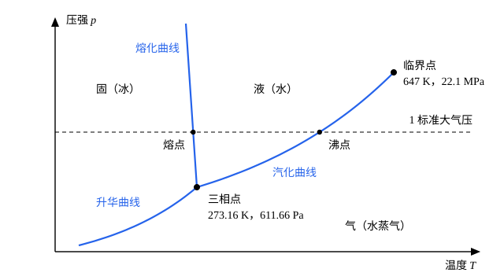

## 这一节要回答的问题

冰在$0\,^\circ\mathrm C$熔化（melting）、水在$100\,^\circ\mathrm C$沸腾（boiling），可高山上气压低，水不到$100\,^\circ\mathrm C$就开了。熔化、沸腾的:term[温度]{id="physics.thermal-physics.temperature"}（temperature）怎样随压强（pressure）变？冰、水、水蒸气在什么条件下能同时存在？

## 讲解

### 相与相变

抽去空气的保温瓶里，冰块漂在水上，水面上方是水蒸气，三者之间分界清楚。

::anchor{id="def-phase"}
物质里各处性质相同、和其余部分有明确分界的部分叫作:term[相]{id="physics.thermal-physics.phase"}（phase）；物质从一个相变成另一个相叫作:term[相变]{id="physics.thermal-physics.phase-transition"}（phase transition），如熔化、汽化（vaporization）、升华（sublimation）。

为什么这样定义：共存时整体不均匀，每一相却均匀，可以各当作一个:term[开放系统]{id="physics.thermal-physics.open-system"}（open system）。边界情况：几块冰合起来仍是一个相；几种气体混成的空气也只是一个相。

### 相平衡与相图

上面那瓶放久了，冰、水不再增减，水蒸气的压强也不再变。两:term[相]{id="physics.thermal-physics.phase"}交换能量、体积和分子，不计重力，由[化学势与开放系统](lesson:physics.thermal-physics.chemical-potential#thm-mu-flow)，平衡共存时:term[温度]{id="physics.thermal-physics.temperature"}、压强、:term[化学势]{id="physics.thermal-physics.chemical-potential"}（chemical potential）分别相等；温度、压强相同时，那里:term[总熵]{id="physics.thermal-physics.entropy"}（total entropy）的改变只剩粒子一项，分子从化学势高的一相跑到低的一相。

::anchor{id="def-phase-equilibrium"}
一种物质两相共存的:term[平衡态]{id="physics.thermal-physics.equilibrium-state"}（equilibrium state）叫作:term[相平衡]{id="physics.thermal-physics.phase-equilibrium"}（phase equilibrium），这时两相的温度、压强、化学势分别相等。以温度为横轴、压强为纵轴，两相能平衡共存的点连成的曲线叫作:term[相平衡曲线]{id="physics.thermal-physics.coexistence-curve"}（coexistence curve，也叫共存曲线），液气、固液、固气之间的分别叫汽化曲线（vaporization curve）、熔化曲线（melting curve）、升华曲线（sublimation curve）；汽化曲线、升华曲线上的压强叫作液体、固体在这一温度的:term[饱和蒸气压]{id="physics.thermal-physics.saturated-vapor-pressure"}（saturated vapor pressure）。

为什么这样定义：两相记作甲、乙，$\mu_{\text{甲}}(T,p)=\mu_{\text{乙}}(T,p)$只是一个方程，温度给定，压强一般就定了，所以共存的点连成曲线，饱和蒸气压只随温度变；曲线两侧，化学势低的那一相稳定。反例：冰块放进温水，两相共存，冰却在化，不是相平衡。

::anchor{id="def-phase-diagram"}
在温度-压强图上画出各条相平衡曲线、标出各相稳定的区域，这样的图叫作:term[相图]{id="physics.thermal-physics.phase-diagram"}（phase diagram）。

为什么这样定义：给定温度、压强，一眼看出是哪一相（几何图像）；它和常微分方程的:term[相图]{id="math.ode.phase-portrait"}（phase portrait）不是一回事。边界情况：曲线上的一点定不下两相各占多少。

多数物质的三条相平衡曲线交于:term[三相点]{id="physics.thermal-physics.triple-point"}（triple point）：三相能平衡共存，要$\mu_{\text{固}}=\mu_{\text{液}}=\mu_{\text{气}}$，两个方程定死了温度、压强，水的是$273.16\,\mathrm K$、$611.66\,\mathrm{Pa}$。熔点（melting point）、沸点（boiling point）却随压强变，所以[温度与热平衡](lesson:physics.thermal-physics.temperature#def-gas-thermometer)说三相点比冰点（ice point）好复现。

### 临界点

室温下的二氧化碳压到约$6\times10^6\,\mathrm{Pa}$就液化（liquefaction）了（[理想气体状态方程](lesson:physics.thermal-physics.ideal-gas-law)），可高于约$31\,^\circ\mathrm C$，压强再大也看不到液面。

::anchor{id="def-critical-point"}
:term[汽化曲线]{id="physics.thermal-physics.coexistence-curve"}在高温一端终止的那一点叫作:term[临界点]{id="physics.thermal-physics.critical-point"}（critical point），这一点的:term[温度]{id="physics.thermal-physics.temperature"}叫作:term[临界温度]{id="physics.thermal-physics.critical-temperature"}（critical temperature），记作$T_{\mathrm c}$。

为什么这样定义：温度高于$T_{\mathrm c}$时，液体和气体不再有区别，加多大的压强也分不成液、气两:term[相]{id="physics.thermal-physics.phase"}；气体要液化，得先冷到临界温度以下。二氧化碳的临界点约在$31.0\,^\circ\mathrm C$、$7.38\,\mathrm{MPa}$，水的约在$647\,\mathrm K$、$22.1\,\mathrm{MPa}$。边界情况：水的汽化曲线低温一端停在:term[三相点]{id="physics.thermal-physics.triple-point"}，不是临界点。

### 克拉珀龙方程

单一成分的一个:term[相]{id="physics.thermal-physics.phase"}处在:term[平衡态]{id="physics.thermal-physics.equilibrium-state"}时，$\mu=\frac GN$（[化学势与开放系统](lesson:physics.thermal-physics.chemical-potential#thm-g-mu-n)），$G$是:term[吉布斯自由能]{id="physics.thermal-physics.gibbs-free-energy"}（Gibbs free energy）；粒子数不变时由$\dd G=-S\dd T+V\dd p$得$\pdvc\mu Tp=-\frac SN$，$\pdvc\mu pT=\frac VN$。沿:term[相平衡曲线]{id="physics.thermal-physics.coexistence-curve"}$\mu_{\text{甲}}-\mu_{\text{乙}}=0$，由[多元复合函数的链式法则](lesson:math.vector-calculus.multivariable-chain-rule#thm-chain-rule)里隐函数（implicit function）的求导公式$y'=-\frac{F_x}{F_y}$，

$$
\dv pT=\frac{\frac{S_{\text{甲}}}{N_{\text{甲}}}-\frac{S_{\text{乙}}}{N_{\text{乙}}}}{\frac{V_{\text{甲}}}{N_{\text{甲}}}-\frac{V_{\text{乙}}}{N_{\text{乙}}}} .
$$

分母是每个粒子的体积之差，要求不为零；$\mu$的偏导数（partial derivative）默认连续，曲线的存在由:term[隐函数定理]{id="math.vector-calculus.implicit-function-theorem"}（implicit function theorem，见[反函数定理与隐函数定理](lesson:math.vector-calculus.inverse-implicit)）保证。

冰在$0\,^\circ\mathrm C$熔化时吸热，:term[温度]{id="physics.thermal-physics.temperature"}却不变（见[热力学第一定律](lesson:physics.thermal-physics.first-law)误区）。

::anchor{id="def-latent-heat"}
一定量的物质在两相能平衡共存的温度、压强下从一相变成另一相，吸收的:term[热量]{id="physics.thermal-physics.heat"}（heat）叫作:term[潜热]{id="physics.thermal-physics.latent-heat"}（latent heat），记作$L$（不是[气体动理论](lesson:physics.thermal-physics.kinetic-theory)的盒长），每摩尔的记作$L_{\mathrm m}$；汽化、熔化、升华的分别叫作汽化热（heat of vaporization）、熔化热（heat of fusion）、升华热（heat of sublimation）。

为什么这样定义：压强不变、两相处于:term[相平衡]{id="physics.thermal-physics.phase-equilibrium"}时吸热而温度不变，所以叫「潜」；:term[热容]{id="physics.thermal-physics.heat-capacity"}（heat capacity）说不出是多少（见[热容与焓](lesson:physics.thermal-physics.heat-capacity#def-heat-capacity)的定义和第 7 题），该问变一定量物质吸多少热。只做体积变化的功时，吸的热等于:term[焓]{id="physics.thermal-physics.enthalpy"}（enthalpy）的增加，$L=\Delta H$；两相:term[化学势]{id="physics.thermal-physics.chemical-potential"}相等，按$G=\mu N$把分子从一相挪到另一相，$G$不变，$\Delta H-T\Delta S=0$，所以$L=T\Delta S$。

边界情况：也有没有潜热的:term[相变]{id="physics.thermal-physics.phase-transition"}，如铁升温到约$1043\,\mathrm K$时失去:term[铁磁性]{id="physics.electromagnetism.ferromagnetism"}（ferromagnetism），见[伊辛模型与平均场近似](lesson:physics.thermal-physics.ising-model)。

::anchor{id="thm-clapeyron"}
定理：只做体积变化的功，一种物质的两相沿相平衡曲线共存，一定量的物质从乙相变成甲相时吸收潜热$L$、体积增加$\Delta V\ne0$，则曲线的斜率$\dv pT=\frac L{T\Delta V}$。这叫作:term[克拉珀龙方程]{id="physics.thermal-physics.clapeyron-equation"}（Clapeyron equation）。

证明思路：上面分式的分子、分母同乘以变过去的粒子数，得$\frac{\Delta S}{\Delta V}$，再用$L=T\Delta S$。反过来变时$L$、$\Delta V$一起变号，斜率不变。

按每千克代[热容与焓](lesson:physics.thermal-physics.heat-capacity)例 1 的数，$100\,^\circ\mathrm C$时汽化曲线的斜率

$$
\dv pT\approx\frac{2.26\times10^6\,\mathrm J}{373\,\mathrm K\times(1.70-0.001)\,\mathrm{m^3}}\approx3.6\,\mathrm{kPa/K} ,
$$

大气压（atmospheric pressure）低$3.6\,\mathrm{kPa}$，沸点约低$1\,\mathrm K$。冰的密度比水小，熔化时$\Delta V<0$，熔化曲线的斜率为负，加压使熔点降低（例 1）。

## 几何图像

水的:term[相图]{id="physics.thermal-physics.phase-diagram"}，示意，不按比例。三条:term[相平衡曲线]{id="physics.thermal-physics.coexistence-curve"}交于:term[三相点]{id="physics.thermal-physics.triple-point"}，汽化曲线停在:term[临界点]{id="physics.thermal-physics.critical-point"}，熔化曲线略向左倾。沿 1 标准大气压（standard atmosphere）的虚线加热冰，先熔化，再沸腾。

## 例题

### 例 1　冰点为什么比三相点低$0.01\,\mathrm K$

冰的密度取$917\,\mathrm{kg/m^3}$，水取$1000\,\mathrm{kg/m^3}$，冰的:term[熔化热]{id="physics.thermal-physics.latent-heat"}是每千克$3.34\times10^5\,\mathrm J$。求:term[三相点]{id="physics.thermal-physics.triple-point"}附近熔点随压强的变化率$\dv Tp$，以及压强从三相点升到 1 标准大气压时熔点的改变。

**为什么想到这么做**：$\dv Tp$是:term[熔化曲线]{id="physics.thermal-physics.coexistence-curve"}斜率的倒数，按每千克用:term[克拉珀龙方程]{id="physics.thermal-physics.clapeyron-equation"}；压强只升约一个大气压，$\dv Tp$当作不变。

**推导**：

$$
\Delta V=\Bigl(\frac1{1000}-\frac1{917}\Bigr)\,\mathrm{m^3}\approx-9.05\times10^{-5}\,\mathrm{m^3} ,\qquad \dv Tp=\frac{T\Delta V}L\approx-7.40\times10^{-8}\,\mathrm{K/Pa} .
$$

压强升高约$1.01\times10^5\,\mathrm{Pa}$，熔点降低约$0.0075\,\mathrm K$。量冰点时水里溶有空气，又使它降低约$0.0025\,\mathrm K$，合起来就是[温度与热平衡](lesson:physics.thermal-physics.temperature)说的「冰点比三相点低约$0.01\,\mathrm K$」。
