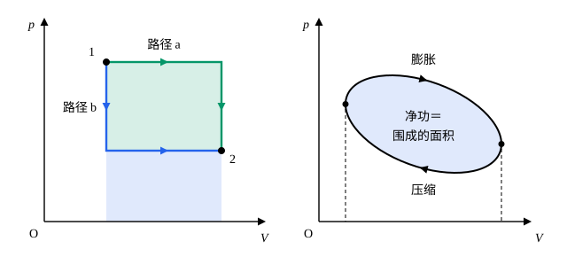

## 这一节要回答的问题

燃气推着活塞对外做功（work）。气体从一个状态变到另一个状态，做了多少功？推得快和推得慢、走不同的路线，做的功一样吗？

## 讲解

### 准静态过程

活塞上堆着细沙，一粒一粒地拿走，活塞慢慢升起，气体时时都几乎处在:term[平衡态]{id="physics.thermal-physics.equilibrium-state"}（equilibrium state）。一下子全拿走，活塞猛地弹起，气体各处压强（pressure）不同。

::anchor{id="def-quasi-static"}
进行得足够缓慢、每一时刻都几乎处在平衡态的过程，叫作:term[准静态过程]{id="physics.thermal-physics.quasi-static-process"}（quasi-static process）。

为什么这样定义：这样每一时刻整个气体才有确定的$p$、$T$，过程才能用:term[状态参量]{id="physics.thermal-physics.state-variable"}（state variable）描述。「足够缓慢」是和气体恢复平衡的时间比，压强的变化在气缸里传开只要约千分之一秒。反例：气体从小孔慢慢漏进真空，可两边压强一直不同，整体不在平衡态。

一定量气体的每个平衡态是:term[$p$-$V$图]{id="physics.thermal-physics.pv-diagram"}（$p$-$V$ diagram）上的一个点，准静态过程是一条曲线，箭头标出走向；不是准静态的过程只能标出起点和终点。

::anchor{id="def-isoprocesses"}
准静态过程中，:term[温度]{id="physics.thermal-physics.temperature"}（temperature）、压强、体积始终不变的，依次叫作:term[等温过程]{id="physics.thermal-physics.isothermal-process"}（isothermal process）、:term[等压过程]{id="physics.thermal-physics.isobaric-process"}（isobaric process）、:term[等容过程]{id="physics.thermal-physics.isochoric-process"}（isochoric process）。在$p$-$V$图上依次是:term[等温线]{id="physics.thermal-physics.isotherm"}（isotherm）的一段、水平线段和竖直线段。

为什么这样定义：它们最简单，许多实际过程也近似如此。边界情况：「等压」要求全程压强不变，只是起点和终点压强相同不算。

把气缸浸在一大池水里，慢慢地拉活塞，气体膨胀时温度几乎不变。

::anchor{id="def-heat-reservoir"}
和系统（system）交换能量以后温度几乎不变的大物体，叫作:term[热库]{id="physics.thermal-physics.heat-reservoir"}（heat reservoir），如大气、一大池恒温的水。

为什么这样定义：准静态的等温过程通常靠热库实现。边界情况：一小杯水不是热库，气体传给它的能量会让它明显变热。

### 气体做的功

设活塞面积为$A$。:term[准静态过程]{id="physics.thermal-physics.quasi-static-process"}中气体各处压强都是$p$，活塞移动$\dd x$时体积增大$\dd V=A\,\dd x$，气体做功$pA\,\dd x=p\,\dd V$。这就是[定积分的物理应用](lesson:math.calculus.physical-applications#def-variable-force-work)里变力做功的微元法（method of differential elements）。

本领域约定：$W$是气体对外界（surroundings）做的功，外界对气体做的功是$-W$；一小段过程里的功记作$\delta W$，不写$\dd W$：功和路线有关（例 1、几何图像的左图），不是:term[状态参量]{id="physics.thermal-physics.state-variable"}的改变量。

::anchor{id="thm-gas-work"}
定理：准静态过程中，气体只做体积变化的功（没有搅拌、通电这类功）时，$\delta W=p\,\dd V$；体积从$V_1$一直增大（或一直减小）到$V_2$时，压强是体积的连续函数$p(V)$，$W=\int_{V_1}^{V_2}p\,\dd V$。体积增大时，$W$是:term[$p$-$V$图]{id="physics.thermal-physics.pv-diagram"}上曲线下这一段的面积，减小时是它的相反数。

证明思路：每一小段的功是$p\,\dd V$（上面算过），加起来就是定积分（definite integral），体积减小时每段都是负的。

体积来回变时，分成单调的几段再相加，体积不变的一段不做功。叶轮慢慢搅动密闭容器里的气体就不行：体积不变，叶轮却在做功。不是准静态时，没有一个$p$可以代进积分；突然膨胀时外界得到的功比准静态时少（第 6 题）。

:term[等压过程]{id="physics.thermal-physics.isobaric-process"}中$W=p(V_2-V_1)$；对:term[理想气体]{id="physics.thermal-physics.ideal-gas"}（ideal gas），由$pV=nRT$也可以写成$W=nR(T_2-T_1)$，$n$是:term[物质的量]{id="physics.thermal-physics.amount-of-substance"}（amount of substance）。理想气体的:term[等温过程]{id="physics.thermal-physics.isothermal-process"}中$p=\frac{nRT}V$，$T$不变，由$\int\frac{\dd V}V=\ln V+C$（$V>0$，见[原函数与不定积分](lesson:math.calculus.antiderivatives)），

$$
W=\int_{V_1}^{V_2}\frac{nRT}{V}\,\dd V=nRT\ln\frac{V_2}{V_1}.
$$

等温膨胀时$W>0$，:term[温度]{id="physics.thermal-physics.temperature"}却不降，这份能量来自:term[热库]{id="physics.thermal-physics.heat-reservoir"}（见[热力学第一定律](lesson:physics.thermal-physics.first-law)）。

### 循环过程

发动机里的气体一次次被压缩、膨胀，又回到差不多原来的状态。

::anchor{id="def-cyclic-process"}
系统经过一系列变化又回到原来状态的过程，叫作:term[循环过程]{id="physics.thermal-physics.cyclic-process"}（cyclic process），简称循环。

为什么这样定义：:term[热机]{id="physics.thermal-physics.heat-engine"}（heat engine）一遍遍地重复同一个循环。边界情况：中间可以有一段不是:term[准静态过程]{id="physics.thermal-physics.quasi-static-process"}，那样的循环在:term[$p$-$V$图]{id="physics.thermal-physics.pv-diagram"}上画不成闭合曲线。

::anchor{id="thm-cycle-work"}
定理：准静态的循环中，气体只做体积变化的功、$p$-$V$图上的闭合曲线不自交时，净功的大小等于它围成的面积；顺时针走时为正，逆时针走时为负。

证明思路：设竖直线和曲线最多交于两点，用体积最小、最大的两点把曲线分成上、下两段；顺时针走时上段膨胀、下段压缩，净功是两段曲线下的面积之差。逆时针走时反过来。

## 几何图像

左图：路径 a 先:term[等压膨胀]{id="physics.thermal-physics.isobaric-process"}、再:term[等容降压]{id="physics.thermal-physics.isochoric-process"}，路径 b 反过来；绿色一块只在路径 a 下面，是沿路径 a 多做的功。右图：顺时针走一圈，净功是围成的面积。

## 例题

### 例 1　两条路线的功

$1.00\,\mathrm{mol}$:term[理想气体]{id="physics.thermal-physics.ideal-gas"}，:term[温度]{id="physics.thermal-physics.temperature"}$300\,\mathrm K$，体积$10.0\,\mathrm L$。路线一：在$300\,\mathrm K$的:term[热库]{id="physics.thermal-physics.heat-reservoir"}里:term[等温膨胀]{id="physics.thermal-physics.isothermal-process"}到$20.0\,\mathrm L$。路线二：先:term[等压膨胀]{id="physics.thermal-physics.isobaric-process"}到$20.0\,\mathrm L$，再:term[等容降温]{id="physics.thermal-physics.isochoric-process"}到$300\,\mathrm K$。两条路线始末状态相同，都是:term[准静态过程]{id="physics.thermal-physics.quasi-static-process"}，气体各做了多少功？

**为什么想到这么做**：沿各自的路线算$W=\int p\,\dd V$，体积不变的一段不做功。

**推导**：路线一，

$$
W=nRT\ln\frac{V_2}{V_1}=1.00\times8.314\times300\times\ln2\,\mathrm J\approx1.73\times10^3\,\mathrm J.
$$

路线二，开始时的压强

$$
p_1=\frac{nRT}{V_1}=\frac{1.00\times8.314\times300}{0.0100}\,\mathrm{Pa}\approx2.49\times10^5\,\mathrm{Pa},
$$

等压膨胀做功$p_1(V_2-V_1)\approx2.49\times10^3\,\mathrm J$，等容降温不做功，共约$2.49\times10^3\,\mathrm J$。路线二多做了约$765\,\mathrm J$：它在较高的压强下膨胀，曲线下的面积大。

### 例 2　循环的净功

例 1 的气体从 A（$10.0\,\mathrm L$，$300\,\mathrm K$）出发，在:term[热库]{id="physics.thermal-physics.heat-reservoir"}里:term[等温膨胀]{id="physics.thermal-physics.isothermal-process"}到 B（$20.0\,\mathrm L$），再:term[等压压缩]{id="physics.thermal-physics.isobaric-process"}到 C（$10.0\,\mathrm L$），最后:term[等容升温]{id="physics.thermal-physics.isochoric-process"}回到 A，只做体积变化的功。求净功，并判断:term[循环]{id="physics.thermal-physics.cyclic-process"}的走向。

**为什么想到这么做**：分段算功再相加，再用「顺时针为正」核对正负。

**推导**：A→B 就是例 1 的路线一，$W_{\mathrm{AB}}\approx1729\,\mathrm J$。B 的压强$p_{\mathrm B}=\frac{nRT}{V_{\mathrm B}}\approx1.247\times10^5\,\mathrm{Pa}$，$W_{\mathrm{BC}}=p_{\mathrm B}(V_{\mathrm C}-V_{\mathrm B})\approx-1247\,\mathrm J$，$W_{\mathrm{CA}}=0$，净功约$482\,\mathrm J$。

在:term[$p$-$V$图]{id="physics.thermal-physics.pv-diagram"}上，A 在左上、B 在右下、C 在左下，A→B→C→A 是顺时针，和净功为正一致。

## 常见误区

- 「$W=p\Delta V$对任何过程都成立。」这是:term[等压过程]{id="physics.thermal-physics.isobaric-process"}的式子，:term[理想气体]{id="physics.thermal-physics.ideal-gas"}:term[等温膨胀]{id="physics.thermal-physics.isothermal-process"}时用开始或最后的压强乘$\Delta V$都不对。
- 「:term[循环]{id="physics.thermal-physics.cyclic-process"}回到了原来的状态，净功就是零。」例 2 的循环净功约$482\,\mathrm J$，不是零。
