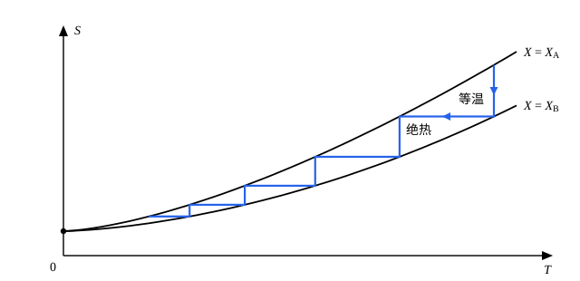

## 这一节要回答的问题

实验室能把物体冷到百万分之一开尔文以下，却从没到过:term[绝对零度]{id="physics.thermal-physics.absolute-zero"}（absolute zero）。这是技术问题，还是原理上就办不到？:term[温度]{id="physics.thermal-physics.temperature"}（temperature）趋于绝对零度时，:term[熵]{id="physics.thermal-physics.entropy"}（entropy）和:term[热容]{id="physics.thermal-physics.heat-capacity"}（heat capacity）会怎样？

## 讲解

### 能斯特表述

1906 年前后，能斯特（Walther Nernst）分析了许多化学反应在低温下的数据：:term[温度]{id="physics.thermal-physics.temperature"}很低时，反应前后的:term[熵]{id="physics.thermal-physics.entropy"}之差很小。一般地，用温度$T$和另一个:term[状态参量]{id="physics.thermal-physics.state-variable"}（state variable）$X$描述一个系统（system）的:term[平衡态]{id="physics.thermal-physics.equilibrium-state"}（equilibrium state），熵写成$S(T,X)$。$X$可以是压强（pressure），也可以是加在:term[顺磁性]{id="physics.electromagnetism.paramagnetism"}（paramagnetism）的盐上的磁场；$X$取两个值时，$S$随$T$变化的两条曲线在温度趋于:term[绝对零度]{id="physics.thermal-physics.absolute-zero"}时挨到一起（几何图像）。

::anchor{id="thm-nernst"}
温度趋于绝对零度时，一个系统各个平衡态的熵趋于同一个有限的值，同一温度下任意两个平衡态的熵之差因而趋于零。这是热力学第三定律（third law of thermodynamics）的能斯特表述（Nernst statement），也叫能斯特定理（Nernst theorem）。

为什么单列为定律：它和:term[热力学第一定律]{id="physics.thermal-physics.first-law"}（first law of thermodynamics）、:term[热力学第二定律]{id="physics.thermal-physics.second-law"}（second law of thermodynamics）一样是从实验总结出来的，不能由它们推出。熵本来只定到差一个常数，既然一个系统各个平衡态的熵趋于同一个值，常把这个值取作零，熵就有了确定的数值；这是约定，不是定律的内容。各书的能斯特表述常只写熵之差趋于零；「有限的值」这一半，下面推:term[热容]{id="physics.thermal-physics.heat-capacity"}时要用。边界情况：玻璃冷却时来不及排成规则的晶体，没有达到平衡态，温度很低时还留着一部分熵，定律管不到它。

### 低温下热容趋于零

::anchor{id="thm-heat-capacity-zero"}
推论：由能斯特表述，保持$X$不变时，系统的:term[热容]{id="physics.thermal-physics.heat-capacity"}$C$在$T\to0$时如果有极限，这个极限一定是零。

证明思路：沿$X$不变的:term[可逆过程]{id="physics.thermal-physics.reversible-process"}（reversible process）升温，$\dd S=\frac{C\,\dd T}T$。压强、磁场这类$X$不变时，物质升温要吸热，$C$是正的；假如极限是正数$c_0$，:term[温度]{id="physics.thermal-physics.temperature"}足够低时就有$C>\frac{c_0}2$；在这个范围里从$\varepsilon$升到$T$，:term[熵]{id="physics.thermal-physics.entropy"}增加了$\int_\varepsilon^T\frac{C\,\dd T'}{T'}>\frac{c_0}2\ln\frac T\varepsilon$。令$\varepsilon\to0$，右边趋于无穷，$S(\varepsilon,X)$就趋于$-\infty$，和「有限的值」矛盾。

实测也是这样：许多晶体在几开尔文以下$C\approx aT^3$（$a$是常量，来历见[德拜模型](lesson:physics.thermal-physics.debye-model)），由它算熵见例 1。按量子力学，温度很低时原子、分子的振动和转动几乎都被冻住（见[能量均分定理](lesson:physics.thermal-physics.equipartition)），细节见[爱因斯坦固体与热容](lesson:physics.thermal-physics.einstein-solid)。

### 绝对零度不能达到

降温常把:term[等温过程]{id="physics.thermal-physics.isothermal-process"}（isothermal process）和可逆的:term[绝热过程]{id="physics.thermal-physics.adiabatic-process"}（adiabatic process）交替使用。设同一:term[温度]{id="physics.thermal-physics.temperature"}下$S(T,X_{\mathrm A})>S(T,X_{\mathrm B})$。每一步都先让系统和同温的:term[热库]{id="physics.thermal-physics.heat-reservoir"}（heat reservoir）接触，等温地把$X$从$X_{\mathrm A}$改成$X_{\mathrm B}$，:term[熵]{id="physics.thermal-physics.entropy"}减少；再把系统隔热，可逆地把$X$改回$X_{\mathrm A}$，这是:term[等熵过程]{id="physics.thermal-physics.isentropic-process"}（isentropic process），熵仍是等温以后的值，比等温以前小。$X$不变时升温，$C>0$，$\dd S=\frac{C\,\dd T}T>0$，熵随温度增大；末态的$X$和等温以前一样，熵却小了，所以温度降低。

:term[顺磁性]{id="physics.electromagnetism.paramagnetism"}的盐的绝热去磁（adiabatic demagnetization）就是这样：$X$是外加的磁场，同一温度下磁场越强，盐的熵越小，$X_{\mathrm A}$是零或很弱的磁场。

为什么到不了零：记$T\to0$时$S(T,X)$的极限为$S(0,X)$。一步从温度$T_1$开始，绝热后的温度$T_2$满足$S(T_2,X_{\mathrm A})=S(T_1,X_{\mathrm B})$。$X$不变时熵随温度增大，所以$S(T_1,X_{\mathrm B})>S(0,X_{\mathrm B})$；由能斯特表述$S(0,X_{\mathrm B})=S(0,X_{\mathrm A})$，于是$S(T_2,X_{\mathrm A})>S(0,X_{\mathrm A})$，$T_2>0$。每一步都停在零以上，有限步到不了零；温度趋于:term[绝对零度]{id="physics.thermal-physics.absolute-zero"}时两条曲线挨到一起，台阶也趋于零（几何图像）。

::anchor{id="thm-unattainability"}
不能用有限次操作使系统的温度降到绝对零度。这叫作绝对零度不能达到原理（unattainability of absolute zero），是热力学第三定律的另一种表述。

为什么说是另一种表述：在等温、绝热交替的办法里，上面由能斯特表述推出了它；反过来，两条曲线在$T=0$不汇合时，从适当的温度出发一步就能降到零（第 5 题）。实验上，别的降温办法也都到不了零。边界情况：到不了不等于不能接近，温度可以无限接近零（第 5 题），这就是[温度与热平衡](lesson:physics.thermal-physics.temperature#def-absolute-zero)一节说的「只能接近、不能达到」。

[热机与卡诺循环](lesson:physics.thermal-physics.heat-engines)说$T_{\mathrm H}$不变时，$T_{\mathrm L}$越接近绝对零度制冷越费功；这和到不了零是什么关系，见第 6 题。物体的热膨胀在低温下也趋于零（见[麦克斯韦关系](lesson:physics.thermal-physics.maxwell-relations)）。

## 几何图像

两条曲线是$X$取两个值时:term[熵]{id="physics.thermal-physics.entropy"}随:term[温度]{id="physics.thermal-physics.temperature"}的变化，在$T=0$汇合于纵轴上的圆点。竖直的一步是:term[等温过程]{id="physics.thermal-physics.isothermal-process"}，水平的一步是可逆的:term[绝热过程]{id="physics.thermal-physics.adiabatic-process"}，也就是:term[等熵过程]{id="physics.thermal-physics.isentropic-process"}；台阶越往左越小，有限步到不了$T=0$。这是示意图。

## 例题

### 例 1　低温下晶体的熵

某晶体在$10\,\mathrm K$以下、压强不变时的:term[摩尔热容]{id="physics.thermal-physics.molar-heat-capacity"}（molar heat capacity）$C_{\mathrm m}=aT^3$，$a=4.8\times10^{-5}\,\mathrm{J/(mol\cdot K^4)}$。取$T\to0$时的:term[熵]{id="physics.thermal-physics.entropy"}为零，求它在$10\,\mathrm K$时每摩尔的熵$S_{\mathrm m}$，以及每摩尔从接近$0$升温到$10\,\mathrm K$要吸收的:term[热量]{id="physics.thermal-physics.heat"}（heat）。

**为什么想到这么做**：熵只由状态决定，沿压强不变的:term[可逆过程]{id="physics.thermal-physics.reversible-process"}升温来算，$\dd S_{\mathrm m}=\frac{C_{\mathrm m}\dd T}T$；从$0$起的积分先从$\varepsilon$起算，再令$\varepsilon\to0$。

**推导**：

$$
S_{\mathrm m}=\lim_{\varepsilon\to0}\int_\varepsilon^{10\,\mathrm K}aT^2\,\dd T=\frac a3\times(10\,\mathrm K)^3=0.016\,\mathrm{J/(mol\cdot K)} ,
$$

正好是这时$C_{\mathrm m}$的$\frac13$。每摩尔吸的热是$\lim_{\varepsilon\to0}\int_\varepsilon^{10\,\mathrm K}aT^3\,\dd T=\frac a4\times(10\,\mathrm K)^4=0.12\,\mathrm{J/mol}$。:term[热容]{id="physics.thermal-physics.heat-capacity"}这样小，一点点热就能让它升温很多。

## 常见误区

- 「热力学第三定律说，:term[绝对零度]{id="physics.thermal-physics.absolute-zero"}时一切物质的:term[熵]{id="physics.thermal-physics.entropy"}都等于零。」定律说的是同一个系统各个:term[平衡态]{id="physics.thermal-physics.equilibrium-state"}的熵趋于同一个有限的值，取作零是约定；没有达到平衡的玻璃，:term[温度]{id="physics.thermal-physics.temperature"}很低时还留着熵。
