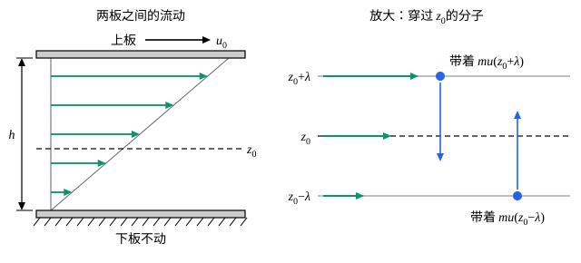

## 这一节要回答的问题

两块平行的大平板夹着一层空气，拖着上板平移，下板也会被往前拖。气体分子之间除了碰撞几乎没有作用力，拖拽是怎样传过去的？把空气抽掉一大半，拖拽几乎不变，:term[温度]{id="physics.thermal-physics.temperature"}（temperature）升高反而变大，又是为什么？

## 讲解

### 黏度

两块很大的平板水平放置，相距$h$，中间是空气（几何图像的左图）。下板不动，上板沿$x$方向以$u_0$匀速平移，$z$轴竖直向上、从下板量起。紧贴两板的空气跟着板走，中间的一层层流层（fluid layer）相对滑动，稳定以后高度$z$处的流速$u(z)$从$0$均匀地增大到$u_0$（证明见第 5 题）。实验发现，维持上板匀速的拉力$F$和板的面积$A$、$u_0$成正比，和$h$成反比。

::anchor{id="def-viscosity"}
流体（fluid）里相邻两层相对滑动时互相拖拽的性质叫作黏性（viscosity）。实验表明，相邻两层之间单位面积上的拖拽力和流速沿垂直方向的变化率成正比，$\frac FA=\eta\dv uz$，这叫作牛顿黏性定律（Newton's law of viscosity）；比例系数$\eta$叫作:term[黏度]{id="physics.thermal-physics.viscosity"}（coefficient of viscosity），也叫黏滞系数，单位是$\mathrm{Pa\cdot s}$。

为什么这样定义：两板之间$\dv uz=\frac{u_0}h$，牛顿黏性定律概括了上面的实验；写成变化率，它只说相邻两层之间的事，流速不均匀变化时也能一层层地用。本节的$\eta$专指黏度，$u$专指流速。

边界情况：番茄酱、血液的$\frac FA$和$\dv uz$不成正比；乱成漩涡的湍流（turbulence）也不能这样算；气体稀薄到:term[平均自由程]{id="physics.thermal-physics.mean-free-path"}（mean free path）和两板的间距差不多时，这条定律也不成立（第 6 题）。

### 输运现象

::anchor{id="def-transport"}
气体里各处的流速、:term[温度]{id="physics.thermal-physics.temperature"}或某种分子的密度（density）不均匀时，分子的:term[热运动]{id="physics.thermal-physics.thermal-motion"}（thermal motion）把动量（momentum）、能量或这种分子本身带到别处，使不均匀渐渐消失，这类现象统称:term[输运现象]{id="physics.thermal-physics.transport-phenomena"}（transport phenomena）。黏性、:term[热传导]{id="physics.thermal-physics.heat-conduction"}（heat conduction）、:term[扩散]{id="physics.thermal-physics.diffusion"}（diffusion）分别输运动量、能量和分子本身。

为什么这样定义：三者道理相同，下面推:term[黏度]{id="physics.thermal-physics.viscosity"}的办法稍加改动，就能用到另两种上（见[热传导与扩散](lesson:physics.thermal-physics.heat-conduction-diffusion)）。边界情况：风把热空气整团吹过来，是整体的流动，不算输运现象。

### 黏度的分子图像

在两板之间高度$z_0$处取一个水平面，看分子怎样穿过它（几何图像的右图）。分子的速度是所在那一层的流速加上杂乱的:term[热运动]{id="physics.thermal-physics.thermal-motion"}速度，后者平均为零，所以高度$z$处的分子平均每个带着沿$x$方向的动量$mu(z)$，$m$是分子的质量。流速远小于分子的:term[方均根速率]{id="physics.thermal-physics.rms-speed"}（root-mean-square speed）$v_{\mathrm{rms}}$，几乎不影响分子上下乱跑。

粗略地看，分子都以$v_{\mathrm{rms}}$运动，各有六分之一朝上、朝下。$\Delta t$里，平面上方厚$v_{\mathrm{rms}}\Delta t$的一层里朝下飞的分子都会穿过平面，每单位面积约有$\frac16\frac NVv_{\mathrm{rms}}\Delta t$个，$\frac NV$是:term[数密度]{id="physics.thermal-physics.number-density"}（number density）；朝上穿过的也这么多。

从上面穿下来的分子，上一次碰撞大约在平面上方一个:term[平均自由程]{id="physics.thermal-physics.mean-free-path"}$\lambda$处，撞的时候平均带上了那一层的流速，带着$mu(z_0+\lambda)$穿过平面；从下面上来的带着$mu(z_0-\lambda)$。于是$\Delta t$里，每单位面积净往下带过去的沿$x$方向的动量是

$$
\frac16\cdot\frac NVv_{\mathrm{rms}}\Delta t\,\bigl[mu(z_0+\lambda)-mu(z_0-\lambda)\bigr] .
$$

$\lambda$远小于两板的间距，由导数（derivative）的定义，方括号里约是$2m\lambda\dv uz$。除以$\Delta t$，就是下方的气体每单位面积、每单位时间净得到的向前的动量；由动量定理（impulse–momentum theorem），这相当于上方的气体拖着它：

$$
\frac FA=\frac13\cdot\frac NVmv_{\mathrm{rms}}\lambda\dv uz .
$$

::anchor{id="thm-viscosity"}
定理：由同一种分子组成的:term[理想气体]{id="physics.thermal-physics.ideal-gas"}（ideal gas），平均自由程远小于容器的大小时，按方均根速率粗略估算，:term[黏度]{id="physics.thermal-physics.viscosity"}$\eta\approx\frac13\rho v_{\mathrm{rms}}\lambda$，$\rho=\frac NVm$是气体的密度；代入平均自由程的估算式，又可以写成$\eta\approx\frac{mv_{\mathrm{rms}}}{3\sqrt2\,\sigma}$，$\sigma$是:term[碰撞截面]{id="physics.thermal-physics.collision-cross-section"}（collision cross section）。

证明思路：把上式和牛顿黏性定律$\frac FA=\eta\dv uz$比较，就得到第一个式子；再代入$\lambda\approx\frac1{\sqrt2\,\sigma N/V}$（见[平均自由程](lesson:physics.thermal-physics.mean-free-path#thm-mean-free-path)），$\frac NV$约掉，得到第二个。

$\frac13$只是粗估：把分子当成硬球（hard sphere）细算，黏度约是粗估的 1.4 倍，可随:term[温度]{id="physics.thermal-physics.temperature"}、压强（pressure）怎样变，粗估已经抓住了。

### 为什么和压强无关

第二个式子里没有:term[数密度]{id="physics.thermal-physics.number-density"}。数密度减半，穿过平面的分子少一半，可$\lambda$变为 2 倍，每个分子带过来的流速差也变为 2 倍，两者正好抵消：$\rho\lambda\approx\frac m{\sqrt2\,\sigma}$，和压强无关。所以同一种气体的:term[黏度]{id="physics.thermal-physics.viscosity"}只由:term[温度]{id="physics.thermal-physics.temperature"}决定：温度越高，分子跑得越快，动量运送得越快，$\eta$随$\sqrt T$增大。实测的黏度增大得更快，因为温度越高，分子的:term[有效直径]{id="physics.thermal-physics.effective-diameter"}（effective diameter）越小。

## 几何图像

左图：流速（绿色箭头）从下板的$0$均匀地增大到上板的$u_0$。右图：从$z_0+\lambda$处下来的分子带着较大的流速，从$z_0-\lambda$处上来的带着较小的，于是$z_0$以下的气体被往前拖，以上的被往后拉。右图的$\lambda$画得太长，其实远小于两板的间距。

## 例题

### 例 1　拖动平板要多大的力

$20\,^\circ\mathrm C$的空气，:term[黏度]{id="physics.thermal-physics.viscosity"}取$1.81\times10^{-5}\,\mathrm{Pa\cdot s}$。两块平行的大平板相距$1.0\,\mathrm{mm}$，下板不动，面积为$0.20\,\mathrm{m^2}$的上板以$2.0\,\mathrm{m/s}$匀速平移，要用多大的力拉上板？

**为什么想到这么做**：流速均匀地增大，$\dv uz=\frac{u_0}h$处处相同，直接用牛顿黏性定律。

**推导**：$\dv uz=\frac{2.0}{1.0\times10^{-3}}\,\mathrm{s^{-1}}=2.0\times10^3\,\mathrm{s^{-1}}$，所以

$$
F=\eta A\dv uz=1.81\times10^{-5}\times0.20\times2.0\times10^3\,\mathrm N\approx7.2\times10^{-3}\,\mathrm N .
$$

### 例 2　由黏度估计分子的大小

$20\,^\circ\mathrm C$时空气的:term[黏度]{id="physics.thermal-physics.viscosity"}是$1.81\times10^{-5}\,\mathrm{Pa\cdot s}$。把空气当成一种分子，:term[摩尔质量]{id="physics.thermal-physics.molar-mass"}（molar mass）取$29\,\mathrm{g/mol}$，按讲解里的估算式，空气分子的:term[碰撞截面]{id="physics.thermal-physics.collision-cross-section"}和:term[有效直径]{id="physics.thermal-physics.effective-diameter"}各约是多少？

**为什么想到这么做**：$\eta\approx\frac{mv_{\mathrm{rms}}}{3\sqrt2\,\sigma}$里，$\eta$好测，$m$和$v_{\mathrm{rms}}$由摩尔质量和:term[温度]{id="physics.thermal-physics.temperature"}就能算，只剩$\sigma$不知道，也用不着知道压强。

**推导**：一个分子的质量$m=\frac M{N_{\mathrm A}}\approx4.82\times10^{-26}\,\mathrm{kg}$，$N_{\mathrm A}$是:term[阿伏伽德罗常量]{id="physics.thermal-physics.avogadro-constant"}（Avogadro constant）；$T$取$293\,\mathrm K$，:term[方均根速率]{id="physics.thermal-physics.rms-speed"}$v_{\mathrm{rms}}=\sqrt{\frac{3RT}M}\approx502\,\mathrm{m/s}$。所以

$$
\sigma\approx\frac{mv_{\mathrm{rms}}}{3\sqrt2\,\eta}=\frac{4.82\times10^{-26}\times502}{3\times1.414\times1.81\times10^{-5}}\,\mathrm{m^2}\approx3.1\times10^{-19}\,\mathrm{m^2} ,
$$

有效直径$d=\sqrt{\frac\sigma\pi}\approx3.2\times10^{-10}\,\mathrm m$。

常用的有效直径正是这样由黏度反推的，换用细算的系数（黏度约是粗估的 1.4 倍），$d$就接近[平均自由程](lesson:physics.thermal-physics.mean-free-path)例 1 给氮分子取的$3.7\times10^{-10}\,\mathrm m$。

## 常见误区

- 「分子质量和:term[温度]{id="physics.thermal-physics.temperature"}都相同时，分子越大、撞得越勤的气体越黏。」由$\eta\approx\frac{mv_{\mathrm{rms}}}{3\sqrt2\,\sigma}$，这时:term[碰撞截面]{id="physics.thermal-physics.collision-cross-section"}越大，:term[黏度]{id="physics.thermal-physics.viscosity"}反而越小：碰撞并不产生拖拽，只是限制了动量能被带多远。
