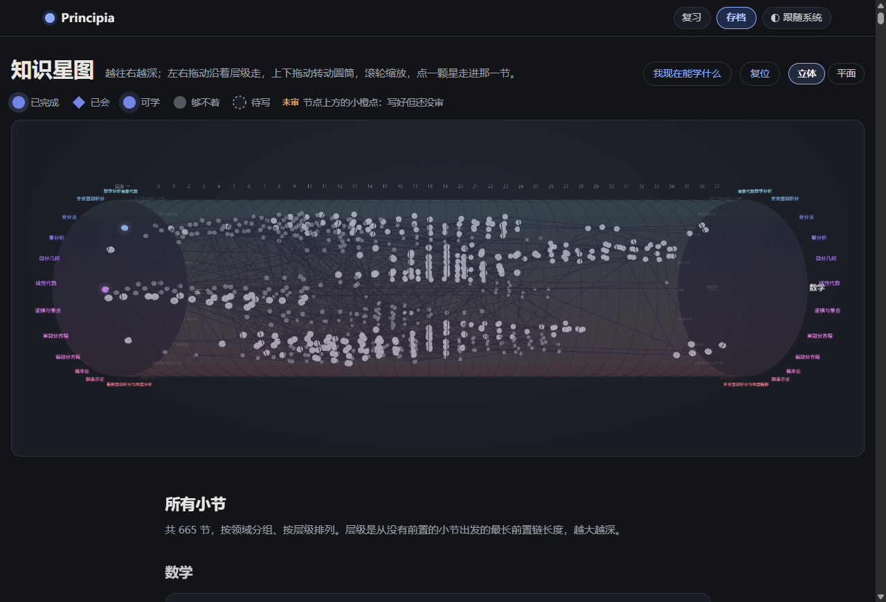
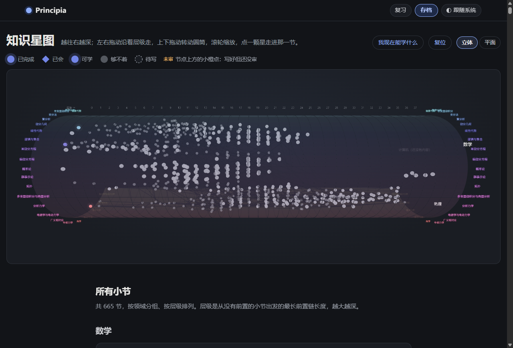
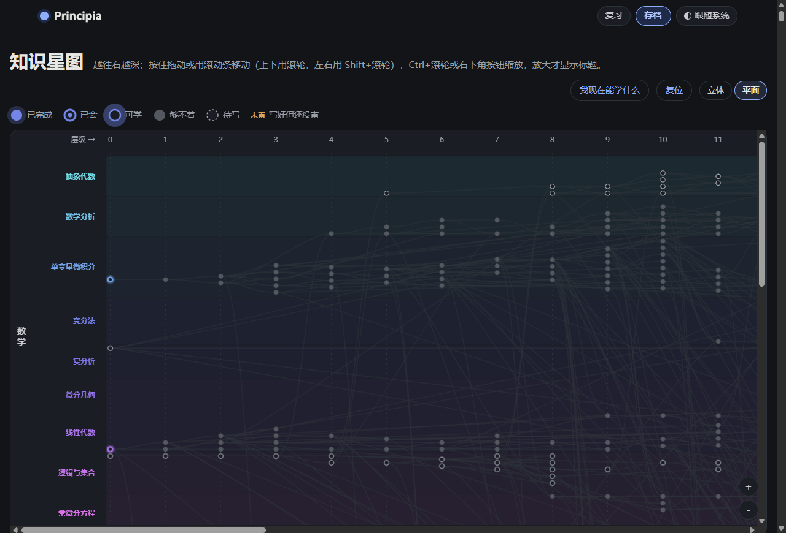
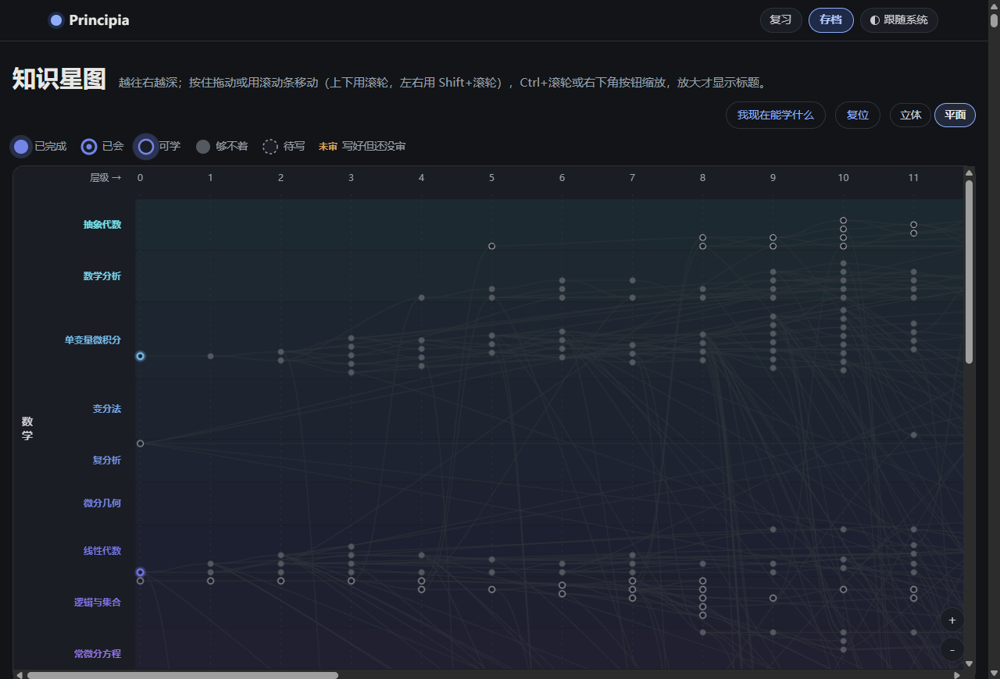
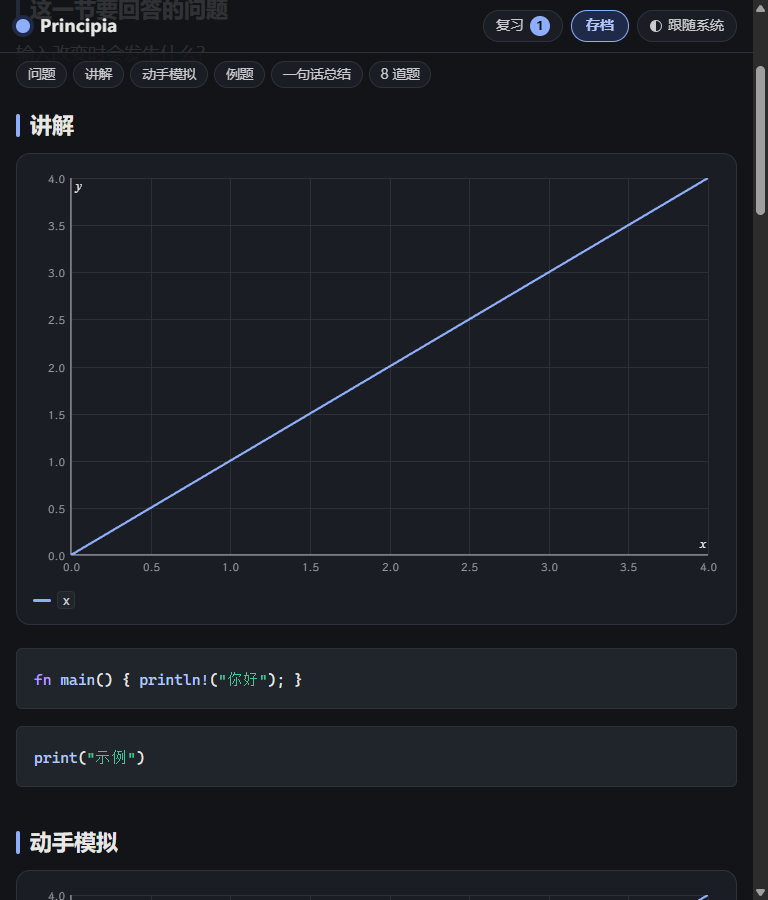
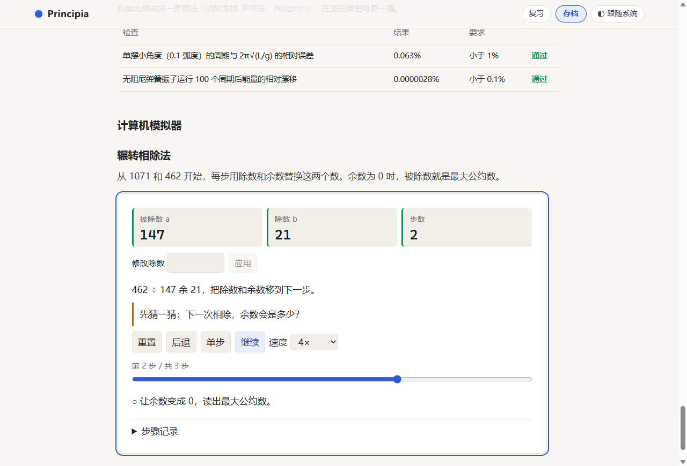
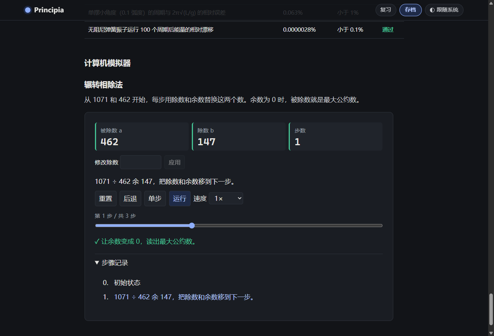
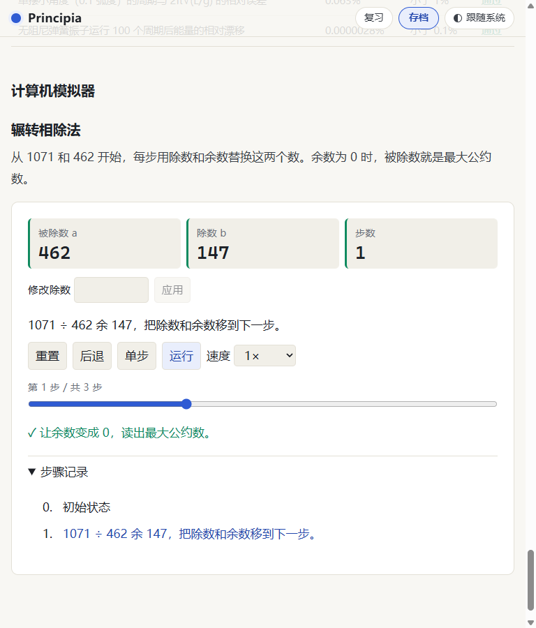

# 计算机台阶 C0 汇报

2026-11-18 · 分支 `cs/c0` · 起点 `f66be9f`

## 1. 一句话结论

C0 的内容侧和模拟器底座已完成，七组验收全部通过，工作止于 C0。

## 2. 需要你决定的

无。

## 3. 验证

### 构建与回归

| 命令 | 结果 |
| --- | --- |
| `npm test` | 28 个测试文件、248 项全部通过。原有数学和物理样例继续通过。 |
| `npm run typecheck` | 通过，退出码 0。 |
| `npm run content` | 全部 665 节构建通过，0 个错误、0 个警告。改前生产构建也是 0 / 0。 |
| `npm run build` | 最终生产构建通过，内容检查 0 / 0。下表为这个构建的实际文件字节数。 |
| `npm run verify` | 344 个已有小节全部一致。另用测试样例核对新题型，大整数差 1、记号换序均能报出差异。 |

### 星图与进度隔离

改前和改后分别先运行 `npm run build`，浏览器访问 `node --import tsx server/main.ts --port 3150 --data <本次临时目录>` 提供的生产页面。改前的两个学科各占 180°。改后读取构建图谱，数学为 0–120°、物理为 120–240°、计算机为 240–360°。真实课程还没有计算机小节，截图中为它留了位置；测试用的计算机课程单独编译。已按新坐标更新布局测试，仍检查领域带宽、相邻行距、节点边界和确定性。

| 视图 | 改前 | 改后 |
| --- | --- | --- |
| 立体 |  |  |
| 平面 |  |  |

页面检查后运行 `git status progress/`，结果为 `nothing to commit, working tree clean`。从起点比较 `content/` 和 `progress/` 也没有差异。

### 编译器与小节页

样例在 `compiler/fixtures/c0/`，故意写错的用例在临时副本上执行。页面检查时让浏览器用样例编译得到的图谱和领域包回应两项内容请求，页面脚本、组件和进度服务均来自 3150 的生产服务。

| 验收项 | 检查与结果 |
| --- | --- |
| 学科标题 | 计算机用「动手模拟」通过，换成「几何图像」构建失败并指出缺少规定标题。原数学样例通过，反向换标题失败。计算机页面和宽、窄屏目录显示「动手模拟」。 |
| 已审小节 | 在已审样例中保留讲解里的组件，将「动手模拟」单独换为合法 SVG 或未实现的组件，两种都被拒绝。 |
| 讲解内组件 | 讲解和动手模拟各放一个 `function-plot`；两处编译产物都含 `x-anim`，浏览器在两处都找到实际画布。 |
| 围栏和缩进 | 无语言、`go`、代码内制表符都在构建时报错并带行号，制表符诊断提示代码缩进用空格。题干写 `go` 也失败。 |
| 高亮与版面 | 浏览器在 Rust、Python、TypeScript 清单和 Rust 题干里均找到高亮标记。另检查全部九种语言，含 P8 的八种语法输出高亮，`text` 保留字面文本。768 像素视口中，给题干代码临时追加长行后，代码框可视宽 674 px、可滚动宽 4198 px，页面可用宽仍为 753 px（含浏览器滚动条的视口为 768 px）。 |
| 答案规格 | `exact` 的值为 1.5、超过安全整数、同时写 `tolerance` 均失败。序列中的 `A B` 单个记号、YAML 布尔值、null、标准答案超出给定 alphabet 均失败。 |
| 条件与占位 | 用测试规格声明参数决定的观测名。合法条件通过，未知名定位到 `when` 的源文件第 4 行；目标文字保留公式标签。待实现的 `cpu` 得到警告和占位标志。辗转相除演示不在内容登记表中。 |

### 判题与答题记录

| 标准答案 | 输入与结果 |
| --- | --- |
| 精确整数 `0x7F` | `127`、`0x7f`、`0b1111111` 均对；`126.9999` 算错；`abc` 只提示格式。浏览器也实际提交了 `0x7f`。 |
| 精确整数 `0x7FC00000` | `2143289344` 对，`2143289345` 错。 |
| 序列 `[A, B, D]` | `a b d`、`A, B, D`、`A→B→D`、`A，B，D`、`A、B->D` 均对；`A, D, B` 和 `A, B` 算错。显式区分大小写时小写 a 与大写 A 不匹配。 |
| 可用记号 `[A, B, C, D]` | 浏览器提交 `A, B` 后，临时服务里该题作答数增加 1；再交 `A, B, X` 显示格式提示，作答数不变。随后交 `A→B→D` 判对。 |
| 工具与集合 | 对同一样例调用 `npm run statements` 使用的导出函数，确认整数填法和可用记号可见、标准答案不被导出。精确 tuple 保序、set 忽略次序且保留重数，验算工具也按这两个口径比较。 |

### 历史、画廊与键盘

- 历史测试走到 100，后退 37 次，再前进 37 次，将状态及事件逐字段与第一次到达时比较，完全一致。
- 两种粒度交替走 25000 步，保留一份逐步计算的对照；跳回第 3、4321、401 步再跳到 25000，逐字段一致。在第 50 步编辑后，历史末端立即缩到 50；重新生成到 25000 后，第 49 步仍属原历史，第 50、51 步与编辑后的分支一致。
- 内核测试覆盖种子序列、停机、预计算、六种比较、逻辑短路、内存读取和非法名字。扫描 `packages/sim/src/core`，DOM、React、`Math.random`、`Date.now`、`performance.now` 均无匹配。
- Chrome 的实际控件从 (1071, 462) 单步到 (462, 147)，后退恢复初值。4× 连续运行在第 2 步 (147, 21) 停下，等待后步数不变；点「继续」到 (21, 0) 即停机并勾选目标。0.25× 下可在下一步前手动暂停。点击步骤记录、鼠标拖进度条、重置均定位正确。在初态将除数改为 100，下一步余数为 71，重置恢复 462。
- 组件有焦点时，→、←、空格、Home 分别单步、后退、运行和重置；移开焦点后空格滚动页面，模拟器步数不变。浏览器模拟「减少动态效果」后初态保持第 0 步。亮色、暗色和 768 px 均已实测，768 px 下页面没有横向溢出。

| 亮色，暂停点 | 暗色，步骤记录 | 768 px |
| --- | --- | --- |
|  |  |  |

### 首屏和按需加载

改前 `index-C9kVMunZ.js` 为 1,050,636 B，改后为 1,051,840 B，增加 **1,204 B**，低于 30 KB。旧的 165.10 kB 动画合包已拆开。浏览器网络记录显示，只使用函数图像的样例页加载了 FunctionPlot 和所需的公用代码，其余四个动画及画廊模拟器均未请求。

以下是 `dist/assets` 中全部 JS 和 CSS 的原始大小，字体不计入脚本块。

| 文件 | 字节 |
| --- | ---: |
| `AnimRuntime-3HtyUYJz.js` | 265 |
| `expr-BMITvnIa.js` | 29,724 |
| `FunctionPlot-DVoakmif.js` | 4,184 |
| `GalleryDemo-BEIvwBIJ.js` | 8,742 |
| `GalleryDemo-DdLEBbqX.css` | 1,809 |
| `GalleryPage-BMhUGLQJ.js` | 9,769 |
| `index-BeTvptDh.js` | 1,051,840 |
| `index-Cs2JfOZB.css` | 68,516 |
| `kit-Dttomgk4.js` | 7,509 |
| `LinearMap2D-CGAwySW9.js` | 99,952 |
| `NoteEditorImpl-4lb8lsJS.js` | 3,022 |
| `ode-DznLwHRb.js` | 778 |
| `Oscillator-B9daV06t.js` | 5,745 |
| `PhasePortrait-BDFW9s0O.js` | 5,589 |
| `registry-D-202NsL.js` | 1,176 |
| `renderNote-C4XCoyVi.js` | 399,546 |
| `StarMap3D-B8n-KnZ_.js` | 934,332 |
| `VectorField2D-Bc98iHio.js` | 4,729 |

页面验证覆盖桌面 Chrome 及其 768 px、减少动态效果模拟；未在实体 iPad 上操作。

## 4. 我替你定的

- 画廊用 1071 与 462 演示辗转相除，1× 每秒 2 步。可以改当前除数，从当前步继续。所有读者默认从暂停开始。
- 进度条每次最多向前预算 200 步，终点未知时显示「已计算」；步骤记录只显示已经走到的范围，每 100 条分页。回退后可点以前的记录前进，编辑后丢弃原分支的记录。
- 目标按读者当前看到的状态判定，达成后在本次挂载期间保持，重置也保留勾选。暂停点在条件由假变真时触发，因此「继续」可以离开该点。
- 稀疏历史额外保留编辑点和每一步的粒度。写和读落在同一位置时，优先显示写入色。
- 待实现组件先校验目标、暂停点的字段和标签；规格提供 `observables(params)` 后再校验允许的观测名。声明 `mem` 的组件通过内核读接口提供 `mem(地址)`。

## 5. 改动清单

| 文件或目录 | 改动 |
| --- | --- |
| `README.md`、`docs/plan.md` | 三学科入口、各包位置；在内容模型、写作与审查、判题、星图、组件库和附录写入规矩，末尾追加 C0 实现记录。 |
| 根目录 `package.json`、`package-lock.json`、`tsconfig.app.json` | 两个直接构建依赖 lowlight、highlight.js，本地 sim 工作区登记和类型检查。 |
| `compiler/layout.ts`、`layout.test.ts`、`src/subjects.ts`、`shared/map.ts`、`shared/content-types.ts`、两种 StarMap 组件 | 三等分布局、显示名、对应类型与注释，更新依赖原半圈坐标的测试预期。 |
| `shared/lesson-sections.ts`、`compiler/lesson.ts`、`src/pages/LessonPage.tsx` | 编译器、正文标题、传给目录栏的标题共用同一规则，区分已审小节的动画要求。 |
| `compiler/highlight.ts`、`markdown.ts`、`yaml-text.ts`、`src/styles/global.css` | 白名单、高亮及 P8 词法、制表符提示、主题颜色和块内滚动。 |
| `compiler/schema.ts`、`problems.ts`、`shared/content-types.ts`、`judge.ts`、`sequence.ts`、`problem-text.ts`、`src/components/ProblemCard.tsx` | 两种答题规则、编译检查、页面提示、提交结果。 |
| `tools/statements/lib.ts`、`tools/verify/lib.ts` | 题干导出及独立验算适配。 |
| `compiler/compile.test.ts`、`cs.test.ts`、`fixtures/c0/`、`shared/cs-judge.test.ts` | 标题、图像、清单、判题回归和可编译、可显示的独立样例。 |
| `packages/anim/package.json`、`src/registry.ts`、`Gallery.tsx`、`specs.ts`、`expr.ts`（动画包内） | 逐组件延迟加载、画廊加载边界、可选观测规格，复用原算术解析器编译模拟条件。 |
| `packages/sim/package.json`、`src/core/{machine,rng,predicate}.ts` 及内核测试 | 内核、历史、检查点、种子、条件与回放验证。星图布局复用同一个 mulberry32。 |
| `packages/sim/src/{specs,registry}.ts`、`compiler/anim.ts`、`compiler/sim.test.ts` | 合并登记、预留 13 个组件名、公共条件及标签、编译集成测试。 |
| `packages/sim/src/kit/useMachine.ts`、`StepperBar.tsx`、`GalleryDemo.tsx`、`sim.css` | 播放控制、步骤记录、事件高亮、目标、暂停与可编辑的画廊演示。 |
| `src/components/AnimRuntime.tsx`、`src/pages/GalleryPage.tsx` | 从两包按名加载，小节与画廊使用同一组件登记。 |
| `docs/reviews/cs-c0-report.md`、`docs/reviews/cs-c0/` | 本汇报和八张浏览器截图。 |

## 6. 和方案不一致的地方，以及原因

C0 范围和验收没有遗留项。目标列表、步骤记录和高亮函数放在 `StepperBar.tsx`，随调用它们的步进界面一起加载。模拟条件通过原表达式翻译器的条件模式接入，原数学动画仍使用原算术模式。登记表里尚无可用于正式内容的计算机模拟器；P8 汇编检查、清单运行工具及具体模拟器留给各自台阶。
